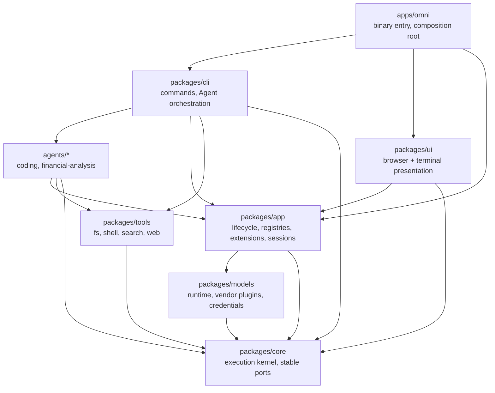

English | [中文](README.zh.md)

# Omni Agent

A TypeScript monorepo for building agent runtimes: a domain-neutral kernel plus independently packaged agents.

[](LICENSE)
[](https://nodejs.org)
[](https://pnpm.io)
[](https://www.typescriptlang.org)
[](https://www.npmjs.com/package/@omni-agent/cli)

The default product is an interactive terminal coding agent. The same runtime also hosts a
read-only financial analysis agent, or your own.

## Table of Contents

- [Background](#background)
- [Install](#install)
- [Usage](#usage)
- [Configuration](#configuration)
- [Extending](#extending)
- [Features](#features)
- [Architecture](#architecture)
- [Project Structure](#project-structure)
- [Documentation](#documentation)
- [Development](#development)
- [Contributing](#contributing)
- [Security](#security)
- [License](#license)

## Background

Most agent frameworks couple the execution loop to a product. Omni Agent inverts that: the kernel
owns execution, tool authorization, cancellation, and context assembly, while agents are
declarative extensions registered explicitly at composition time.

Three constraints follow, and the codebase enforces them:

- **`core` and `app` never import a concrete agent.** Agents enter through `AgentExtension`.
- **One tool entry.** Every tool call goes through `ToolCallCoordinator`. There is no second
  execution path, no legacy branch, no global runtime setter.
- **Model context is a projection, not the transcript.** Session JSONL is the source of truth;
  what the model sees is rebuilt every turn through an explicit pipeline.

## Install

### Prerequisites

- Node.js `>= 22.19.0`
- An API key for at least one supported model vendor

### Install the CLI

```bash
npm install -g @omni-agent/cli
```

With pnpm, approve the native build scripts explicitly:

```bash
pnpm add -g --allow-build=keytar --allow-build=tree-sitter --allow-build=tree-sitter-bash \
  @omni-agent/cli
```

`keytar`, `tree-sitter`, and `tree-sitter-bash` are native modules with build scripts — keytar
backs OS keychain credential storage, and the Tree-sitter grammars back Bash command analysis.

### Install from source

To run the latest unreleased code, build a tarball from a checkout and install that instead. This
path additionally requires pnpm (the repository pins `pnpm@11.5.1`):

```bash
git clone https://github.com/xdnloveme/omni-agent.git
cd omni-agent
pnpm install
pnpm run pack:cli
```

```bash
pnpm add -g --allow-build=keytar --allow-build=tree-sitter --allow-build=tree-sitter-bash \
  ./artifacts/omni-agent-cli-0.0.1.tgz
```

The tarball filename follows the version in `packages/cli/package.json`.

### Quick Start

```bash
cd /path/to/your/project
omni
```

On first launch, onboarding walks you through selecting a vendor, connection, and model, and
stores the credential in the OS keychain. Verify the environment at any time with `omni doctor`.

Contributing to Omni Agent itself, or want to run it without installing? See
[Development](#development) for the from-source workflow.

## Usage

### CLI

```bash
omni                    # start the coding agent
omni run [agent-id]     # start an agent (default: coding)
omni agent create <agent-id> <directory>  # generate one minimal Manifest-first package
omni agent describe <agent-id>       # list the package's available components
omni agent validate <agent-id>       # validate the recipe without building runtime resources
omni agent plan <agent-id> [--json]  # show the immutable resolved composition
omni doctor             # read-only runtime diagnostics
omni --help, -h         # usage
omni --version, -v      # CLI version
```

`omni doctor` never mutates state. It reports eight checks: Node.js version, resolved workspace
root and ID, global directory accessibility, configuration validity, coding Agent package
availability, and the resolvability of the `keytar`, `tree-sitter`, and `tree-sitter-bash` native
modules.

### Slash commands

Typed at the prompt during a session:

| Command        | Effect                                                 |
| -------------- | ------------------------------------------------------ |
| `/config`      | Reconfigure vendor, connection, and model              |
| `/permissions` | Change permission mode and revoke persistent approvals |
| `/new`         | Start a new conversation session                       |
| `/clear`       | Clear the current session history                      |
| `/help`        | List available commands                                |
| `/skills`      | List and manage available skills — see note below      |
| `/trace`       | Control local Trace capture for the current Agent      |

`/skills` is registered conditionally: the CLI only builds the skill controller when the started
agent exposes a `skills` capability. Agents without it never see the command. User-invocable
skills additionally register as their own slash commands and appear in Tab completion.

### Local Agent traces

The CLI Host provides `/trace start`, `/trace stop`, and `/trace status` for every started Agent.
Capture is off by default and isolated by Agent under `~/.omni-agent/traces/<agent-id>/`. Start an
Agent with `omni --trace` or `omni run <agent-id> --trace` to enable capture for that process.
`/trace start` and `/trace stop` control future runs interactively; an active run remains complete.
Each captured run records a span lifecycle plus a replay timeline containing sanitized model
requests, streamed responses, thinking, and tool input/output. Capture uses bounded asynchronous
persistence; under extreme storage pressure streamed detail may degrade while lifecycle records
are prioritized. Trace files are local diagnostics; they do not change Session JSONL and are not a
second execution path.

Start the read-only local viewer in another terminal:

```bash
omni trace preview coding
```

The viewer listens only on `127.0.0.1`, opens the browser, and supports Session and Run selection,
historical replay, model-request inspection, a live span waterfall, raw events, and live updates
for active runs. It loads no remote assets. Because captures can contain sensitive local context,
review the storage directory shown by `/trace status` and clear it when no longer needed:

```bash
omni trace clear coding
```

The clear command refuses to remove data while that Agent has an active capture. The Web viewer
remains strictly read-only.

### Built-in tools

| Tool                 | Purpose                                                | Authorization              |
| -------------------- | ------------------------------------------------------ | -------------------------- |
| `file_read`          | Bounded, version-consistent paginated UTF-8 read       | `dynamic` (path-scoped)    |
| `file_write`         | Create or fully overwrite a UTF-8 text file            | `dynamic` (path-scoped)    |
| `file_edit`          | One exact, whitespace-sensitive replacement            | `dynamic` (path-scoped)    |
| `glob`               | Fast file discovery by name or path pattern            | `dynamic` (path-scoped)    |
| `grep`               | ripgrep content search with structured match locations | `dynamic` (path-scoped)    |
| `bash`               | Execute Bash from the injected execution `cwd`         | `dynamic` (shell analysis) |
| `web_fetch`          | Fetch a URL and return readable text                   | `dynamic` (URL-scoped)     |
| `web_search`         | Web search via DuckDuckGo                              | `dynamic` (query-scoped)   |
| `request_user_input` | Collect 1–3 structured decision answers                | `trusted`                  |
| `skill_read`         | Load full instructions for a named skill               | `trusted`                  |

`request_user_input` is trusted because it only asks the current user a question — it grants no
authority and has no external side effect. `bash` is the only tool marked `sandbox_eligible` and
the only one accepting a caller-supplied timeout (`timeout_ms`).

### Permission modes

`standard` (default) permits routine workspace reads and writes plus routine external reads, and
asks before shell execution and higher-risk operations. `supervised` tightens both: it also asks
before writes and before routine external reads. Every call is reassessed before its scope
candidates are consulted, and invalid state fails closed to supervised behavior with no automatic
approvals.

Approvals persist to `~/.omni-agent/permissions.json` under the granting agent, and their reuse
boundary depends on the scope kind:

- **Agent-scoped, shared across tools** — `filesystem_read_directory`, `filesystem_read_file`, and
  `filesystem_write_directory`. A directory read grant is honored by `file_read`, `glob`, and
  `grep` alike; a directory write grant by `file_write` and `file_edit`. Read grants never
  authorize writes or shell execution.
- **Tool-scoped** — `tool_routine` and `bash_executable`, keyed by the specific tool identity, so
  approving one tool's routine operations says nothing about another's.

## Configuration

Configuration is layered: the global `~/.omni-agent` directory is the baseline, and files in the
project root override it. A present-but-invalid project file is an error, never a silent fallback
to global.

The "Written by" column describes current behavior, not a guaranteed invariant.

| File                             | Scope   | Purpose                                  | Written by |
| -------------------------------- | ------- | ---------------------------------------- | ---------- |
| `omni.config.json`               | project | Shared model + per-agent model overrides | you        |
| `omni.providers.json`            | project | Custom vendor and connection definitions | you        |
| `omni.extensions.mjs`            | project | Local ESM extensions                     | you        |
| `.env`                           | project | Fallback environment credentials         | you        |
| `~/.omni-agent/config.json`      | global  | CLI-selected model                       | the CLI    |
| `~/.omni-agent/providers.json`   | global  | Interactively defined custom providers   | the CLI    |
| `~/.omni-agent/extensions.mjs`   | global  | Global local extensions                  | you        |
| `~/.omni-agent/permissions.json` | global  | Persistent tool approvals                | the CLI    |
| `~/.omni-agent/.env`             | global  | Global fallback environment credentials  | you        |

Today the CLI only writes the three global files marked above; it reads the project files and
`.env` files without modifying them.

### Model selection

```json
{
  "model": {
    "vendorId": "anthropic",
    "connectionId": "default",
    "modelId": "claude-sonnet-4-5"
  },
  "agents": {
    "financial-analysis": {
      "model": {
        "vendorId": "openai",
        "connectionId": "default",
        "modelId": "gpt-5"
      }
    }
  }
}
```

Resolution order: project agent override → global agent override → project shared model → global
shared model. A model selection may also carry `requestedOutputTokens` (integer) and a
vendor-validated `settings` object.

Model configuration must never contain credentials. Fields such as `apiKey`, `password`,
`accessToken`, or `privateKey` are rejected.

### Credentials

The OS keychain (via keytar) is the credential source of truth. Environment sources are read-only
fallbacks resolved in this order:

```text
process.env  ->  <project>/.env  ->  ~/.omni-agent/.env
```

The CLI reads environment files but never writes them, and never mutates `process.env`. Copy
`.env.example` to `.env` for file-based project credentials.

### Built-in vendors

`openai`, `anthropic`, `google`, `mistral`, `deepseek`, `qwen`, `openrouter`, `moonshot`.

`volcengine` and `zhipu` are implemented and exported as opt-in factories
(`createVolcengineVendorPlugin`, `createZhipuVendorPlugin`) rather than registered by default. Any
OpenAI-compatible endpoint can be added declaratively through `omni.providers.json`.

## Extending

### Write an extension

An `AgentExtension` is a plain object. Drop it in `omni.extensions.mjs` at the project root, or in
`~/.omni-agent/extensions.mjs` for every project. The default export may be a single extension or
an array.

```js
// omni.extensions.mjs
export default {
  manifest: { id: "my-extension", version: "1.0.0", apiVersion: 1 },
  contributions: {
    tools: [myTool],
    commands: [myCommand],
  },
  async activate(context) {
    // context: { cwd: string }
  },
  async dispose() {},
};
```

The full contribution surface:

```ts
interface AgentExtensionContributions {
  agents?: AgentContribution[];
  tools?: AgentToolDefinition[];
  commands?: Command[];
  middleware?: RuntimeMiddleware[];
  contextMiddleware?: ContextMiddlewarePort[];
  contextPolicyStages?: ContextPolicyStagePort[];
  providers?: VendorPlugin[];
}
```

Registration is transactional: contributions are validated before commit and rolled back in
reverse order if activation fails. Local extension files are trusted local code and are not
sandboxed.

### Add a tool

Every tool declares authorization, execution, and timeout explicitly. There is no default and no
metadata fallback.

```ts
import type { AgentToolDefinition } from "@omni-agent/core";

const myTool: AgentToolDefinition = {
  name: "my_tool",
  description: "Does one specific thing.",
  schema: {
    type: "object",
    additionalProperties: false,
    required: ["query"],
    properties: { query: { type: "string" } },
  },
  timeout: { kind: "none" },
  authorization: { kind: "static", risk: "read", reason: "Reads public data" },
  execution: { kind: "host" },
  async execute(params, context) {
    context.signal?.throwIfAborted();
    return {
      content: [{ type: "text", text: `${String(params.query)} in ${context.cwd}` }],
      isError: false,
    };
  },
};
```

- `timeout`: `{ kind: "none" }` | `{ kind: "fixed"; timeoutMs }` |
  `{ kind: "input"; parameter; defaultMs; minMs; maxMs }`
- `authorization`: `{ kind: "trusted"; reason }` |
  `{ kind: "static"; risk: "read" | "execute"; reason }` |
  `{ kind: "dynamic"; assess(input, context) }`
- `execution`: `{ kind: "host" }` | `{ kind: "sandbox_eligible"; profile }`

`execute` must return a `ToolResult`: `content` is an array of `{ type: "text"; text: string }`
parts and `isError` is required. Return structured errors with `isError: true` rather than hiding
failures in successful output.

Resolve paths and spawn processes with the injected execution `cwd`. Never call `process.cwd()`
inside a tool, and honor `context.signal` wherever work can block.

### Package an agent

Generate the smallest supported Agent Package without adding it to this monorepo or changing the
Harness:

```bash
omni agent create release-notes ./release-notes-agent
```

The target must not already exist. The command generates one Manifest v2 Recipe, one Prompt
profile, one `echo_text` Tool component, one Blueprint, and package metadata. It has no template
mode, hidden default composition, or alternate Factory path. See the generated README for local
installation and validation commands.

Then follow the executable [five-minute tutorial](docs/build-an-agent-in-five-minutes.md) and
[`examples/minimal-agent`](examples/minimal-agent). The checked-in
[`agent-manifest-v2.schema.json`](schemas/agent-manifest-v2.schema.json) provides YAML completion
and immediate structural feedback in compatible editors.

An agent package exports `./agent.yaml` plus an `agentBlueprint` from its root. The CLI validates
the non-executable Manifest before importing package code and resolves
`@omni-agent/agent-<id>` by convention, so no CLI branch is needed to add one.

```yaml
apiVersion: omni-agent/v2
kind: Agent
metadata:
  id: example
  displayName: Example Agent
runtime:
  blueprintApiVersion: 2
description: An example agent.
composition:
  prompt:
    profile: example.default
    contributors: []
  tools:
    sequence:
      - tool: example.tool
  capabilities: {}
```

```ts
import type { AgentBlueprint, AgentBlueprintContext } from "@omni-agent/app";
import { defineAgent } from "@omni-agent/core";

// Package-private Catalog: the Descriptor and Factory have one owner.
const toolComponents = [
  {
    descriptor: {
      id: "example.tool",
      displayName: "Example tool",
      description: "Does one specific thing.",
      toolName: myTool.name,
    },
    create: () => myTool,
  },
] as const;
const toolComponentsById = new Map(
  toolComponents.map((component) => [component.descriptor.id, component]),
);

export const agentBlueprint = {
  descriptor: {
    promptProfiles: [
      {
        id: "example.default",
        displayName: "Default example prompt",
        description: "Core instructions for the example agent.",
      },
    ],
    promptContributors: [],
    toolBundles: [],
    tools: toolComponents.map(({ descriptor }) => descriptor),
    capabilities: { skills: [], artifactRecovery: [] },
  },
  build(context: AgentBlueprintContext) {
    const tools = context.composition.tools.componentIds.map((id) => {
      const component = toolComponentsById.get(id);
      if (!component) throw new Error(`Unknown Tool component: ${id}`);
      return component.create();
    });
    return {
      extension: {
        manifest: { id: context.manifest.metadata.id, version: "1.0.0", apiVersion: 1 },
        contributions: {
          tools,
          agents: [
            {
              definition: defineAgent({
                id: context.manifest.metadata.id,
                description: context.manifest.description,
                instructions: `You are an example agent working in ${context.cwd}.`,
              }),
              tools: { include: tools.map((tool) => tool.name) },
            },
          ],
        },
      },
      capabilities: {},
    };
  },
} satisfies AgentBlueprint;
```

`AgentBlueprintContext` contains `{ manifest, composition, cwd, interaction }`. The immutable
composition is resolved by App's Planner from the Manifest recipe and Blueprint descriptor. Agent
packages do not declare a turn limit. An extension registered through `AgentFactory` must contribute exactly
one agent whose ID matches the Manifest ID. The package must export `./agent.yaml`; package version
comes only from `package.json`.

Install an external agent into the package-manager-neutral resolution root:

```bash
pnpm --dir ~/.omni-agent/agents add @omni-agent/agent-example
# or: npm install --prefix ~/.omni-agent/agents @omni-agent/agent-example
omni run example
```

That directory is only a conventional `node_modules` root. It is not a registry, and the CLI does
not scan it — it resolves the exact package name through Node.

### Add a model vendor

A vendor owns one or more connections, each mapping to a distinct runtime provider. Contribute
`VendorPlugin` values through an extension's `providers` array, or build one with `defineVendor`:

```ts
interface VendorPlugin {
  readonly manifest: VendorPluginManifest; // { id, version, apiVersion: 1 }
  readonly vendor: VendorDefinition; // { id, displayName, connections }
  createProviders(
    context: VendorPluginContext,
  ): readonly ProviderContribution[] | Promise<readonly ProviderContribution[]>;
  resolveSelection?(
    selection: ModelSelection,
    context: VendorSelectionContext,
  ): ResolvedProviderSelection | Promise<ResolvedProviderSelection>;
  dispose?(): void | Promise<void>;
}
```

For an OpenAI-compatible endpoint, no code is required — declare it in `omni.providers.json`. Only
a genuinely new wire protocol needs a `ModelTransport` implementation.

## Features

**Extension system.** `AgentExtension` contributes agents, tools, commands, runtime middleware,
context middleware, context policy stages, and model vendor plugins. Contributions are validated
before registration; failed activation and normal unregistration clean up in reverse order, attempt
every fallible cleanup, and report all cleanup failures by resource. Optional local extensions that
fail produce diagnostics without preventing the default agent from starting.

**Tool authorization pipeline.** Every tool declares an explicit `authorization` strategy
(`trusted` / `static` / `dynamic`), an independent `execution` strategy (`host` /
`sandbox_eligible`), and a timeout policy (`none` / `fixed` / schema-bound `input`). There is no
central `switch (toolName)` — domain assessment stays with the tool owner.

**Structured shell analysis.** Bash authorization is derived from a single Tree-sitter-backed
analysis pass. Persistent approval is scoped to a literal executable name (not its subcommands);
compound commands and nested substitutions require every known executable to be granted.
`BASH_ENV`, `ENV`, and exported `BASH_FUNC_*` values are stripped before spawning.

**Path-scoped filesystem grants.** Sensitive files require an exact-file grant, so a directory
approval never silently covers `.env`, credentials, system paths, or symlinks resolving into them.

**Context engine.** Model context is assembled per turn through a fixed pipeline: session snapshot
→ working conversation → context draft → context middleware → envelope → policy pipeline →
assembly → `ModelRuntimePort`. Stable micro-compression projects large tool results into
content-addressed sidecar artifacts (recoverable via `file_read`), and a mandatory heavy checkpoint
gate at 90% of usable input budget produces a validated structured summary rather than truncating.

**Model-agnostic port.** `ModelRuntimePort` is Core's only model contract. Vendors are plugins
composing connection-level factory strategies; a genuinely new protocol implements the
`ModelTransport` port. Backend transport types never cross into Core, App, CLI, or agent packages.

**Prompt caching.** `ModelCacheCoordinator` owns cache intent, scope, and semantic fingerprints,
and exposes lease state to the context engine as `allow` / `defer`. Prompt bodies are never
persisted.

**Workspace-isolated sessions.** Transcripts are strict JSONL under
`~/.omni-agent/workspaces/<workspace-id>/sessions/<agent-id>/`. The workspace ID derives from the
canonical Git root, so subdirectories of a repository share history while unrelated projects never
do.

**Skills.** A skill index is contributed to the system prompt with its own budget; full skill
bodies load on demand through the trusted `skill_read` tool.

### Non-goals

Stated plainly, because they affect how you should deploy this:

- The permission layer is **execution policy, not an OS sandbox**. It cannot fully constrain an
  untrusted child process or eliminate filesystem race conditions. No OS-level sandbox
  implementation ships today; `sandbox_eligible` is a marker, not a guarantee.
- Local ESM extensions (`omni.extensions.mjs`) are **trusted local code** and are not sandboxed.
- `file_write` / `file_edit` use direct overwrite. This is deliberately not an atomic commit; a
  failed write may leave an unknown target state.
- The financial analysis agent is read-only and does not place trades or fetch market data.

## Architecture



| Package           | Responsibility                                                                         |
| ----------------- | -------------------------------------------------------------------------------------- |
| `packages/core`   | Agent execution kernel: loop, tool coordination, permissions, context, events, ports   |
| `packages/models` | Model runtime, vendor plugins, catalogs, protocol conversion, credential persistence   |
| `packages/app`    | Application lifecycle, agent/tool/command registries, extension host, sessions, config |
| `packages/tools`  | Domain-neutral filesystem, shell, search, and web tools                                |
| `packages/ui`     | Browser and terminal interaction, presentation, adapters, formatting, and delivery     |
| `packages/cli`    | Commands, Agent creation/use-case orchestration, sessions, and onboarding workflow     |
| `apps/omni`       | Binary entry, CLI/UI composition, signals, Trace preview lifecycle, and process exit   |
| `agents/*`        | Independently packaged business agents                                                 |

### Dependency direction

```text
tools  -> core
models -> core
app    -> core, models
agents -> app, core, tools
ui     -> app, core
cli    -> app, core, tools, agents/*
apps/omni -> app, cli, ui
```

Reverse dependencies are not allowed. CLI and UI do not import each other; `apps/omni` is their
only composition root. `core` and `app` must never import a concrete agent, and an agent package
must never import the CLI, UI, or another agent package.

### Runtime contracts

| Type                          | Role                                                                                     |
| ----------------------------- | ---------------------------------------------------------------------------------------- |
| `ModelRuntimePort`            | Core's only model contract; receives prepared context messages and tool specs            |
| `AgentRunner`                 | Per-agent execution loop, constructed with exactly one `ModelRuntimePort`                |
| `ToolCallCoordinator`         | The agent loop's only tool entry: schema validation, domain preflight, routing           |
| `ToolAuthorizationRouter`     | Admits `trusted` tools directly; delegates everything else to the gate                   |
| `PermissionGate`              | Permission decision point for non-trusted tools                                          |
| `ToolInvocationRunner`        | Executes authorized calls only; runs middleware after authorization                      |
| `ExecutionDeadlineSupervisor` | Owns linked cancellation, deadline timers, and late-settlement observation               |
| `AgentFactory`                | The only runtime assembly entry: resolves a package into one immutable Plan and instance |
| `AgentBlueprint`              | The `agentBlueprint` value each agent package exports                                    |
| `AgentExtension`              | Declarative contribution unit; validated and rolled back atomically                      |

The tool call path:

```text
AgentLoop
  -> ToolCallCoordinator        schema validation, domain preflight
  -> ToolAuthorizationRouter
       |-> trusted              -> authorized call
       `-> permission-controlled -> PermissionGate -> authorized call
  -> lifecycle middleware
  -> ToolInvocationRunner       host or sandbox-eligible execution
```

Full contract: [`docs/architecture.md`](docs/architecture.md) and
[`docs/tool-call-runtime.md`](docs/tool-call-runtime.md).

## Project Structure

```text
omni-agent/
├── packages/
│   ├── core/     Agent loop, tool coordination, permissions, context engine, ports
│   ├── models/   Model runtime, vendor plugins, catalogs, credentials, cache
│   ├── app/      Lifecycle, registries, extension host, sessions, config, workspaces
│   ├── tools/    Filesystem, shell, search, web, and user-input tools
│   ├── ui/       Browser and terminal presentation, interaction adapters, delivery
│   └── cli/      Arg parsing, commands, Agent run and onboarding orchestration
├── apps/
│   └── omni/     Binary entry, CLI/UI composition, signals, process lifecycle
├── agents/
│   ├── coding/              Default coding agent (skills, fs, shell, search, web)
│   └── financial-analysis/  Read-only deterministic indicator agent
├── docs/         Architecture and runtime contracts
├── scripts/      Build and packaging scripts
├── omni.config.json      Project model configuration
└── omni.providers.json   Project vendor definitions
```

## Documentation

| Document                                                                                           | Contents                                                               |
| -------------------------------------------------------------------------------------------------- | ---------------------------------------------------------------------- |
| [`docs/architecture.md`](docs/architecture.md)                                                     | Layers, dependency rules, contracts, composition, and subsystem design |
| [`docs/agent-package.md`](docs/agent-package.md)                                                   | Manifest v2, Blueprint, composition, package loading, and ownership    |
| [`docs/build-an-agent-in-five-minutes.md`](docs/build-an-agent-in-five-minutes.md)                 | Executable minimal Agent tutorial and dynamic YAML assembly            |
| [`docs/tracing.md`](docs/tracing.md)                                                               | Runtime Observation, Assembly Evidence, local Trace, and replay        |
| [`docs/tool-call-runtime.md`](docs/tool-call-runtime.md)                                           | Authoritative tool authorization, execution, cancellation, sandbox     |
| [`docs/context-engineering.md`](docs/context-engineering.md)                                       | Context pipeline, compression, checkpointing                           |
| [`docs/model-cache.md`](docs/model-cache.md)                                                       | Prompt cache intent, scopes, fingerprints, lease state                 |
| [`docs/skill-system-architecture.md`](docs/skill-system-architecture.md)                           | Skill discovery, indexing, and loading                                 |
| [`docs/pluggable-cli-integration-architecture.md`](docs/pluggable-cli-integration-architecture.md) | CLI integration and pluggability design                                |
| [`AGENTS.md`](AGENTS.md)                                                                           | Contributor guide: ownership rules and change discipline               |

## Development

Run Omni Agent directly from a source checkout — no global install, no tarball:

```bash
pnpm install
pnpm dev                           # coding agent (default)
pnpm run dev:coding                # coding agent, explicitly
pnpm run dev:financial-analysis    # read-only financial analysis agent
pnpm run dev -- run <agent-id>     # any installed agent package
pnpm run dev -- agent describe coding
pnpm run dev -- agent validate coding
pnpm run dev -- agent plan coding --json
```

Verification and build:

```bash
pnpm run format         # format source, tests, config, docs
pnpm run format:check   # verify formatting
pnpm run typecheck      # project-wide type checking
pnpm run test           # run the test suite (Vitest)
pnpm run test:watch     # watch mode
pnpm run build          # build all packages
pnpm run build:cli      # build the standalone CLI distribution directory
pnpm run pack:cli       # produce an installable npm tarball
pnpm run eval:checkpoint     # offline checkpoint-summary evaluation
pnpm run eval:clarification  # offline clarification-routing evaluation
```

A husky pre-commit hook runs `format:check`, `typecheck`, and `test`.

## Contributing

Contributions are welcome and pull requests are accepted. There is no CLA and no separate
`CONTRIBUTING.md` — [`AGENTS.md`](AGENTS.md) is the contributor guide and defines package
ownership, dependency direction rules, and what belongs where. Read it before your first change.

Questions, bug reports, and feature proposals go to
[GitHub Issues](https://github.com/xdnloveme/omni-agent/issues). For anything that changes layer
boundaries or public usage, open an issue to discuss before writing code.

Before submitting:

1. Keep changes scoped; preserve unrelated work in the tree.
2. Verify dependency direction when adding an import or workspace dependency.
3. Run `pnpm run format`, `pnpm run typecheck`, and `pnpm run test`.
4. Run `pnpm run build` when package exports, references, or dependencies change.
5. Smoke-test `pnpm dev` when CLI startup, composition, configuration, or TUI behavior changes.

Add tests for runtime loops, cancellation, extension atomicity, tool boundaries, and user-visible
compatibility. Avoid tests that only mirror implementation details.

## Security

Omni Agent executes model-directed shell commands and file writes on your machine. Understand the
boundary before granting approvals:

- **The security model lives in [`docs/tool-call-runtime.md`](docs/tool-call-runtime.md)** — the
  authoritative contract for tool authorization, permission scoping, execution, cancellation, and
  sandbox boundaries.
- **Permissions are execution policy, not a sandbox.** See [Non-goals](#non-goals). Do not rely on
  the permission layer to contain hostile code; run untrusted work in a VM or container.
- **Credentials** live in the OS keychain. `.env` files are read-only fallbacks. Never put
  credentials in `omni.config.json` — credential-shaped fields are rejected.
- **Extensions are trusted code.** `omni.extensions.mjs` executes with full process privileges.
  Only load extension files you wrote or audited.

There is no `SECURITY.md` and no private disclosure channel yet. Report vulnerabilities through
[GitHub Issues](https://github.com/xdnloveme/omni-agent/issues); if a report is sensitive, open a
minimal issue asking for a private contact rather than posting details.

## License

Licensed under the [Apache License 2.0](LICENSE).

Copyright 2026 [xdnloveme](https://github.com/xdnloveme/omni-agent).
