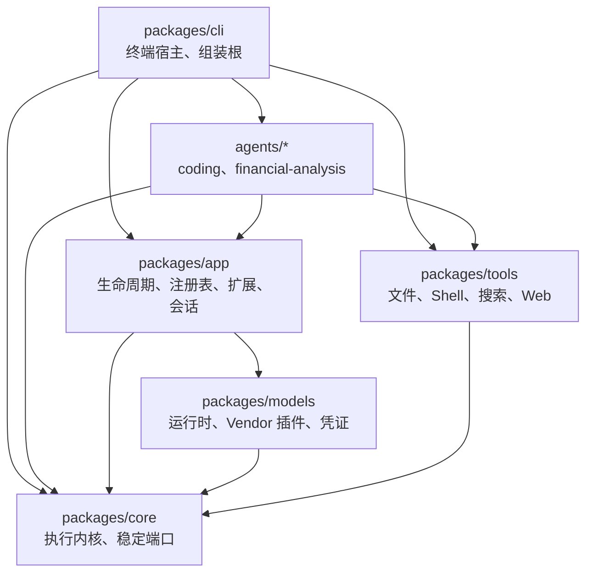

[English](README.md) | 中文

# Omni Agent

用于构建 Agent 运行时的 TypeScript monorepo：领域无关的内核 + 独立打包的 Agent。

[](LICENSE)
[](https://nodejs.org)
[](https://pnpm.io)
[](https://www.typescriptlang.org)
[](https://www.npmjs.com/package/@omni-agent/cli)

默认产品是一个交互式终端编码 Agent。同一套运行时也可以承载只读的金融分析 Agent，或者你自己的 Agent。

## 目录

- [背景](#背景)
- [安装](#安装)
- [使用](#使用)
- [配置](#配置)
- [扩展](#扩展)
- [特性](#特性)
- [架构](#架构)
- [项目结构](#项目结构)
- [文档](#文档)
- [开发](#开发)
- [参与贡献](#参与贡献)
- [安全](#安全)
- [许可证](#许可证)

## 背景

大多数 Agent 框架把执行循环和具体产品耦合在一起。Omni Agent 反转了这一点：内核负责执行、工具授权、
取消和上下文组装，而 Agent 是在组装期显式注册的声明式扩展。

由此产生三条约束，并且代码库强制执行它们：

- **`core` 和 `app` 永远不导入具体 Agent。** Agent 只能通过 `AgentExtension` 进入。
- **唯一的工具入口。** 所有工具调用都经过 `ToolCallCoordinator`。不存在第二条执行路径、遗留分支或
  全局运行时 setter。
- **模型上下文是投影，不是会话记录。** Session JSONL 是唯一事实源；模型看到的内容每轮都通过显式管线
  重新构建。

## 安装

### 前置要求

- Node.js `>= 22.19.0`
- 至少一个受支持模型 Vendor 的 API Key

### 安装 CLI

```bash
npm install -g @omni-agent/cli
```

使用 pnpm 时，需要显式批准原生模块的构建脚本：

```bash
pnpm add -g --allow-build=keytar --allow-build=tree-sitter --allow-build=tree-sitter-bash \
  @omni-agent/cli
```

`keytar`、`tree-sitter` 和 `tree-sitter-bash` 是带构建脚本的原生模块 —— keytar 支撑操作系统钥匙串
凭证存储，Tree-sitter 语法则支撑 Bash 命令分析。

### 从源码安装

想使用尚未发版的最新代码，可以从源码检出构建 tarball 再安装。这条路径额外需要 pnpm（仓库锁定
`pnpm@11.5.1`）：

```bash
git clone https://github.com/xdnloveme/omni-agent.git
cd omni-agent
pnpm install
pnpm run pack:cli
```

```bash
pnpm add -g --allow-build=keytar --allow-build=tree-sitter --allow-build=tree-sitter-bash \
  ./artifacts/omni-agent-cli-0.0.1.tgz
```

tarball 文件名跟随 `packages/cli/package.json` 中的版本号。

### 快速开始

```bash
cd /path/to/your/project
omni
```

首次启动时，引导流程会带你选择 Vendor、连接和模型，并把凭证写入操作系统钥匙串。任何时候都可以用
`omni doctor` 检查环境。

想为 Omni Agent 本身做贡献，或者不安装直接运行？参见[开发](#开发)中的源码运行流程。

## 使用

### CLI

```bash
omni                    # 启动编码 Agent
omni run [agent-id]     # 启动某个 Agent（默认：coding）
omni doctor             # 只读运行时诊断
omni --help, -h         # 用法说明
omni --version, -v      # CLI 版本
```

`omni doctor` 绝不修改任何状态。它会报告八项检查：Node.js 版本、解析出的工作区根目录与 ID、全局目录
可访问性、配置有效性、coding agent blueprint 可用性，以及 `keytar`、`tree-sitter`、
`tree-sitter-bash` 三个原生模块能否解析。

### 斜杠命令

在会话中于输入框直接键入：

| 命令           | 作用                             |
| -------------- | -------------------------------- |
| `/config`      | 重新配置 Vendor、连接和模型      |
| `/permissions` | 修改权限模式并撤销持久化批准     |
| `/new`         | 开始一个新会话                   |
| `/clear`       | 清空当前会话历史                 |
| `/help`        | 列出可用命令                     |
| `/skills`      | 查看和管理可用技能 —— 见下方说明 |

`/skills` 是条件注册的：只有当启动的 Agent 暴露了 `skills` 能力时，CLI 才会构建技能控制器。不具备该
能力的 Agent 根本看不到这个命令。此外，可由用户调用的技能会各自注册为独立的斜杠命令，并出现在 Tab
补全中。

### 内置工具

| 工具                 | 用途                                    | 授权方式                |
| -------------------- | --------------------------------------- | ----------------------- |
| `file_read`          | 有界、版本一致的分页 UTF-8 读取         | `dynamic`（路径作用域） |
| `file_write`         | 创建或完全覆盖 UTF-8 文本文件           | `dynamic`（路径作用域） |
| `file_edit`          | 一次精确的、空白敏感的替换              | `dynamic`（路径作用域） |
| `glob`               | 按文件名或路径模式快速发现文件          | `dynamic`（路径作用域） |
| `grep`               | 基于 ripgrep 的内容搜索，返回结构化匹配 | `dynamic`（路径作用域） |
| `bash`               | 在注入的执行 `cwd` 下执行 Bash          | `dynamic`（Shell 分析） |
| `web_fetch`          | 抓取 URL 并返回可读文本                 | `dynamic`（URL 作用域） |
| `web_search`         | 通过 DuckDuckGo 进行网页搜索            | `dynamic`（查询作用域） |
| `request_user_input` | 收集 1–3 个结构化决策答案               | `trusted`               |
| `skill_read`         | 加载指定技能的完整指令                  | `trusted`               |

`request_user_input` 之所以是受信任的，是因为它只是向当前用户提问 —— 它不授予任何权限，也没有任何
外部副作用。`bash` 是唯一标记为 `sandbox_eligible` 的工具，也是唯一接受调用方指定超时（`timeout_ms`）
的工具。

### 权限模式

`standard`（默认）允许常规的工作区读写以及常规的外部读取，在执行 Shell 和更高风险操作前询问。
`supervised` 会同时收紧这两类：写入前会询问，常规外部读取前也会询问。每次调用都会在查询其作用域候选
之前重新评估；状态非法时会失败关闭到 supervised 行为，且不保留任何自动批准。

批准持久化到 `~/.omni-agent/permissions.json`，归属于授予它的 Agent，其复用边界取决于作用域种类：

- **Agent 级、跨工具共享** —— `filesystem_read_directory`、`filesystem_read_file` 和
  `filesystem_write_directory`。一个目录读授权会被 `file_read`、`glob`、`grep` 共同认可；一个目录写
  授权会被 `file_write` 和 `file_edit` 共同认可。读授权永远不会授予写入或 Shell 执行权限。
- **工具级** —— `tool_routine` 和 `bash_executable`，以具体的工具标识为键，因此批准了某个工具的常规
  操作，并不意味着另一个工具也被批准。

## 配置

配置是分层的：全局 `~/.omni-agent` 目录是基线，项目根目录中的文件覆盖它。项目文件存在但无效属于错误，
绝不会静默回退到全局配置。

「写入方」一列描述的是当前行为，而不是被保证的架构不变量。

| 文件                             | 范围 | 用途                        | 写入方 |
| -------------------------------- | ---- | --------------------------- | ------ |
| `omni.config.json`               | 项目 | 共享模型 + 按 Agent 的覆盖  | 你     |
| `omni.providers.json`            | 项目 | 自定义 Vendor 与连接定义    | 你     |
| `omni.extensions.mjs`            | 项目 | 本地 ESM 扩展               | 你     |
| `.env`                           | 项目 | 兜底的环境变量凭证          | 你     |
| `~/.omni-agent/config.json`      | 全局 | CLI 选择的模型              | CLI    |
| `~/.omni-agent/providers.json`   | 全局 | 交互式定义的自定义 Provider | CLI    |
| `~/.omni-agent/extensions.mjs`   | 全局 | 全局本地扩展                | 你     |
| `~/.omni-agent/permissions.json` | 全局 | 持久化的工具批准            | CLI    |
| `~/.omni-agent/.env`             | 全局 | 全局兜底环境变量凭证        | 你     |

目前 CLI 只写入上表中标注的三个全局文件；它会读取项目文件和 `.env` 文件，但不修改它们。

### 模型选择

```json
{
  "model": {
    "vendorId": "anthropic",
    "connectionId": "default",
    "modelId": "claude-sonnet-4-5"
  },
  "agents": {
    "financial-analysis": {
      "model": {
        "vendorId": "openai",
        "connectionId": "default",
        "modelId": "gpt-5"
      }
    }
  }
}
```

解析顺序：项目 Agent 覆盖 → 全局 Agent 覆盖 → 项目共享模型 → 全局共享模型。模型选择还可携带
`requestedOutputTokens`（整数）和一个由 Vendor 校验的 `settings` 对象。

模型配置绝不能包含凭证。`apiKey`、`password`、`accessToken`、`privateKey` 之类的字段会被拒绝。

### 凭证

操作系统钥匙串（通过 keytar）是凭证的唯一事实源。环境类来源是只读兜底，按以下顺序解析：

```text
process.env  ->  <项目>/.env  ->  ~/.omni-agent/.env
```

CLI 会读取环境文件但从不写入，也从不修改 `process.env`。如需基于文件的项目凭证，复制 `.env.example`
为 `.env`。

### 内置 Vendor

`openai`、`anthropic`、`google`、`mistral`、`deepseek`、`qwen`、`openrouter`、`moonshot`。

`volcengine` 与 `zhipu` 已经实现，但以可选工厂的形式导出
（`createVolcengineVendorPlugin`、`createZhipuVendorPlugin`），默认不注册。任何 OpenAI 兼容端点都可以
通过 `omni.providers.json` 声明式接入。

## 扩展

### 编写扩展

`AgentExtension` 就是一个普通对象。把它放在项目根目录的 `omni.extensions.mjs`，或放在
`~/.omni-agent/extensions.mjs` 以对所有项目生效。默认导出可以是单个扩展，也可以是数组。

```js
// omni.extensions.mjs
export default {
  manifest: { id: "my-extension", version: "1.0.0", apiVersion: 1 },
  contributions: {
    tools: [myTool],
    commands: [myCommand],
  },
  async activate(context) {
    // context: { cwd: string }
  },
  async dispose() {},
};
```

完整的贡献面：

```ts
interface AgentExtensionContributions {
  agents?: AgentContribution[];
  tools?: AgentToolDefinition[];
  commands?: Command[];
  middleware?: RuntimeMiddleware[];
  contextMiddleware?: ContextMiddlewarePort[];
  contextPolicyStages?: ContextPolicyStagePort[];
  providers?: VendorPlugin[];
}
```

注册是事务性的：贡献在提交前完成校验，激活失败时按注册的逆序全部回滚。本地扩展文件是受信任的本地
代码，没有被沙箱化。

### 添加工具

每个工具都必须显式声明授权、执行与超时策略，没有默认值，也没有元数据兜底。

```ts
import type { AgentToolDefinition } from "@omni-agent/core";

const myTool: AgentToolDefinition = {
  name: "my_tool",
  description: "Does one specific thing.",
  schema: {
    type: "object",
    additionalProperties: false,
    required: ["query"],
    properties: { query: { type: "string" } },
  },
  timeout: { kind: "none" },
  authorization: { kind: "static", risk: "read", reason: "Reads public data" },
  execution: { kind: "host" },
  async execute(params, context) {
    context.signal?.throwIfAborted();
    return {
      content: [{ type: "text", text: `${String(params.query)} in ${context.cwd}` }],
      isError: false,
    };
  },
};
```

- `timeout`：`{ kind: "none" }` | `{ kind: "fixed"; timeoutMs }` |
  `{ kind: "input"; parameter; defaultMs; minMs; maxMs }`
- `authorization`：`{ kind: "trusted"; reason }` |
  `{ kind: "static"; risk: "read" | "execute"; reason }` |
  `{ kind: "dynamic"; assess(input, context) }`
- `execution`：`{ kind: "host" }` | `{ kind: "sandbox_eligible"; profile }`

`execute` 必须返回 `ToolResult`：`content` 是 `{ type: "text"; text: string }` 组成的数组，`isError`
是必填字段。请用 `isError: true` 返回结构化错误，而不是把失败藏进看似成功的输出里。

请使用注入的执行 `cwd` 解析路径和启动进程。工具内部绝不能调用 `process.cwd()`；只要工作可能阻塞，就
必须响应 `context.signal`。

### 打包一个 Agent

Agent 包从其根部导出 `agentBlueprint`。CLI 按约定解析 `@omni-agent/agent-<id>`，因此新增 Agent 不需要
改动 CLI 分支。

```ts
import type { AgentBlueprint, AgentBlueprintContext } from "@omni-agent/app";
import { defineAgent } from "@omni-agent/core";

export const agentBlueprint = {
  id: "example",
  build(context: AgentBlueprintContext) {
    const tools = [myTool];
    return {
      id: "example",
      extension: {
        manifest: { id: "example", version: "1.0.0", apiVersion: 1 },
        contributions: {
          tools,
          agents: [
            {
              definition: defineAgent({
                id: "example",
                description: "An example agent.",
                instructions: `You are an example agent working in ${context.cwd}.`,
              }),
              tools: { include: tools.map((tool) => tool.name) },
            },
          ],
        },
      },
      capabilities: {},
    };
  },
} satisfies AgentBlueprint;
```

`AgentBlueprintContext` 即 `{ cwd: string; interaction: InteractionSurfacePort }`。`instructions`
可以是字符串，也可以是 `(context) => string | Promise<string>` 函数；`maxTurns` 可选（省略时不限
轮次）。通过 `AgentFactory` 注册的扩展必须恰好贡献一个 id 与 blueprint id 相同的 Agent。

把外部 Agent 安装到包管理器中立的解析根目录：

```bash
pnpm --dir ~/.omni-agent/agents add @omni-agent/agent-example
# 或：npm install --prefix ~/.omni-agent/agents @omni-agent/agent-example
omni run example
```

该目录只是一个约定俗成的 `node_modules` 安装根。它不是 Agent 注册表，CLI 也不会扫描它 —— CLI 通过
Node 解析精确的包名。

### 接入模型 Vendor

一个 Vendor 拥有一个或多个连接，每个连接映射到一个独立的运行时 Provider。可以通过扩展的 `providers`
数组贡献 `VendorPlugin`，或用 `defineVendor` 构建：

```ts
interface VendorPlugin {
  readonly manifest: VendorPluginManifest; // { id, version, apiVersion: 1 }
  readonly vendor: VendorDefinition; // { id, displayName, connections }
  createProviders(
    context: VendorPluginContext,
  ): readonly ProviderContribution[] | Promise<readonly ProviderContribution[]>;
  resolveSelection?(
    selection: ModelSelection,
    context: VendorSelectionContext,
  ): ResolvedProviderSelection | Promise<ResolvedProviderSelection>;
  dispose?(): void | Promise<void>;
}
```

对于 OpenAI 兼容端点，无需写任何代码 —— 在 `omni.providers.json` 中声明即可。只有真正的新线路协议才
需要实现 `ModelTransport`。

## 特性

**扩展系统。** `AgentExtension` 可贡献 Agent、工具、命令、运行时中间件、上下文中间件、上下文策略阶段
以及模型 Vendor 插件，注册与回滚都是原子的。可选的本地扩展失败只会产生诊断信息，不会阻止默认 Agent
启动。

**工具授权管线。** 每个工具都必须显式声明 `authorization` 策略（`trusted` / `static` / `dynamic`）、
彼此独立的 `execution` 策略（`host` / `sandbox_eligible`）以及超时策略（`none` / `fixed` / 绑定 schema
的 `input`）。没有中心化的 `switch (toolName)` —— 领域判定始终留在工具的属主处。

**结构化 Shell 分析。** Bash 授权全部来自单一的、基于 Tree-sitter 的分析入口。持久化批准的粒度是字面
可执行文件名（而非其子命令）；复合命令与嵌套替换要求其中每一个已知可执行文件都被授权。启动进程前会
移除 `BASH_ENV`、`ENV` 以及导出的 `BASH_FUNC_*` 值。

**路径级文件系统授权。** 敏感文件必须使用精确文件授权，因此目录批准绝不会静默覆盖 `.env`、凭证、系统
路径，或指向它们的符号链接。

**上下文引擎。** 模型上下文按轮次通过固定管线组装：会话快照 → 工作会话 → 上下文草稿 → 上下文中间件
→ 信封 → 策略管线 → 组装 → `ModelRuntimePort`。稳定微压缩把大体积工具结果投影为内容寻址的 sidecar
制品（可通过 `file_read` 恢复）；在可用输入预算达到 90% 时，强制的重量级检查点门会产出一份经过校验的
结构化摘要，而不是直接截断。

**模型无关端口。** `ModelRuntimePort` 是 Core 唯一的模型契约。Vendor 以插件形式组合连接级工厂策略；
真正的新协议则实现 `ModelTransport` 端口。后端传输类型绝不会越界进入 Core、App、CLI 或 Agent 包。

**提示词缓存。** `ModelCacheCoordinator` 独占缓存意图、作用域与语义指纹，并以 `allow` / `defer` 的
形式把租约状态暴露给上下文引擎。提示词正文从不持久化。

**工作区隔离的会话。** 会话记录是严格的 JSONL，存放于
`~/.omni-agent/workspaces/<workspace-id>/sessions/<agent-id>/`。工作区 ID 由规范化的 Git 根目录派生，
因此同一仓库的子目录共享历史，而互不相关的项目永远不会。

**技能（Skills）。** 技能索引以独立预算注入系统提示词；完整技能正文通过受信任的 `skill_read` 工具按需
加载。

### 非目标

明确写出来，因为这会影响你的部署方式：

- 权限层是**执行策略，不是操作系统沙箱**。它无法完全约束不受信任的子进程，也无法消除文件系统竞态。
  目前没有随附任何 OS 级沙箱实现；`sandbox_eligible` 只是标记，不是保证。
- 本地 ESM 扩展（`omni.extensions.mjs`）是**受信任的本地代码**，没有被沙箱化。
- `file_write` / `file_edit` 采用直接覆盖写。这刻意不是原子提交；写入失败可能让目标文件处于未知状态。
- 金融分析 Agent 是只读的，既不下单交易，也不抓取行情数据。

## 架构



| 包                | 职责                                                         |
| ----------------- | ------------------------------------------------------------ |
| `packages/core`   | Agent 执行内核：执行循环、工具协调、权限、上下文、事件、端口 |
| `packages/models` | 模型运行时、Vendor 插件、模型目录、协议转换、凭证持久化      |
| `packages/app`    | 应用生命周期，Agent/工具/命令注册表，扩展宿主，会话，配置    |
| `packages/tools`  | 领域无关的文件系统、Shell、搜索与 Web 工具                   |
| `packages/cli`    | 进程入口、TUI、运行模式、初始引导、诊断                      |
| `agents/*`        | 独立打包的业务 Agent                                         |

### 依赖方向

```text
tools  -> core
models -> core
app    -> core, models
agents -> app, core, tools
cli    -> app, core, tools, agents/*
```

不允许反向依赖。`core` 和 `app` 绝不能导入具体 Agent，Agent 包也绝不能导入 CLI 或另一个 Agent 包。

### 运行时契约

| 类型                          | 作用                                                      |
| ----------------------------- | --------------------------------------------------------- |
| `ModelRuntimePort`            | Core 唯一的模型契约，只接收已准备好的上下文消息与工具规格 |
| `AgentRunner`                 | 单 Agent 执行循环，构造时恰好接收一个 `ModelRuntimePort`  |
| `ToolCallCoordinator`         | Agent 循环唯一的工具入口：schema 校验、领域预检、路由     |
| `ToolAuthorizationRouter`     | 直接放行 `trusted` 工具，其余全部委派给权限门             |
| `PermissionGate`              | 非受信工具的权限决策点                                    |
| `ToolInvocationRunner`        | 只执行已授权的调用；中间件在授权之后才运行                |
| `ExecutionDeadlineSupervisor` | 负责联动取消、截止计时器和迟到结果的观测上报              |
| `AgentFactory`                | 唯一的组装入口：校验 blueprint、解析模型、创建实例        |
| `AgentBlueprint`              | 每个 Agent 包导出的 `agentBlueprint` 值                   |
| `AgentExtension`              | 声明式贡献单元，经过校验并可原子回滚                      |

工具调用路径：

```text
AgentLoop
  -> ToolCallCoordinator        schema 校验、领域预检
  -> ToolAuthorizationRouter
       |-> trusted              -> 已授权调用
       `-> 受权限控制            -> PermissionGate -> 已授权调用
  -> 生命周期中间件
  -> ToolInvocationRunner       host 或 sandbox-eligible 执行
```

完整契约见 [`docs/architecture.md`](docs/architecture.md) 与
[`docs/tool-call-runtime.md`](docs/tool-call-runtime.md)。

## 项目结构

```text
omni-agent/
├── packages/
│   ├── core/     Agent 循环、工具协调、权限、上下文引擎、端口
│   ├── models/   模型运行时、Vendor 插件、模型目录、凭证、缓存
│   ├── app/      生命周期、注册表、扩展宿主、会话、配置、工作区
│   ├── tools/    文件系统、Shell、搜索、Web、用户输入工具与工具集
│   └── cli/      入口、参数解析、TUI、运行模式、引导、doctor、命令
├── agents/
│   ├── coding/              默认编码 Agent（技能、文件、Shell、搜索、Web）
│   └── financial-analysis/  只读的确定性指标计算 Agent
├── docs/         架构与运行时契约文档
├── scripts/      构建与打包脚本
├── omni.config.json      项目模型配置
└── omni.providers.json   项目 Vendor 定义
```

## 文档

| 文档                                                                                               | 内容                                       |
| -------------------------------------------------------------------------------------------------- | ------------------------------------------ |
| [`docs/architecture.md`](docs/architecture.md)                                                     | 分层、依赖规则、契约、组装流程与子系统设计 |
| [`docs/tool-call-runtime.md`](docs/tool-call-runtime.md)                                           | 工具授权、执行、取消与沙箱边界的权威契约   |
| [`docs/context-engineering.md`](docs/context-engineering.md)                                       | 上下文管线、压缩与检查点                   |
| [`docs/model-cache.md`](docs/model-cache.md)                                                       | 提示词缓存意图、作用域、指纹与租约状态     |
| [`docs/skill-system-architecture.md`](docs/skill-system-architecture.md)                           | 技能的发现、索引与加载                     |
| [`docs/pluggable-cli-integration-architecture.md`](docs/pluggable-cli-integration-architecture.md) | CLI 集成与可插拔性设计                     |
| [`AGENTS.md`](AGENTS.md)                                                                           | 贡献者指南：归属规则与变更纪律             |

## 开发

直接从源码检出运行 Omni Agent —— 无需全局安装，也不用打 tarball：

```bash
pnpm install
pnpm dev                           # 编码 Agent（默认）
pnpm run dev:coding                # 显式启动编码 Agent
pnpm run dev:financial-analysis    # 只读金融分析 Agent
pnpm run dev -- run <agent-id>     # 任意已安装的 Agent 包
```

校验与构建：

```bash
pnpm run format         # 格式化源码、测试、配置和文档
pnpm run format:check   # 校验格式
pnpm run typecheck      # 全项目类型检查
pnpm run test           # 运行测试套件（Vitest）
pnpm run test:watch     # 监听模式
pnpm run build          # 构建所有包
pnpm run build:cli      # 构建独立 CLI 分发目录
pnpm run pack:cli       # 产出可安装的 npm tarball
pnpm run eval:checkpoint     # 离线检查点摘要评测
pnpm run eval:clarification  # 离线澄清路由评测
```

husky 的 pre-commit 钩子会自动运行 `format:check`、`typecheck` 和 `test`。

## 参与贡献

欢迎贡献，接受 Pull Request。本项目没有 CLA，也没有单独的 `CONTRIBUTING.md` ——
[`AGENTS.md`](AGENTS.md) 就是贡献者指南，它定义了包的归属、依赖方向规则以及各类代码的落位。在提交
第一个改动前请先阅读它。

问题咨询、缺陷报告和功能提案请提交到
[GitHub Issues](https://github.com/xdnloveme/omni-agent/issues)。凡是会改变层边界或公开用法的改动，
请先开 issue 讨论再动手写代码。

提交前：

1. 保持改动聚焦，保留工作树中不相关的内容。
2. 新增 import 或工作区依赖时校验依赖方向。
3. 运行 `pnpm run format`、`pnpm run typecheck` 和 `pnpm run test`。
4. 当包的导出、引用或依赖发生变化时运行 `pnpm run build`。
5. 当 CLI 启动、组装、配置或 TUI 行为变化时冒烟测试 `pnpm dev`。

请为运行时循环、取消、扩展原子性、工具边界和用户可见的兼容性补充测试。避免只是镜像实现细节的测试。

## 安全

Omni Agent 会在你的机器上执行由模型驱动的 Shell 命令和文件写入。在授予批准之前请先理解边界：

- **安全模型记录在 [`docs/tool-call-runtime.md`](docs/tool-call-runtime.md)** —— 它是工具授权、权限
  作用域、执行、取消与沙箱边界的权威契约。
- **权限是执行策略，不是沙箱。** 参见[非目标](#非目标)。不要指望权限层能关住恶意代码；不受信任的
  工作请放到虚拟机或容器里跑。
- **凭证**存放在操作系统钥匙串中，`.env` 文件只是只读兜底。绝不要把凭证写进 `omni.config.json` ——
  形似凭证的字段会被拒绝。
- **扩展是受信任的代码。** `omni.extensions.mjs` 以完整进程权限执行。只加载你自己编写或审计过的扩展
  文件。

目前仓库还没有 `SECURITY.md`，也没有私密披露渠道。漏洞请通过
[GitHub Issues](https://github.com/xdnloveme/omni-agent/issues) 报告；如果内容敏感，请先开一个不含
细节的最小 issue 索要私下联系方式，而不是直接公开细节。

## 许可证

基于 [Apache License 2.0](LICENSE) 授权。

Copyright 2026 [xdnloveme](https://github.com/xdnloveme/omni-agent)。
