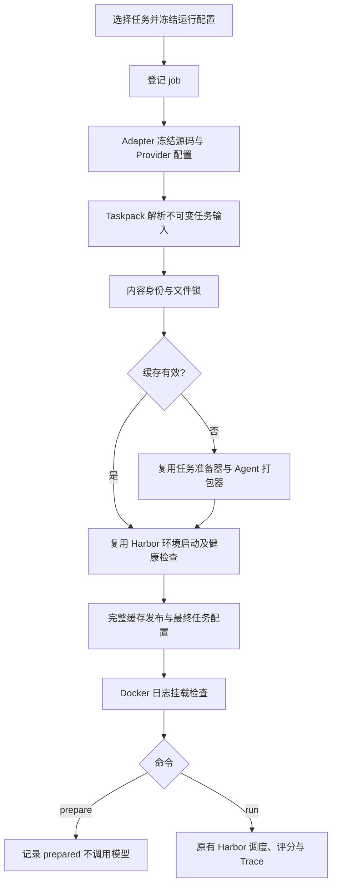

# 自动准备生命周期 — 2026-09-18

本次目标：统一命令在调用模型前准备所选任务、冻结 Agent 源码与配置、检查容器，并复用有效缓存。代码局限于 benchmark；不修改 Agent prompt、runtime 或工具执行策略。

## 边界与改动

```text
benchmark/
├── run.py                         # 提前登记 job，准备成功后进入现有 Harbor 入口
├── selection.py                   # 只选择任务、传递 profile 中的准备声明
├── preparation.py                 # 插件生命周期、内容缓存、锁、发布与就绪检查
├── adapters/omni/
│   ├── suite.py                   # Omni 配置快照、凭据要求和打包接入
│   └── prepare.py                 # 复用原打包流程，确定性源码归档
├── taskpacks/swe/
│   ├── suite.py                   # 固定上游任务、镜像和 runtime 输入
│   └── prepare.py                 # 复用任务准备器，核对上游文件摘要
├── environments/runtime.py        # 原镜像构建日志接入 job 日志
├── configs/default.json           # 声明 taskpack 和 adapter，无公共名称分派
├── pyproject.toml / uv.lock        # 显式固定已使用的 filelock
├── tests/test_preparation.py       # 发布、失效、失败保留与免费容器集成
├── tests/test_selection.py         # 自动准备模式的选择契约
└── README.md                      # 命令、插件契约、缓存和验证边界
```



公共层不包含题号、语言名称或 Omni Provider 的解析分支。测试用第二个 taskpack 接入同一契约。任务特有依赖仍归上游 Dockerfile/taskpack，Agent 的源码与凭据归 adapter。Docker/Harbor 是本轮支持的执行后端，不承诺任意云环境。

准备目录不会被索引为试题；准备失败不启动 Harbor Agent。损坏缓存明确拒绝，丢失本地镜像则重建并保留旧记录。未配置插件的 profile 和原生 --config 是显式的已准备任务输入，不是自动准备失败的回退。

## 验证边界

健康检查只证明声明的探针，不代表评分器正负对照或任意依赖都可用。50 题全量准备与 5 路真实并行未在本轮验证。没有运行付费模型。

- Python 常规回归：34 项通过；7 项 opt-in 容器测试默认跳过。其中本轮新增准备集成测试另行启用并通过。
- TypeScript：138 个测试文件、1,001 项测试通过；typecheck、format:check、git diff --check 通过。
- 实际执行 `pnpm run benchmark prepare` 两次：首次构建/发布，第二次缓存命中且 prepare.log 为 0 字节，无重复构建；两次 state=prepared，trials=[]，均无 launcher.log。
- 使用现有 execution-contract 夹具、当前 Omni 源码和本地模型配置；准备命令不调用模型。探针证实 cwd=/testbed、user=benchmark-runner、原任务 Node v20.20.2、本地服务返回 ok。产物经 Harbor ArtifactHandler 保存。
- 首次选择了 Colima 未共享的临时目录：健康检查通过，但挂载预检明确失败并保留 job，未进入模型执行。换用已配置共享目录后通过；没有修改产品默认路径或增加隐式回退。
- 本轮不重复跑此前 6 项评分/交接 opt-in 容器测试，不重跑付费 benchmark；没有改变它们的评分/交接实现。没有改 TypeScript 依赖或导出；Python 依赖锁由真实 pnpm 入口的 uv --frozen 验证。

最终免费容器证据：`/private/tmp/omni-benchmark-p0/auto-preparation-reviewed-20260918/`（测试临时目录，不是产品配置）。
