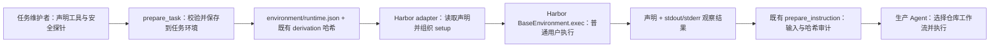

# 任务运行环境交接契约（2026-09-15）

后续审计与输入预算修复见[修复记录](runtime-audit-budget-2026-09-15.md)；本文保留 v3 阶段的验证记录。

结论：用任务级、与语言无关的声明替换 test_python 专用实现。职责分离完成；没有新增 Agent 运行机制、环境管理框架、依赖安装器或另一条进程执行路径。

## 职责与依赖



- 任务环境拥有工具路径、探针参数等知识，配置随每题保存；不能把多语言环境要求混在全局 Agent 参数里。
- runtime.py 拥有声明校验和就绪验证，复用 Harbor 的环境执行、用户、cwd 与超时接口。没有 Python、Node 或 Java 分支。
- agent.py 仅接入 setup 生命周期及已有输入交接，不负责识别语言、查找解释器或安装依赖。
- 生产 Agent、Core、工具权限、模型 Provider 均未因本轮收敛而修改。上一轮通用作用域说明保留。

## 替换范围

```text
benchmark/
├── adapters/harbor/
│   ├── runtime.py                    新增：任务声明与通用探针验证
│   ├── prepare_task.py               接收声明，保存到任务环境并纳入现有哈希
│   └── agent.py                      删除 test_python 与 Python 探针，接入通用交接
├── environments/swe-python/
│   └── runtime.json                  上游 Python 环境的具体声明，不是通用默认值
├── configs/harbor/
│   ├── swe-verified-mini-first3.yaml  删除全局解释器选项，改用 v7 任务
│   └── swe-verified-mini-hard1.yaml   同上
├── tests/
│   ├── test_environment.py           真实不同探针、失败中止与声明边界
│   ├── test_prepare_task.py          声明随题保存及哈希
│   └── test_instruction.py           新输入协议审计
├── README.md                         职责、契约及使用方式
└── reports/task-runtime-contract-2026-09-15.md
```

旧 Python 专用选项和实现直接删除，无兼容分支。历史报告和 v6 任务保留；新配置使用单独准备的 v7 任务。输入协议为 evaluation-input-v3，原题、规则、环境观察与提交输入分别保存并校验哈希。

## 验证证据

- format:check、typecheck、git diff --check 通过；完整 TypeScript 测试 133 文件、907 项通过。
- Benchmark 测试 19 项：16 项通过、3 项既有官方评分容器控制跳过。真实本地 Python、Node 与 stderr 探针共用一个执行契约；失败后不会换工具或继续后续探针。
- 四个真实上游容器均为 network=none，以 omni-benchmark 普通用户通过新声明验证，错误工具路径均被拒绝。Sphinx 的 stdout 版本输出与 Django 的 stderr 版本输出均完整保留，无版本格式解析。
- Sphinx 7590 原始仓库 test_domain_cpp.py：25 项通过。这是环境控制，不是 Agent 解题或官方评分通过。
- 四题 v6/v7 全文件哈希对比仅 environment/runtime.json 和 derivation.json 不同。题目、镜像定义、评分资产、参考解答全部不变。
- 原始观察、镜像 digest、输入审计、对比与检查日志位于忽略目录 benchmark/artifacts/task-runtime-2026-09-15/。四个验证容器删除，专用 Colima 已停止。

未运行付费模型或完整 Harbor Agent 试跑，尚未验证模型试错率和题目通过率的变化。未修改生产包依赖、导出或 CLI 启动逻辑，因此未重复 build 或 pnpm dev；评分器未变，未重复 Oracle 控制。Java 可按同一声明格式配置，但本次未实测 Java 镜像。

## 明确限制

探针由可信任务维护者声明，与上游环境准备具有相同信任来源。必须使用无副作用、不暴露凭据或评分信息的就绪检查；Benchmark 不承诺静态判定任意探针是否安全。探针受现有容器、用户及网络边界约束，不自动获得额外权限。

退出 0 且产生有界输出只证明该探针成功。模块不把版本输出解释为全部依赖齐全或测试通过，也不自动发现未声明的工具。没有声明的任务仅交接工作目录和空工具列表。
