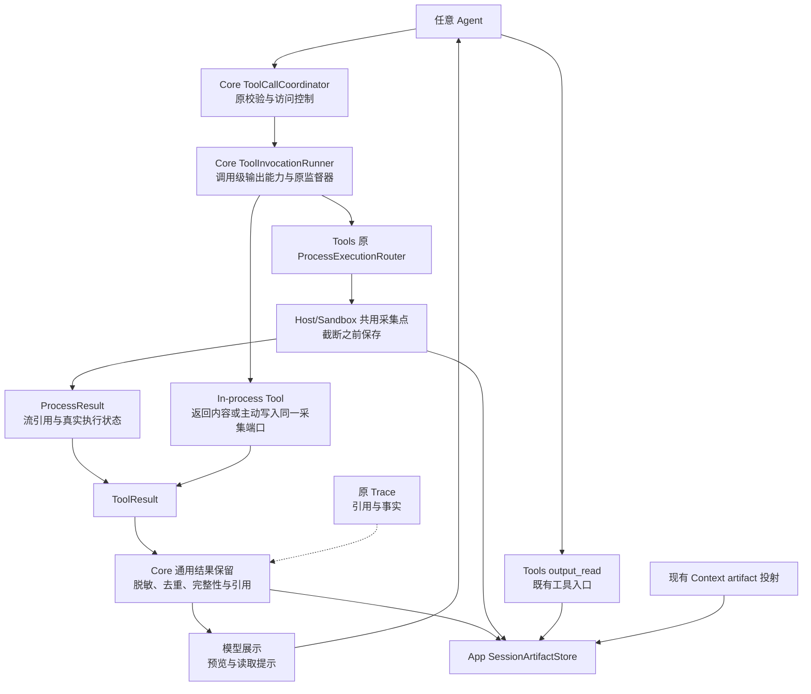
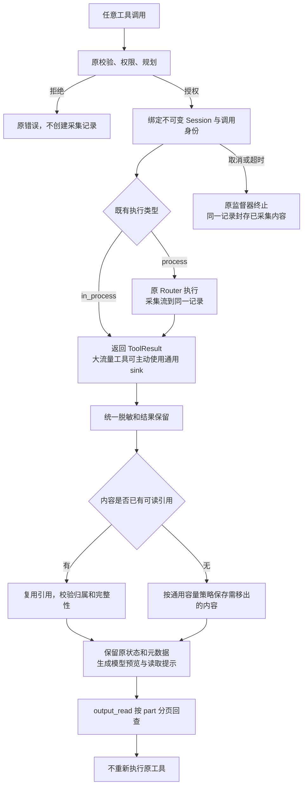

# Agent 基座：输出保留与回查 — implementation plan

状态：v1 原计划缺口已补齐并完成验收（2026-09-17）。第 15 节保留首次实施记录，第 16 节记录本次修复、补验与剩余资源限制；头尾预览、token 展示预算和写入性能优化不属于此次收尾。

## 1. 目标和已核实事实

目标：任意工具执行一次后，Agent 可重复读取该次调用保留的输出；展示截断不再等于内容丢失。统一入口覆盖 in_process 和 process，不按工具名称或 Agent 类型选择机制。能力不依赖 coding、benchmark、具体语言、模型或 Trace 开关。

当前事实：

- `packages/tools/src/shell/bash.ts` 的模型输出预算为 10 KiB；`process/host-process-runner.ts` 的 BoundedOutput 在共享预算耗尽后丢弃数据。
- Host 和 Rust Sandbox 路径最终均经过 runHostProcess，可在同一采集位置支持能力，不必修改 Rust 协议、增加执行器或对子进程做 Shell 包装。
- App 已有 ContextProjectionRepository 的工具结果文件、摘要投射和 ContextSidecarLifecycle。它保留的是工具返回后的内容，无法恢复此前丢弃的进程输出。
- ToolInvocationRunner 是授权后执行与监督的 owner；App 管理 Session；ProcessExecutionRouter 不得扩充权限。
- App 不依赖 Tools，不能为了复用分页而反向 import Tools。现有分页实现位于 Tools，复用时须提取最小的中立文本读取部分到 Core。
- 上次 Trace 证明存在重复取输出、展示截断；也证明模型已看见关键失败，因此该能力不能被宣称为解决上次未通过的充分条件。

成功标准：有界采集、可追溯读取、状态真实、Session 隔离、取消与清理正确。不是某一道题提分。

## 2. 范围与不变量

本次包含：

1. 通用输出记录契约、Session 内读取能力、容量及生命周期。
2. 所有工具统一经过结果保留与模型展示策略，包括成功和失败结果；进程流在源头接入同一输出记录，内存工具返回后由统一结果边界接入。结构化元数据与原业务状态保持不变。
3. 一个 `output_read` 工具，支持有界分页及尾部读取。
4. 现有 Context artifact 存储职责复用与重复路径清理。
5. Trace 关联引用、无 Trace 模式、Session 重开、失败及取消的验证。

不包含：全文搜索服务、专用测试执行工具、后台任务调度器、LLM 自动总结输出、UI 日志面板、网络存储、强制改写每个内存工具的实现、默认任务预算、自动重跑或自动改参数。

保持不变：权限决策、Shell/pipefail 原生语义、退出码和信号、Process planner 的纯输入映射、ToolCallCoordinator 唯一入口、既有 Session JSONL 可读性、模型 Provider 与预算、coding 验证策略、benchmark 评分隔离。

显式公开变化：coding 增加一个读取工具（追加到已有顺序）；ToolResult 增加通用输出引用及内容来源描述，ProcessResult 仅提供进程流的采集事实；开启采集的已授权调用存在有界内部写盘。其他 Agent 可组合相同工具，不强制每个 Agent 都暴露它。

## 3. 架构与职责



图中采集点和通用结果保留共享同一个调用记录。进程流是输入方式，不是独立的输出子系统；Sandbox 仍沿已有 runner 传回。

| Owner             | 职责                                              | 禁止承接                              |
| ----------------- | ------------------------------------------------- | ------------------------------------- |
| Core execution    | 所有工具统一结果保留、调用级端口、关联和终态      | 路径选择、文件持久化、语言判断        |
| Core 中立 I/O     | 已打开文件的有界 UTF-8 分页、超长行续读           | 路径授权、Session、业务文件编辑语义   |
| App artifacts     | Session 绑定、文件写入/读取、配额、记录终态和清理 | 启动命令、解析测试结果                |
| App context       | 压缩投射与 revision 事务，委托共享 artifact 存储  | 自己再实现文件写入、进程输出采集      |
| Tools process     | 同一执行链捕获 stdout/stderr，保留真实进程结果    | 改权限、重新调度、猜测业务成功        |
| Tools output_read | 输入校验、调用绑定的读取端口、模型可见结果        | 接受磁盘任意路径或跨 Session 标识     |
| Agent 包          | 声明工具组合                                      | 自定义保存逻辑、为题目生成日志规则    |
| benchmark         | 沿用通用状态目录归档；验证证据                    | 给 runtime 注入题目策略、另造输出存储 |

依赖仍是 `tools -> core`、`app -> core`、`agents/* -> app/core/tools`。Ports and Adapters 用于真实的存储/执行边界；组合与依赖注入代替继承。调用级 writer 使用显式状态机。没有 OutputManager/Registry/StrategyFactory 等无实际必要的层。

## 4. 唯一存储和现有逻辑清理

将 ContextProjectionRepository 中目录创建、artifact 内容写入、摘要校验等通用持久化职责移入 App 的 SessionArtifactStore；repository 保留 projection revision 校验、事务顺序和投射状态。复用 AtomicJsonFile、InterprocessFileLock、既有 sanitizer 和 Session 路径校验。

既有 Context artifact 文件格式、路径、file_read recovery 能力继续作为现有契约，不迁移历史 Session，也不让进程输出依赖 Context 压缩。共享 store 可以存储两种实际数据：不可变文本快照和调用输出记录，但不能设计任意插件式 artifact 框架。

新增输出位于 workspace/agent/session 的专属存储命名空间，路径由 App 从已有 layout 推导。Core、Tools 和模型只接收引用。一个调用的内容只保存一份；新的输出引用随结果进入 Context 后，压缩保留该引用，不把已有输出复制成第二份“大日志”。普通无引用工具结果沿用既有 artifact 投射。

Context clear 不得删除仍被 Session/运行引用的输出；Session clear/delete 才清除其输出。Session 切换仅更换能力绑定，不删除文件。保持旧 Context artifact 生命周期，不能为了统一目录误改变旧语义。

## 5. 契约设计

建议名称可在 P0 按现有命名规范微调；下述语义不可省略：

- `OutputReference`：不可猜测的 outputId、记录格式版本；归属由注入的 capability 决定，模型不能传入 sessionId/agentId/path。
- `OutputDescriptor`：内容 part 的 id、媒体类型、原有顺序、已观察大小、保存量、完整性与原因；文本/结构化数据/资源引用按内容类型表达。stdout/stderr 只是进程来源的 stream 属性，不是通用契约的固定两个字段；执行状态单独保留。
- `OutputCapturePort`：调用级有界 append / finalize；内部文件句柄不传给模型。
- `SessionOutputReaderPort`：当前 Session 内按引用读取；未知、归属不符、记录未结束/丢失等返回中立结构化错误。
- `output_read`：outputId、partId、分页参数，或互斥 tail 模式；响应含版本、下一页游标、hasMore、保存是否完整。采用现有 64 KiB 文本响应上限与 UTF-8 超长行续读规则，不再发明第二套页码系统。

默认只允许读取已封存记录，避免边写边读的一致性协议。取消后留下的记录标记 interrupted/incomplete，下一次 Run 可以查阅。v1 不承诺实时 tail。

`exitCode=0` 不等于任务成功；`capture=complete` 不等于业务成功；`run=cancelled` 不因日志已保存而改成 completed。三类状态必须独立。

输出能力从 App 在 Run 激活时按不可变 Session identity 绑定，再传给既有 invocation owner；共享 ProcessExecutionRouter 不保存 currentSession，也不读全局可变 getter。toolCallId 来自原关联链，无重复生成系统。

没有读取工具的 Agent 不应被替换为无法访问的引用；工具保留和模型展示为不同步骤，展示不得提前破坏内部消费者需要的完整 ToolResult。明确共享执行/脱敏结果的处理顺序，沿既有 middleware 和 observation 契约传递，不增加输出专用 Hook，Runner 显式调用唯一处理组件。组装时校验暴露工具与能力一致，具体规则见下文。

## 6. 执行与读取流程



不要向 Shell 添加重定向、tee、pipefail 或包装器。若调用方命令本身已经过滤输出，本能力不能恢复被过滤掉的内容。

## 7. 容量、脱敏、并发与取消

展示和保存预算独立。v1 建议资源默认值：维持 Bash 10 KiB 展示预算；每调用所有内容 part 合计保存 16 MiB，每 Session 256 MiB；通过已有配置校验链提供正整数参数，不作为任务执行上限。这些是明确的资源折中，不是语言/模型/题目常量。这两个保存数值尚未定案：P0 用已有 Trace 的输出规模和免费高输出样本核对，记录覆盖比例、截断比例、磁盘占用及选值理由后固定唯一配置来源；不因保存额度耗尽终止工具。

- 达到保存额度：记录 limit 原因，继续消费管道避免阻塞子进程，不终止或重跑用户命令；不以“保存成功”掩盖内容缺失。
- 对并发调用原子预留/核算预算，使用已有进程间锁，只锁短元数据操作，不持锁覆盖进程生命周期。Session 配额耗尽后不自动删除仍可引用的旧记录；Session clear 释放容量。
- 存储错误：保持原执行语义，输出明确 persistence_error；若从未成功创建记录，不返回虚假引用。结束状态中的保存失败必须可观察。
- 采集队列有界。慢磁盘通过有界背压处理；取消必须能停止等待，不产生无限缓冲或脱离 owner 的后台 writer。
- 脱敏发生在写盘之前；精确敏感值可能跨 chunk，需要有界尾部保留。复用共享匹配/脱敏实现，不逐块调用 sanitizer 后宣称安全。未知秘密不承诺全部识别；文本分页不得从保存前的未脱敏缓存返回。
- UTF-8 使用增量解码；非文本输出明确标识为不支持完整文本回查，不伪称字节无损备份。v1 存储的是经过脱敏的文本证据。
- 封存后不可变；晚到 chunk 不得写入新 Session 或重开旧 writer。崩溃留下 writing 记录时，在下一次激活按 Session lease/锁判定 abandoned，不能将仍活跃进程的记录误清除。
- 取消/超时继续由 OperationDeadlineSupervisor 和原 runner 控制；不另建 timeout race。关联输出信息不能丢失原异常类型、code 或 AbortSignal 语义。
- 父进程保存内部文件，子进程不获得内部目录额外权限。读取引用是 Session capability，不是任意文件读取后门；目录穿越、符号链接替换需拒绝。

## 8. 预期文件范围

下列为源码核对后的预期目录；[+] 新增、[~] 修改、[→] 提取并删除原重复实现。P0 后登记实际文件，不以清理为由扩大无关重构。

```text
packages/
├── core/src/
│   ├── execution/
│   │   ├── output.ts                         [+] 引用、完整性、Session 端口
│   │   ├── tool-output-retention.ts          [+] 统一保留和展示缩减
│   │   ├── tool-invocation-runner.ts          [~] afterExecute 后处理及取消封存
│   │   └── types.ts / index.ts               [~] capability 透传与导出
│   ├── io/
│   │   ├── text-page-reader.ts               [→] 原有 UTF-8 分页内核
│   │   ├── file-snapshot.ts                  [→] 原有文件版本计算
│   │   └── text-read-error.ts                [+] 中立读取错误
│   ├── agent-loop.ts / agent/loop/           [~] Run 到调用的 Session 能力传递
│   ├── tool-calls/                          [~] coordinator 的上下文传递
│   ├── context/compression/micro/strategies/artifact.ts [~] 已有引用不重复落盘
│   ├── tool-calls/tool-definition-validator.ts [~] 读取能力声明校验
│   └── types.ts / index.ts                  [~] 公开契约
├── app/src/
│   ├── persistence/session-artifact-store.ts [+] 存储、writer、配额、lease 同一 owner
│   ├── context/projectionRepository.ts      [~] 原快照文件写入委托给 store
│   ├── assembly/agent-runtime-assembler.ts  [~] 显式 reader 组合启用能力
│   ├── application/agent-application.ts     [~] Session 生命周期与 clear
│   └── config/{types,config-service}.ts     [~] 沿现有配置链解析存储资源限额
├── tools/src/
│   ├── process/{host-process-runner,process-execution-router,sandbox-process-runner}.ts
│   │                                        [~] 唯一流采集入口与能力透传
│   ├── output/output-read.ts                [+] Session 内读取与分页
│   ├── filesystem/io/{streaming-line-reader,file-snapshot}.ts [-] 提取后删除
│   ├── filesystem/{file-read,file-edit,file-write}.ts
│   ├── filesystem/io/{direct-file-writer,file-errors}.ts
│   │                                        [~] 改用共享读取/快照，保留领域错误
│   ├── search/grep.ts / web/web-fetch.ts     [~] 分离展示缩减与既有获取限制
│   └── index.ts                            [~] 导出通用 reader
agents/coding/
├── agent.yaml                              [~] 显式追加 reader
└── src/components/tool-catalog.ts           [~] 工具注册
benchmark/
├── adapters/omni/evidence.py                [~] 现有证据 owner 校验输出引用闭包
└── tests/test_output_evidence.py            [+] 归档搬迁/缺失检测
 tests/output-retention.test.ts             [+] 真实进程及跨层生命周期测试
 tests/fixtures/coding-agent-behavior-baseline.ts [~] 新工具基线
 packages/cli/src/agent-inspection/controller.test.ts [~] inspect 工具列表基线
 docs/{architecture,tool-call-runtime,context-engineering}.md [~] 公开契约
 docs/plans/agent-output-retention-and-retrieval.md [~] 原计划实施记录
```

若新增导出引发 package.json 或测试基线调整，只作必要装配变更并记入清单。预计影响 Core/App/Tools 和 coding 薄注册，属于中等侵入性；不把跨层生命周期改造宣传成“只加一个工具”。不改 Models、UI、Rust 执行协议、coding 解题 prompt 或题库。

## 9. 注释要求

注释使用英文，解释约束及原因，不逐行复述：

- Capture before preview truncation; retained text may still be incomplete.
- Bind output access to the originating session; never use mutable current-session state.
- Preserve the process outcome when output persistence fails.
- Finalized records reject late writes; cancellation does not imply complete capture.
- Carry sensitive-value overlap across chunks before persisting text.
- Context projection reuses an existing output reference instead of duplicating its content.

复杂状态转换、取消时序和权限边界必须有说明；公共端口注明调用方/实现方责任、容量与完整性语义。不写用户路径、模型名、题号或测试框架特例。

## 10. Roadmap 与阶段门槛

| 阶段                  | 工作                                                                           | 完成门槛                                                                  |
| --------------------- | ------------------------------------------------------------------------------ | ------------------------------------------------------------------------- |
| P0 契约确认           | 锁定 Session 绑定点、已有 artifact 复用、分页提取、配置默认值、流式脱敏/取消   | 无 App -> Tools 依赖；无第二存储/执行 owner；列出实际新增、修改、删除文件 |
| P1 存储能力           | 实现引用、唯一 store、配额、writer 封存与跨 Session 校验；提取既有文件写入职责 | 重开可读、配额并发安全、崩溃记录不伪装完整、旧 Context artifact 测试通过  |
| P2 统一结果接入       | 所有工具共用结果策略；Host/Sandbox 源头采集；取消和关联                        | 大输出保存不依赖预览；状态不被 I/O 错误覆盖；无子进程额外权限             |
| P3 回查闭环           | output_read、分页复用、工具组合校验、模型可见预览/提示                         | 同一次输出多次读取；无跨 Session；无隐藏重新执行                          |
| P4 Context/Trace/归档 | 复用引用，Session clear、重开与 Trace 关闭场景                                 | 原有投射兼容；无同内容二次落盘；取消输出可定位；benchmark 沿用同一存储    |
| P5 验收收尾           | 免费真实 headless 验证、风险测试、最终 diff 与架构清理、文档                   | 所有必要测试通过；无重复实现、硬编码、兼容分支或未声明的半成品路径        |

每阶段纵向验证后再推进。不得将旧 store 保留一份再增加新 writer 路径；提取在同阶段完成替换。遇到持久化格式/外部消费者迫使兼容层时，先记录问题并与用户对齐，不自行加入 shim。

## 11. 验证设计

优先行为级链路，不为字段映射逐个写 mock 测试：

1. 真实命令产生超过展示预算、低于保存预算的多字节 stdout/stderr；命令计数器只执行一次，后续读到原先被截断部分，退出码保持非零。
2. Host 与受控 Rust Sandbox 同一行为；子进程不能读写内部输出目录。真实 sandbox 不可用时明确列为未验证，不用 mock 冒充。
3. 管道默认和显式 pipefail 均保留原语义；输出保存不自动修正命令。
4. 取消/超时、晚到写入、清理失败：原 Run 状态正确，部分输出完整性明确，下一 Session 不受污染。
5. 精确敏感值跨 chunk、UTF-8 跨 chunk、超长行、尾部读取与分页；落盘和回查都不泄露已知敏感值。
6. 配额耗尽、磁盘失败、并发写入、Session 清理与重开；没有无限缓存、静默成功或有效引用被抢先删除。
7. Context 既有快照仍可恢复，新输出引用不重复保存；关闭 Trace 后完整闭环仍成立。
8. 免费真实 headless + 可控本地模型：执行一次、读取两次、完成。用通用长输出命令，不依赖 SWE 题目。

完成前按仓库要求执行 format、定向测试、format:check、typecheck、全量 test；涉及导出执行 build；装配和 Session 改动执行 CLI smoke。记录通过、失败、未运行的检查及原因。

新增必验：用进程、内存文本、结构化结果、错误结果四种工具验证相同保留策略；既有分页结果及 output_read 不触发递归落盘；含多内容块/资源引用的结果保持类型和顺序。检验新增工具无须添加名称白名单即可接入。

本计划不包含付费复跑；当前用户只要求计划，实施与付费验证另行按后续指令执行。

## 12. 质量评估与完成定义

设计目标：高内聚、低耦合、职责单一；通过已有 owner 注入所需能力，以调用级状态机处理真实生命周期。没有为了使用设计模式而加层。

评审结论为 Ready with trade-offs：资源有界意味着不能承诺无限完整输出；低侵入性受 Session 持久化、脱敏和取消等必要边界制约，不能靠 after-tool 截断补丁实现完整采集。P0 任何重大结构风险未闭合时停止进入下一阶段并修订本文件。

验收必须同时满足：输出可回查、身份隔离、状态真实、取消安全、旧链路无重复、存储不依赖 Trace、无 benchmark 定制。实现质量以代码审查与行为证据确认，不提前宣称“零风险”“100% 高质量”或提升得分。

## 13. 修订：所有工具输出是统一能力边界

本节澄清本轮设计范围，取代任何将能力限定为 Process Tool 的表述。v1 必须交付所有工具的统一结果处理，不能先做 Bash 专用实现后把通用化留作未来。

### 内容类型与处理策略

| 内容                   | 处理规则                                                                                               |
| ---------------------- | ------------------------------------------------------------------------------------------------------ |
| 小型文本               | 保留原样展示，不强制每次写文件                                                                         |
| 大型文本               | 先有界保存，再返回预览与引用；失败结果同样适用                                                         |
| 结构化结果             | 保持类型、原结果及语义字段；模型展示可缩减，不能将任意 JSON 字符串切一半冒充合法数据；明确按内容块回查 |
| 已分页结果             | 当前页继续展示并保留原 continuation；不抓取源数据全集，也不要求知道 file_read/grep 等名字              |
| 已有输出引用           | 校验绑定后复用，不再次落盘相同正文                                                                     |
| 图片等多模态块         | 保持现有内容类型与资源引用，不进行文本截断或伪装可全文读取；v1 不新增二进制编码/存储服务               |
| output_read 返回的页面 | 声明同一通用分页/来源事实，避免生成“输出引用的输出引用”递归链                                          |

所有分支依据内容类型、大小、已保存来源、完整性及分页等显式事实；禁止 `switch(toolName)`、工具白名单和语言映射。若当前 ToolResult 不足以表达分页/来源，扩展通用描述并由已有工具 owner 声明，不能在 Core 解析工具私有 meta。

“统一处理所有工具”不等于无限保存、给所有工具新增相同接口实现，或完全保存外部数据源。内存工具返回后可以自动接入；已经在内部丢弃的数据不可恢复。P0 对现有工具区分资源读取分页、领域结果上限和仅用于展示的截断：前两者保留语义，最后一种应移至通用结果投射，必要时使用同一 sink 提前采集，并登记实际受影响工具文件。

原始进程流和工具生成的领域结果不是同一语义。例如 grep 可从进程输出生成结构化匹配事实；通用结果必须保留这些事实，不能用 stdout 引用取代它们。同一进程流不重复存储，必要的派生结构化结果不是平行实现。

职责收敛：ToolInvocationRunner 仅调用单一结果保留组件，不承担内容类型处理细节；通用组件只做结果策略与引用投射，不启动命令或写磁盘；App store 只承担持久化及生命周期。源头采集是同一契约的优化入口，不能引入第二种记录格式、第二份配额或第二条读取链。

P0 文件树需增加实际有展示截断/分页声明的 tool owner 文件；不预先机械改写全部工具。验收要求涵盖全部执行类型，而不是要求每个工具都新增模板代码。

## 14. 实施前必须锁定的处理与生命周期契约

### 14.1 处理顺序与不新增 Hook

沿 ToolInvocationRunner 现有链路显式调用一个结果保留组件，不新增 HookEngine、输出事件总线或插件处理链。保留原 beforeExecute/afterExecute 的调用与失败语义，不把输出处理混入可选 middleware。

正常结果的固定顺序：

1. 原输入校验、访问控制、规划；拒绝不创建输出采集文件。
2. 原 beforeExecute；成功后绑定调用级输出能力并执行工具。采集端口写盘前处理跨 chunk 脱敏。
3. 接收领域 ToolResult，按现有机制脱敏；afterExecute 看到领域结果及可用引用，不能看到仅为模型生成的短预览。不能假设流式大结果全部常驻内存。
4. afterExecute 完成后，再检查可能新增内容的敏感值；冻结用于后续保留的逻辑结果。这里沿用同一 sanitizer，不新建规则。
5. 统一输出组件校验现有引用、保存需要移出的正文、封存记录，产生 canonical result：状态、结构化元数据、有限预览、可选正文引用及完整性。
6. observation/Trace 记录 canonical result，原返回链将其写入 Session；Context 基于同一结果生成模型请求，不重新落盘相同正文。

模型展示不能原地修改 middleware 持有的对象。业务元数据不得被展示裁剪覆盖。afterExecute 抛错继续遵从当前执行失败契约；已存在的输出记录可关联到失败诊断，不能把 middleware 失败变成成功。

工具异常由既有 runner 映射成 ToolResult 后，也经过同一个结果保留组件；取消保持取消分支，只封存已采集内容并关联记录，不伪造成功工具返回。保留组件自身失败需直接生成有界的存储诊断，不递归调用自身处理自己的错误。

### 14.2 正文唯一来源和 Trace 边界

| 消费者               | 保存/使用内容                                                                    |
| -------------------- | -------------------------------------------------------------------------------- |
| SessionArtifactStore | 已移出结果的大正文唯一权威副本，含版本、摘要、归属和完整性                       |
| Session JSONL        | 小结果原样；大结果保存 canonical result，不嵌入同一份大正文                      |
| Context projection   | 使用已有引用，保留状态和恢复信息；没有引用的原有结果仍沿旧快照契约               |
| Trace                | 记录 canonical result、调用关联及保存诊断，不再额外展开完整大正文                |
| Model request trace  | 如实记录实际发给模型的预览和读取页面；这是请求审计，不因正文去重而删改 wire 证据 |

“唯一正文”不是禁止预览或读取片段出现在会话/请求记录中，也不强迫不同调用做全局内容去重。按调用身份和已有引用避免重复保存即可。Session 重开后必须能解析历史输出引用；文件丢失或摘要不符明确报错，不自动重执行源工具。

### 14.3 工具接入核对表

| 已核对位置                                                 | 现有边界                                         | 计划处理                                                                     |
| ---------------------------------------------------------- | ------------------------------------------------ | ---------------------------------------------------------------------------- |
| tools/shell/bash.ts、process/host-process-runner.ts        | 10 KiB 展示截断及源头丢弃                        | 源头进入通用采集；保持短预览，替换不可恢复的展示丢弃路径                     |
| tools/filesystem/file-read.ts、io/streaming-line-reader.ts | 行数、字节和版本化分页                           | 保留分页；仅提取中立分页内核并声明通用分页来源                               |
| tools/search/grep.ts                                       | max_results、进程采集上限、文本展示预算并存      | 保持搜索条数和解析语义；分离展示预算，不能将原始 stdout 当匹配结果替代品     |
| tools/search/glob.ts                                       | 最多返回 200 条的既有结果范围                    | 不自动扩大返回集合；核对并声明结果范围完整性，不声称有全部路径可回查         |
| tools/web/web-fetch.ts                                     | 8 MiB 压缩/16 MiB 解压上限与 64 KiB 模型展示预算 | 网络/解压安全上限保持；展示缩减移交通用机制，保留 URL/status/MIME 等领域信息 |
| tools/web/web-search.ts                                    | 用户/工具的结果数量限制                          | 保持搜索范围；返回后的大文本适用统一策略                                     |
| 第三方/其他内存工具                                        | 通用 ToolResult                                  | 自动进入结果处理；提前流式写入为可选接入，不要求每个工具新增 writer          |

此表用于静态实施盘点，禁止变成运行时工具名路由表。P0 继续检查剩余输出生产者，将确实要修改的文件补入第 8 节。未接入的源头截断必须明确声明，不能宣称已恢复其丢失数据。

### 14.4 无读取能力的确定行为

Agent 显式启用输出回查能力时，assembler 必须校验对应 reader 工具已暴露、Session store 已绑定；缺一即组装失败，在执行副作用前反馈配置错误。不得降级为写文件后返回不可读取的引用。

未启用能力的 Agent 保持既有输出行为，不启用移出正文的投射，不偷偷注入工具或创建第二套兼容流程；任何截断仍必须真实呈现。所有 Agent 可使用同一能力，并不意味着 runtime 绕过其声明的工具组合强制启用。此为产品能力选择，不能新增用于保留错误旧实现的临时开关。

### 14.5 清理、读取和崩溃

- App 的 Session owner 先停止接纳该 Session 新 Run/读取，再等待当前 Run 与已开始的有界读取结束，之后清理。沿用既有串行/锁边界，若无法满足必须在 P0 说明，不新增全局调度器。
- 不持存储元数据锁等待完整 Run。用相同 Session 操作边界短时检查并标记 closing；跨进程读取需有等价的访问 lease。锁/lease 能否复用是 P0 硬门槛，不把单进程引用计数当跨进程保证。
- clear/delete 遇到未停止 writer 或未知清理状态时明确失败/未完成，不报告已释放磁盘，也不允许晚到数据重建已清理目录。
- 清理失败保留可重试状态和诊断；重试仅清理已确认归属且无活跃引用的记录，不重新执行工具。
- 崩溃恢复根据原进程/Session 所有权确认 abandoned。仅凭文件时间旧不能删除；未关联的临时文件纳入同一 store 的恢复清理，不新增独立 GC 服务。
- clear 完成后旧引用返回明确 missing/cleared；不能解析到新 Session 的同名内容。重开正常保留的 Session 不触发清理。

### 14.6 归档和离线回查

benchmark 继续使用通用状态目录归档。归档必须包含引用描述、正文、版本、摘要和完整性信息，不能只复制 Trace 或容器绝对路径。引用是逻辑标识，归档移动目录后仍能校验和定位。

在 Run 停止、输出封存后制作快照，再验证所有本次引用的闭包；取消/崩溃输出保留真实不完整状态。引用缺失或摘要不匹配属于证据不完整，不能把归档标为 complete。此状态不覆盖已经产生的官方评分或进程退出状态。

本次不新增独立离线 UI 或另一套 artifact resolver。归档验证复用相同描述/摘要契约；如现有收集脚本遗漏新目录，只修改既有收集 owner。原始输出不落在提交补丁目录，不进入待评测仓库，维持答案和评分资产隔离。

### 14.7 P0 与最终验收补充

P0 完成记录必须包含：精确处理顺序、实际工具接入文件、资源默认值依据、Session 清理并发机制、Trace/Session 新结果格式消费者扫描、归档闭包位置。若有外部契约阻碍一次替换，先对齐，不实现隐式兼容层。

新增验收场景：afterExecute 不受预览裁剪且新增敏感值被再次脱敏；未暴露 reader 的配置在执行前失败；Session clear 与已开始读取竞争；跨进程活跃 writer 不被误判 abandoned；归档移到不同目录后可校验和读取；故意删除一个正文使归档明确不完整。配置限额覆盖保存量，不影响命令原本的执行许可和期限。

文件范围补充：现有 Trace observer/结果序列化、Session 结果验证、App assembly 能力校验及 benchmark 原收集脚本如有契约变更，必须登记其真实路径并纳入对应行为测试；不为了支持新引用机械增加泛用序列化框架。

## 15. 实施记录与验收边界（2026-09-16）

### 15.1 已锁定的设计

结论：Ready with trade-offs。按原路线实施，没有新增 Hook 框架、执行器、题目分支或第二套分页逻辑。

- 授权执行 → 脱敏 → 原有 afterExecute → 再脱敏 → 正文保存/预览 → canonical result → Session、Trace 和模型上下文。中间件仍看到完整内存结果；进程流由同一 host runner 在展示裁剪前保存。
- 通过显式选择声明 `outputReader: true` 的工具启用能力，assembler 同时绑定 Session store；没有独立 enable 开关可形成“已启用但缺 reader”的配置。底层工具脱离 App 调用且无绑定时返回明确错误。未选择 reader 的 Agent 不生成新的输出引用。
- `SessionArtifactStore` 放在现有 `app/persistence`，避免仓库通用 `artifacts/` 忽略规则误吞源码。writer 是该 owner 的内部状态，不为文件数机械拆出 output-capture 类。App 不 import Tools。
- 复用 `InterprocessFileLock`：独立 Session lifetime lease 持续到 Run 实际结束；短 metadata lock 仅保护存储操作。clear 遇到活跃 lease 有界失败，调用者结束 Run 后可重试；不会宣称已清理。Session 关闭后旧 capability 不再接纳读取或写入。
- 复用现有流式精确值脱敏、UTF-8 分页、snapshot 和原子 JSON 写入。原 Context 快照路径和摘要契约不变；已有输出引用的结果跳过再次 artifact offload。
- 大 structuredContent 保存为 application/json part，canonical result 用 `meta.structuredOutputPart` + `meta.output` 指向正文；afterExecute 仍获得完整值。多模态 block 原样保留，不声称本次实现了通用二进制存储。
- stdout/stderr 保留的是脱敏后的 UTF-8 文本。非法编码会标为 unsupported_content/incomplete；取消/超时为 interrupted；正文资源限额为 limit；存储失败明确显示诊断，不把命令退出状态改为成功。
- benchmark 的已有全状态收集路径涵盖 outputs；仅在原 evidence owner 增加清单和摘要闭包检查，不新增 collector。输出不完整与证据缺失分别记录，不覆盖评分。

### 15.2 资源取舍

默认预览 10 KiB 沿用原 Bash 展示量；每调用正文 16 MiB、每 Session 256 MiB 是本地存储的初始工程预算，并非从付费题目效果反推的最优值。三项支持现有配置链 `outputRetention` 覆盖。每 Session 最多 1024 条记录、每记录最多 128 个 part 用于约束零正文记录及元数据数量；超出会显式报告保存失败/不完整，不阻止工具原本执行，不是模型输出预算或任务次数上限。

无后台 GC；清理归 Session owner。并发保障复用现有进程锁和 stale-owner 规则；不承诺任意文件系统故障下仍能持久化诊断。二进制归档、外部存储和全文检索仍不在本次范围内。

### 15.3 实施与验证

P0–P4 已完成：契约、唯一存储、统一结果处理、读取工具、Context/Trace/benchmark 关联均落地。P5 免费验证完成，证据存于忽略目录 `benchmark/artifacts/agent-output-retention-2026-09-16/`。

- TypeScript 全量测试 934 项通过，类型检查通过；构建与 `pnpm dev --help` 启动验证通过。
- 真实 Headless：本地确定性 SSE 模型，4 次请求；Bash 只执行一次，退出码 7 保留，后续 output_read 两次取得尾部/头部，Run 正常结束且 Trace 完整。没有付费模型调用。
- 真实 Rust/Seatbelt：保留超出预览的输出并回查尾部，子进程读取输出存储中的标记文件被系统拒绝。此测试证明该配置的隔离，不等同于全平台安全审计。
- 行为测试覆盖跨 chunk 脱敏、成功/错误结果、afterExecute 完整输入、结构化及多模态、无 Trace 重开、搬迁、缺失/摘要损坏、取消、容量限制、旧 capability 拒绝和活跃 lease 阻止 clear。
- 未执行付费题目和杀进程后的跨进程恢复专项压力测试；已有恢复逻辑与锁复用验证不能替代该压力测试。本次不声称提升某题通过率或降低真实模型费用。

本轮未改变 Models、UI、Rust 协议、coding 解题 prompt。工作区此前存在这些范围的改动，不能把工作区总 diff 当成本轮改动。

## 16. 原计划收尾验收（2026-09-17）

### 16.1 范围与结构结论

本节修正第 15 节过早标记全部完成的问题，保留原实施历史，不用新的优化目标替换原验收要求。

结构结论：Ready with trade-offs。沿现有存储 owner、执行 owner 和观察链补齐；没有新增执行路径、兼容层或 Hook。

```text
packages/core/src/
├── persistence/interprocess-file-lock.ts      [修改] 原进程锁接收 AbortSignal，取消等待并清除待发布锁
├── execution/output.ts                        [修改] create/append/finish 的协作取消契约
├── execution/tool-output-retention.ts          [修改] 传递取消，不将取消转换成保存失败结果
├── execution/tool-invocation-runner.ts         [修改] 原监督器有界封存，取消事实携带输出或失败诊断
├── execution/operation-deadline-supervisor.ts  [修改] 复用现有清理时限常量
├── runtime-observation/{facts,ports}.ts        [修改] 执行取消事实包含封存结果
├── tracing/runtime-observer/replay-runtime-observer.ts [修改] 原 Trace 写入取消封存事实
└── __tests__/runtime-trace-observer.test.ts    [修改] 验证诊断实际进入 replay
packages/app/src/persistence/session-artifact-store.ts [修改] 先登记 part，再写正文；恢复残留与缺失诊断
packages/tools/src/process/host-process-runner.ts      [修改] 使用调用信号，采集仍在唯一入口
 tests/output-retention.test.ts               [修改] 真实进程、竞争、恢复及消费者契约测试
 tests/fixtures/output-crash-writer.mts        [新增] 仅用于真实子进程的崩溃窗口故障注入
```

保持原命令、退出码、信号、授权、默认展示和保存额度不变。删除锁原先不可取消的 sleep；取消封存不再吞掉异常。不存在第二份锁实现或另一条存储写入链。

### 16.2 缺口闭合

| 原要求         | 修复或证据                                                                                                            |
| -------------- | --------------------------------------------------------------------------------------------------------------------- |
| 存储取消       | 共享锁的等待、采集 append 和读取支持 AbortSignal；封存检查取消并由原 OperationDeadlineSupervisor 管理清理时限         |
| 保存失败可观察 | tool.execution.cancelled 记录 output 或 outputPersistenceFailure；保留取消语义，已知敏感值仍经过原 sanitizer          |
| 崩溃窗口       | part 意图先入清单，再写正文；恢复按真实文件重新计算字节、行数和摘要，observedBytes 不小于已保存量                     |
| 孤立文件       | 持有 Session lease 确认无活跃 writer 后，清理 store 命名范围内的孤立正文与 AtomicJsonFile 临时文件，保留其他文件      |
| 缺失正文       | 明确 incomplete/persistence_error，读取失败；不会因一个缺失的中断正文阻止下一次运行                                   |
| 跨进程         | 真实子进程持锁超过原锁 30 秒 stale 窗口后 clear 仍被拒绝；SIGKILL 后恢复未提交清单大小的正文                          |
| 竞争           | 并发 writer 合计额度受约束；锁内排队的读写可取消，未获准的写入不会晚到执行；原有活跃 Session clear 测试保留           |
| 结构化结果     | 实际 Session JSON 序列化、Provider 消息转换、output_read 解码后与原 JSON 深度相等；多模态和 afterExecute 测试继续通过 |
| 原执行语义     | 真实 bash 默认管道与显式 pipefail 保持不同退出码；跨进程 UTF-8 分块仍完整解码                                         |

重要限制：AbortSignal 是协作取消，不能撤回已经提交给操作系统的文件 I/O。Session owner 必须继续等待实际写入结算再清理，不能将提前释放 lease 当作“快速取消”。本次不承诺故障磁盘的硬实时中断。

### 16.3 结构化消费者核对

核对范围包括 Core coordinator 的 ToolResult 验证、toolBatchPhase 的事件/Session 生成、transcript JSON 验证、Context 复制/估算/压缩、Models message-mapper 以及 App MCP 输入映射。structuredContent 在这些输出消费者中均为可选值；未发现必须原位保留大 JSON 才能完成业务的消费者。

因此保留现有 canonical 契约：afterExecute 获取完整类型化结果；大 JSON 在 application/json part 中保存，meta.structuredOutputPart 标明其身份，模型接收可回查引用。原 JSON 不被截断后冒充有效结构化对象。持久化的 canonical result 不同时嵌入完整大 JSON。已有小 structuredContent 和业务错误状态保持原样。

### 16.4 资源默认值依据

对历史 Trace 去重核对得到 1095 条工具执行结果：可见文本合计 1,571,980 字节，最大 23,645 字节，P95 为 5,304 字节，其中 17 条包含截断提示。历史内容已经经过展示裁剪，只能说明可见负载，不能推算原始输出覆盖率。

免费真实进程使用相同默认配置得到：

| 产生正文 | 保存正文 | 结果               | 命令退出码 |
| -------- | -------- | ------------------ | ---------- |
| 1 KiB    | 1 KiB    | complete           | 0          |
| 1 MiB    | 1 MiB    | complete           | 0          |
| 16 MiB   | 16 MiB   | complete           | 0          |
| 20 MiB   | 16 MiB   | incomplete / limit | 0          |

合计产生 37 MiB + 1 KiB、保存 33 MiB + 1 KiB：样本正文保留率约 89.19%，4 次调用有 1 次触发额度限制。元数据与文件实际占用另存测量清单。这个刻意覆盖边界的样本不代表生产截断率。

固定 v1 每调用 16 MiB，是在大于当前可见负载且免费边界样本已验证的前提下约束单次正文；每 Session 256 MiB 可容纳 16 次满额度调用，作为有限本地磁盘预算。没有证据证明这些值最优，也不声称完整覆盖所有真实任务。后续可凭原生输出记录的 observedBytes/bytes 再评估，无需付费重跑来完成本次工程验收。

previewBytes 调整普通结果的保留触发与预览；Bash 按原计划维持既有 10 KiB 展示量。这不是统一展示预算已经完成的声明；统一展示策略、头尾预览、token 预算另立增量计划。

### 16.5 最终验证和证据

本次证据目录：`benchmark/artifacts/agent-output-retention-v1-close-2026-09-17/`，沿用已有 gitignore，不将日志或运行状态提交到源码中。

包含定向/全量测试、类型检查、格式、构建、CLI 启动、免费 Headless、真实 Rust/Seatbelt、容量测量、搬迁后归档闭包及本轮源码摘要。最终验证：940 项 TypeScript 测试、6 项 Python 测试通过；格式、类型检查、构建、CLI 启动、免费 Headless 和真实沙箱均通过。该目录 verification.json 保存机器可读结论。

未运行付费模型、SWE 重跑、Windows/Linux 平台验证或长时间压力测试；本次真实进程故障注入已覆盖原先缺失的跨进程恢复场景，但不代表所有文件系统与平台故障均被穷举。v1 质量以明确覆盖的契约和证据为准。

## 17. 修订计划：统一输出来源与展示契约（2026-09-17，已实施）

Implemented as an incremental revision of v1. Section 17.10 records the final scope, justified changes to the anticipated file list, and verification evidence. Agent task strategy is unchanged.

### 17.1 根因、归属和设计结论

真实运行的一次结果同时保存 stdout 18218 字节和 content-0 10276 字节，后者是已截断的展示文本。进程捕获层已持有 writer，但通用保留层尚未取得最终 OutputRecord，只能看到普通文本，因而再次保存。根因是缺少内容与正文的显式来源关系，不是阈值大小或工具名称。

Core 拥有来源契约、保留决策和结果投影；Tools 拥有实际输出及其来源声明；App 继续拥有 Session 存储生命周期和能力装配。设计结论：Ready with trade-offs。可以实施，取舍是暂不合并所有工具的预览预算，不改变磁盘格式，不增加跨工具内容去重。运行时契约字段影响已有工具适配，必须同一变更更新所有受影响的内置消费者。

### 17.2 从最终输出倒推输入

| 倒推层级           | 预期表现                                                                        | 责任主体                              | 实现边界                                                |
| ------------------ | ------------------------------------------------------------------------------- | ------------------------------------- | ------------------------------------------------------- |
| 模型最终看到的结果 | 预览、准确的正文引用和 complete/incomplete/interrupted 状态；独立附加内容不消失 | Core 保留层                           | 不出现将预览冒充完整正文的第二个引用；不推断业务成功    |
| 回查结果           | 同一 Session 按原有 outputId、partId 和分页参数读取正文，不重跑工具             | 现有 output_read 和 SessionOutputPort | 读取参数、分页与存储格式不变；不强制模型调用            |
| 保存后的记录       | 同一份已捕获正文不因展示而重复保存；独立大内容仍按现有规则保存                  | Core 保留层；App 存储                 | 复用一个调用的 writer 和现有 finish；不增加第二个存储器 |
| 工具返回结果       | 按内容部分标明哪些是正文的预览；允许一个预览对应 stdout、stderr 多个部分        | Tools 结果构造；Core 契约             | 预览来源与 page 声明均随文本块携带；无结果级豁免        |
| 执行器返回结果     | 有捕获能力时传递该调用的输出身份与流部分来源，尚未 finish 时不宣称完整          | 现有进程执行层                        | 来源来自实际捕获上下文；无能力时不伪造引用              |
| 执行输入           | 保持原工具参数、cwd、signal、访问策略和调用级输出上下文                         | 现有执行入口                          | 不增加模型必须填写的来源字段，不解析 command 猜测来源   |
| 能力装配输入       | 只有实际注册读取工具时，模型才看到保存与回查能力说明                            | 现有 App 装配                         | 复用 outputReader 选择机制，不新增系统提示注入器        |

### 17.3 锁定来源契约

1. ProcessResult 传递实际捕获来源；工具构造结果时将 outputId 和非空、去重的 partIds 放到对应文本块的 outputSource。一个预览允许对应多个部分；不依赖 content 数组位置。
2. page 声明迁移到文本块 outputSource，删除结果级 outputSource 及旧 preview 索引映射，不保留兼容路径。
3. 未声明来源的文本与 structuredContent 仍视为独立内容；不以文本相似度、工具名或 writer 存在推断来源。
4. 捕获来源不包含磁盘路径，不复制完整 OutputRecord，不自行声明 complete；最终记录是字节数、哈希及完整状态的唯一事实来源。
5. 受信任中间件重排、深拷贝预览时来源随块保留；替换成独立内容时必须移除来源，产生新预览时显式声明其来源。Core 在中间件之后校验并消费来源，不将内部字段写入会话或模型协议。
6. 已保存引用不能使整个结果跳过保留；独立附加内容继续走现有保留流程。page 保留已有显式分页边界。

### 17.4 校验与失败语义

在发布可回查引用前验证以下不变量：来源仅声明于预览文本块；partIds 非空且不重复；来源 outputId 属于当前调用的捕获记录；所引用 partId 全部存在。跨 Session、其他调用的来源不可冒充当前调用的进程预览。既有 output_read 分页属于独立 page 契约，通过原有 Session 校验读取既存记录。

对调用级 writer 仍只执行现有一次终结流程，之后以最终记录确认来源与完整状态。不提前 finish 后再写入，也不增加第二个取消或清理路径。incomplete/interrupted 的记录仍可表达已保存部分，但不得被投影为完整正文。

引用无效、正文保存失败或终结失败必须返回现有结构化输出错误及有界诊断，不返回成功的可回查承诺，不静默丢弃独立内容，也不以另存预览掩盖失败。未启用保存能力的普通执行保持原有有界输出；若工具仍声明不存在的捕获来源，属于显式契约错误。

### 17.5 能力说明的唯一归属

- output_read 的工具描述负责一般能力规则：按结果中的引用读取已保存部分；只为读取同一次输出时优先回查；代码或状态变化后的重新执行仍由 Agent 判断；保存不完整时只能读取保留部分。
- Core 结果文本只负责本次事实：输出 ID、部分、字节数、完整状态及导航提示，不复制长篇策略。
- Bash 描述只保留自身执行语义，并明确 10 KiB 是内联展示上限，不能暗示所有正文只保留 10 KiB。删除引导模型默认预先过滤输出的通用策略；解释 shell 内部已经过滤的内容不属于执行器收到的正文，保存层无法恢复它。
- 保留 Bash 的退出码、管道及 pipefail 说明。不强制全局 pipefail、不扫描 FAILED 推断业务失败。
- App 已按实际工具注册结果向模型提供描述，因此本轮不新增系统 prompt、不修改 AgentRuntimeAssembler，不维护额外一套能力提示。没有注册读取工具时，不承诺存在 output_read。

### 17.6 改动文件树

下列为预计必要修改范围，实施前依据完整消费者搜索确认；不为满足文件数量机械拆分。

```text
packages/
├─ core/src/
│  ├─ execution/
│  │  ├─ output.ts                    # 扩展现有来源契约，明确预览与正文的关联
│  │  ├─ types.ts                     # ProcessResult 传递捕获来源，不改变退出码
│  │  └─ tool-output-retention.ts      # 校验来源、复用正文、保留独立内容并移除内部映射
│  └─ types.ts                        # ToolResultContent 文本块携带来源；删除旧结果级 preview 契约
├─ tools/src/
│  ├─ process/host-process-runner.ts   # 从实际捕获上下文提供来源，保留原生命周期
│  ├─ shell/bash.ts                   # 声明展示来源，清理与统一能力冲突的说明
│  ├─ search/grep.ts                  # 只标记实际来源于进程输出的内容，保留独立搜索元数据
│  └─ output/output-read.ts           # 统一能力说明；保留读取协议与分页实现
 tests/
└─ output-retention.test.ts           # 扩展真实进程—保存—会话—回查的行为级覆盖
 docs/
├─ tool-call-runtime.md               # 更新输出来源和失败契约
└─ plans/agent-output-retention-and-retrieval.md
                                     # 维护本节阶段状态和验收证据
```

原则上不新增生产文件。ToolInvocationRunner、ProcessExecutionRouter、sandbox-process-runner 仅在现有对象转发确实丢失新增来源时调整；应先确认，不能另建执行分支。若导出类型发生变化，更新现有 barrel export，不添加兼容别名。

不改 SessionArtifactStore 的持久化格式、配额和恢复机制，不修改 agents/coding 提示、models、UI、CLI 或 benchmark 评分。旧来源声明是内部行为替换，不增加历史数据迁移或兼容分支；通过在最终结果中移除运行时映射保持现有持久化记录语义。

### 17.7 必须清理的旧逻辑及注释

删除“捕获了正文，但由于展示文本超阈值再次保存展示”的处理路径。清理结果级引用存在就豁免全部内容的粗粒度行为，用内容来源判定替代；page 仍是显式的已有分页边界。移除冲突的通用输出指引，不保留新旧两套说明。

注释解释：为什么一个预览可以引用多个正文部分；为什么不能因 writer 存在而跳过整个结果；为什么完整性只能来自最终记录；为什么来源映射在结果投影后必须移除。不增加逐行复述或评测题目案例到产品代码注释中。

### 17.8 Roadmap 与阶段门槛

| 阶段          | 交付                                                   | 通过条件                                                                        |
| ------------- | ------------------------------------------------------ | ------------------------------------------------------------------------------- |
| R0 契约核对   | 搜索进程结果、ToolOutputSource、page 和结构化消费者    | 来源只有一个事实入口；无需改持久化协议；如确有外部消费者阻塞，先对齐而非加 shim |
| R1 来源与去重 | Core 契约、进程来源、Bash/grep 映射和保留逻辑          | 一次执行、同正文不重复、独立内容不漏存、无效引用不能发布                        |
| R2 能力说明   | output_read 一般规则、Bash 执行语义、Core 单次结果事实 | 启用与未启用能力的说明准确，没有系统 prompt 新注入路径                          |
| R3 验证与清理 | 集成测试、原生命周期回归、文档与最终 diff 审查         | 无旧分支、工具名 dispatch、兼容层、任务定制；证据与未覆盖风险明确               |

### 17.9 验收测试与完成定义

在现有 tests/output-retention.test.ts 扩展行为覆盖，优先真实进程和实际 Session 存储，不用大量 mock 重复实现。

- 真实进程输出超过展示上限；转换后展示文本也超过保留阈值。只执行一次，原始流只保存一次；同时输出 stdout/stderr 的预览引用均有效。
- 同一结果混合“已保存正文预览＋独立大文本＋独立结构化内容”：只去掉重复保存，独立内容可完整回查。
- 同一正文用于多个预览时不重复落盘；无效来源、缺失部分、其他调用或跨 Session 引用明确失败；中间件插入、重排、深拷贝、替换和删除均保持正确关联。
- 容量超限、保存失败与取消沿用现有状态语义；预览不能伪装成完整正文。复用原恢复测试，不重复造进程锁或清理测试体系。
- file_read 和 output_read 的 page 不二次保存；普通内存结果继续按阈值保存；无输出能力时不生成虚假引用或回查承诺。
- 经 Session 持久化和模型消息转换后引用仍可用，内部来源映射不泄漏。能力说明应在真实工具装配结果中核对；不为纯文案新增脆弱快照测试。

执行聚焦测试，随后按仓库要求运行格式、类型和全量测试；契约导出或包引用改变时运行构建。没有修改 CLI/App 启动时不扩大为无关 UI 检查。核对依赖方向和最终 diff。

完成标准是输出契约闭合且回归通过，不是某道付费题通过。不自动发起新的付费 run；本轮既有授权的付费验证已完成。后续如要测模型是否更常回查，应另列实验，不能以本次代码测试替代。

### 17.10 实施修订与验证（2026-09-17）

本次在第 17 节基础上实施来源契约和预览修复。真实免费复现发现，进程的 10 KiB 预览加上退出码后会再次触发普通正文保留，裁掉退出码、截断提示并产生 content-0 副本；stdout 还可能耗尽 stderr 的展示预算。

实际范围与原预计的差异及理由：

- 新增 Core `execution/text-output-preview.ts`，由进程捕获和普通内存结果复用同一套有界首尾预览；避免两处各写 UTF-8 裁剪逻辑。正文预算不包含状态和引用元数据。
- `ProcessInvocation.outputPreview` 是面向展示的显式选择；默认前缀语义保留给机器解析消费者。Bash 采用首尾预览，stdout/stderr 保留独立份额，空闲份额可借用。sandbox-process-runner 只透传此字段，仍调用既有捕获入口。
- Bash 把状态放在独立内容块，将流预览映射到实际捕获的正文。Core 消费映射并校验当前调用、部分和 Session；不再创建重复预览副本。无效来源及存储失败不掩盖原工具状态。
- grep 不加入预览来源映射：其展示包含文件大小和行列导航，是原始 JSON 之外的独立派生结果，不能冒充纯正文预览。机器 JSON 仍按前缀解析，不改现有搜索执行链路。
- 既有 output_read 描述已统一回查规则，App 已按实际注册装配能力，故无需重复修改或新增 Prompt。
- 回归集中在新增 `tests/output-preview.test.ts`，原 `tests/output-retention.test.ts` 保留生命周期和恢复覆盖；不另造存储器、锁、取消或恢复实现。

验证覆盖真实子进程→ToolInvocationRunner→保留层→模型消息投影→output_read；另覆盖创建/终结失败、未启用保存、配额不足、独立附加内容、非法/跨 Session 来源、UTF-8 和机器前缀语义。复现修复前后的正文均可回读，修复后首次文本能看到末尾错误、stderr 错误、退出码及截断提示，且无重复 content-0。

完成状态以本轮最终全量测试、类型、格式和构建结果为准。未运行新的付费模型或 Docker 评分；免费进程验证不能替代模型使用率或通过率实验。

Verification completed: 969 tests passed; repository typecheck, format check and full build passed. Free before/after probes are archived in `benchmark/artifacts/output-preview-2026-09-17/` (gitignored). No paid model calls or Docker evaluation were run.

### 17.11 中间件来源关联修订（2026-09-17）

免费审计证明，旧数组索引在 afterExecute 插入内容后可能指向独立正文，导致漏存。来源现已迁移到文本块本身，旧索引协议直接删除；复用现有 ToolInvocationRunner、脱敏器和 Session 存储，不引入注册表、Hook 层或兼容分支。中间件语义替换的来源责任见 17.3；运行时不猜测文本含义。

预算边界：独立原始文本和 JSON 共用 Session 预览预算；进程预览由上游约束，page 由分页契约约束，状态和导航引用在正文预算之外。多模态内容保持原语义，不宣称任意混合结果受到单一总字节上限。本次不改变预算机制。

新增五个真实 ToolInvocationRunner 中间件回归，覆盖插入、重排、深拷贝、替换和删除；同时验证脱敏、独立正文完整回查、不重复保存及模型消息不泄漏内部来源。验收结果见 benchmark/reports/output-contract-audit-2026-09-17.md。

### 17.12 输出部分身份与生命周期收敛（2026-09-17）

审计复现：原 append(partId, text) 把创建和追加混为一谈，工具捕获部分与保留层生成的 content-0/structured 同名时会串写。设计结论 Ready with trade-offs：调整所有写入调用方，但保持既有存储、锁、配额、恢复和读取协议。

- Core 定义 createPart 和仅可追加的 OutputPartWriterPort；删除旧字符串追加接口，不保留兼容入口。
- App writer 唯一分配 ID、创建正文并维护生命周期。句柄只是绑定身份的写入能力，不复制终结状态。label 可重复，仅作描述；旧记录不含 label 仍按原 ID 读取，无数据迁移。
- Tools 为每个实际有内容的 stdout/stderr 持有部分句柄，ProcessResult 传递流到真实 ID 的关联；Bash 将真实 ID 绑定至预览块。
- Core 保留层同样申请新的部分保存独立文本和 JSON，不自行构造身份。来源引用和最终 OutputRecord 保持各自职责。
- 验证同名并发创建、连续追加、空部分、终结后创建/追加拒绝、捕获与独立正文同名隔离、旧 v1 记录无改写回查；原取消、配额、崩溃恢复测试一并迁移。

新增仅为契约类型和行为回归，不新增生产文件、管理器、Hook 或注册表。没有修改 Agent prompt、Provider 或 benchmark 评分策略。

本节验收：982 项测试、类型检查、格式检查和完整构建通过；见 benchmark/reports/output-contract-audit-2026-09-17.md 的 Part identity ownership repair。未发起付费验证。

### 17.13 输入输出边界修复（2026-09-17）

设计结论 Ready。根因是最终脱敏依赖可选保存能力，以及结果级 page 声明使独立附件被豁免。所有者分别为执行结果边界与内容投影边界。

- ToolInvocationRunner 统一使用公共 sanitizer：中间件前、保存前、最终返回前。错误结果复用同一 finalizeResult；取消诊断沿用原路径。删除保留层中的脱敏职责，不新增 sanitizer 或执行入口。
- ToolResultContent.outputSource 统一声明捕获来源或 page；file_read、output_read 同步迁移。旧结果级 page 声明删除。重排/复制随块保留；独立替换移除声明。
- meta.outputRead 记录本次读取的历史记录及 partId；meta.output 记录本次新创建的正文，两者含义互斥而非竞争。附件失败不抹掉已验证的原读取来源。
- 原 writer、锁、配额、部分句柄、首尾预览与回查机制全部复用。输入校验、权限、超时、Agent prompt、Provider 与评分逻辑不变。
- 验收覆盖存储开启/关闭下中间件敏感内容、分页块插入/重排/复制/替换/删除、附件存储失败、原页面与新附件分别回查。证据记入 io-boundary-audit-2026-09-17.md。

17.13 验收完成：990 项测试（138 文件）、类型、格式和完整构建通过；原始探针两项缺口均已消除，新增 8 个边界回归。未执行付费调用或容器重跑。

### 17.14 存储事实与展示投影分离（2026-09-17）

设计结论 Ready。敏感标签脱敏会改变展示记录，旧 validate(record) 将整份展示对象与磁盘比较，因此误判来源无效。修复以 Session 存储作为唯一事实来源。

- Core 引用只包含 outputId、可选 partId；读取请求要求 partId。SessionOutputPort.resolve 按引用加载和验证权威记录，支持现有 AbortSignal。
- App 的 resolve 和 read 共用同一个内部记录解析、状态、部分归属和正文完整性检查，在既有锁下执行；删除 validate(record)，不保留兼容入口。
- meta.outputRead 只携带 outputId/partId；meta.output 是可脱敏的展示快照。Core 校验时根据 ID 回到存储，不信任调用方提供的标签或其他展示字段。
- 工具输入参数、磁盘格式、writer 生命周期与配额不变。不新增存储、注册表或执行链。旧磁盘记录继续使用原 ID。
- 新增真实工具执行到 output_read 的敏感标签回归，并验证未终结、错误部分、跨 Session、取消和损坏正文仍被拒绝。
