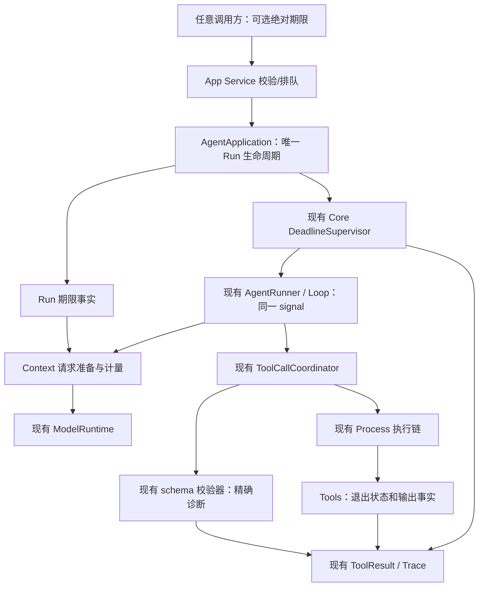
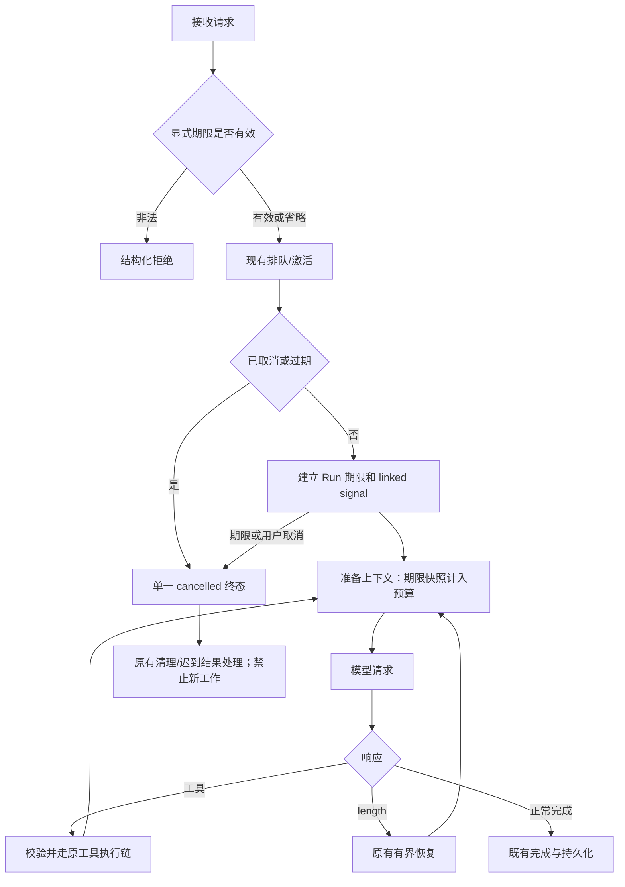

# Agent 基座：工具反馈与 Run 期限 — implementation plan

状态：Ready with trade-offs（设计可进入实施；P0 生命周期检查为跨层改造的前置门槛）。P0–P5 已完成；实现与免费验证证据见实施记录。

## 1. 目标与事实

目标：为所有 Agent 提供可修正的工具输入反馈、准确且语义明确的进程结果，以及调用方显式设置的 Run 期限。成功标准是这些基础契约成立，不是某道 benchmark 得分提高。

本计划独立于 model-output-budget-recovery.md，不改写已完成的动态输出预算与截断恢复方案。

最新 Trace 的已知事实：

- grep 使用不被 schema 接受的 path 字段，两次收到泛化的 additional properties 报错。ToolInputValidator.formatErrors 未保留 AJV params 中的具体字段信息。
- Python 失败经过 tail 管道，Bash 返回 0，工具 isError=false；这符合当前 Bash 原生语义，但不能代表测试成功。其他命令显式捕获失败并最终返回 0，也不能被 runtime 擅自重判。
- 正确解释器路径从首轮已提供，测试失败在后续上下文中保留。因此没有证据支持增加语言专属环境修复或补传相同上下文。
- benchmark 外部进程期限为 1800 秒，AgentServiceRunRequest 没有期限字段；模型没有收到期限事实。
- 模型长时间生成、未及时修复回归仍是独立问题；以下改造不能保证消除该行为。

## 2. 设计结论、范围与不变量

采用现有 owner 和调用链，不新增执行框架、调度器、工具包装器、日志框架或 Agent 基类。

新增：必要的通用契约字段、schema 错误详情、进程状态元数据、Run 期限事实及高风险行为测试。优先在已有文件内实现，不预设新的目录或 service。

修改：Core 校验反馈与 Context 准备输入、Tools 的进程结果表示、App Run 生命周期、headless 参数传递、契约文档。

删除/替换：丢失具体错误字段的格式化逻辑；涉及本次期限传递的重复来源。仅删除确认被替代的旧逻辑，不清理无关工作区改动。

保持：工具名和 schema 的业务语义、Bash 默认 Shell 语义、显式错误处理、权限与项目规则加载、取消与终态接口、动态输出预算、输出恢复、Provider 凭据、无期限运行行为、历史 Session 可读取。

禁止：

- Core/App 引用 benchmark 或某个 agents/*；按工具名、测试框架、语言、模型名分支。
- 字段别名表、自动猜测/纠正参数、非法调用自动重试。
- 根据 FAILED、ERROR、日志关键词推断命令或任务失败。
- 写死用户路径、解释器位置、30 分钟默认值、剩余两分钟收尾等策略。
- 新的 deadline timer、第二个恢复循环、隐式 fallback、临时兼容开关。
- 将进程退出 0、工具 isError=false 或 Trace 完整解释为任务完成。

## 3. 能力 A：可修正的 schema 错误

Owner：Core ToolInputValidator；ToolCallCoordinator 只将结果放入现有 ToolResult 返回链。

从现有 AJV ErrorObject 生成中立诊断：字段路径、校验 keyword、具体附加/缺失字段、相关 schema 约束。文本和结构化信息由同一份诊断生成，不能各自实现一套判断。允许字段来自当前 schema，不维护工具名映射表；不擅自推断或改写参数名称。

错误数量、文本长度使用现有输出/脱敏约束；若必须新增通用容量边界，必须在契约中说明其作用是防日志膨胀，不是任务特例。不得回显凭据、完整非法输入或任意敏感枚举值。保留 invalid_tool_input 错误码和“不执行非法调用”的行为。

验收：多余字段、缺失字段、嵌套类型错误可定位；敏感内容不泄露；工具未执行；模型可见文本与结构化详情一致。复用 schema validator，不创建第二个 validator。

## 4. 能力 B：准确的进程结果契约

Owner：Tools Bash 的 createToolResult；执行仍走现有 ProcessExecutionRouter / ProcessResult。

明确两层语义：ProcessResult 表示整个 Shell 进程的退出状态；业务检查是否通过由调用方结合证据判断。保留默认 /bin/bash -c，不默认加 pipefail、errexit，不改写用户命令，不收集每个管道段作为新的执行协议。

将已有 ProcessResult 中的 exitCode、signal、stdout/stderr 截断标记投射至现有 ToolResult 元数据，若已有等价字段则直接复用。进程失败继续按退出码/信号产生 isError；结果文本同步提供必要的退出/截断事实。不要把 null 退出码填成 0。

工具说明明确：普通管道通常采用末段退出码；调用者需要传播上游错误时显式使用 Bash 自身的 pipefail 或保存并返回原退出码。长输出需通过已支持的文件/分页能力保存和读取，不能增加“测试工具”或自动命令包装层。

这项不会自动修复所有“测试失败但 Shell 成功”。这是刻意保留的通用语义边界。若未来要求默认 pipefail，必须另行审查 SIGPIPE、正常早退管道和调用方兼容影响；不在本次隐式引入。

验收：非零退出、信号终止、普通管道、显式 pipefail、显式捕获错误后成功均准确呈现；输出截断状态可见。不用测试框架名称或日志内容作为判定条件。

## 5. 能力 C：显式 Run 期限

### 5.1 生命周期与来源

Owner：App AgentApplication.run 的统一 Run 生命周期，覆盖 Service 和直接调用者；AgentService 负责校验与传递，不能另起 timer。Core 已有 OperationDeadlineSupervisor 负责计时、链接取消和清理；Core Loop 和 Context 只消费同一次 Run 的期限事实及 linked signal。

公开请求新增可选 deadlineAtMs（绝对 UTC 毫秒）。省略表示无 Run 期限，绝不补默认值。公开边界拒绝 NaN、Infinity、不安全整数等无效输入；合法但已过期的请求在任何模型/工具副作用前取消，不当作一次成功运行。队列等待计入绝对期限，激活前必须重新检查。

在运行 owner 处一次性将绝对期限换算为剩余时长，使用同一单调时钟起点管理本次运行；后续模型调用、压缩、输出恢复均不重置期限。系统墙钟变化不应让已经开始的 Run 延长或缩短。若现有监督器接口不能支持一致的时钟事实，扩展它本身，不另写计时实现。

复用 cancelled 终态，使用既有可容纳原因的失败/Trace 字段区分期限与用户取消。不得只因底层异常不是 AbortError 而误记 failed；不得无条件把其他错误改成 cancelled。终态仅发布一次，后续迟到结果不能覆盖终态。

### 5.2 清理与并发门槛

OperationDeadlineSupervisor 已有有界 cleanup 与 late settlement，但不能因此在尚有未结束操作时释放 Session 排他权并启动下一个 Run。P0 必须确认：排队取消、Service iterator 退出、Session close、Run 取消、晚到回调和持久化之间的所有权。

超时后的清理不计为新的工作预算；不再发模型/工具请求。挂起操作的完成或隔离由现有 Session/应用生命周期承载。若无法在当前契约中保证旧 Run 不再写状态，停止该部分并修订设计，不添加轮询锁、静默强退或兼容路径。

### 5.3 Context 与 Trace

期限是 Run 事实，不是机器环境或 Session 长期状态。通过现有 Context 准备链的请求专用事实传递，不写入用户任务，不污染持久化的 workspace 环境快照，也不通过刷新整个 system prompt 反复破坏稳定前缀。

在每次模型请求准备时提供 deadlineAtMs、capturedAtMs、remainingMs（明确这是捕获时刻的快照）；预算估算包含此内容。无期限时省略整块。当前模型流式请求不能被事后提示中途改变，只能由既有 signal 取消，不增加周期性中断或强制收尾策略。

Trace 复用现有 run/context/request 事件记录事实与取消原因。历史无期限 Session 继续读取；不持久化第二份倒计时。若现有事件 schema 需要破坏性迁移，先修订方案，不偷偷加兼容分支。

### 5.4 入口及 benchmark

headless 提供可选 --deadline-at-ms，经过 CLI / AgentService 传入同一契约。交互 CLI 和其他 Host 未指定时行为不变。本次不扩展 现有 WebSocket Protocol 的外部字段；底层 AgentService 能力保持 Host 中立，WebSocket 暴露可作为后续独立协议变更。

benchmark 仅在已有作答时段开始位置，从现有时长配置生成绝对期限，并通过正式 headless 参数传递；Core 不知道该来源是 benchmark。跨容器使用墙钟期限前核对时钟偏差，不将宿主单调时间戳传给另一进程。

外部进程 watchdog 只负责 Agent 不合作时的最终进程终止/清理，截止应由同一作答配置与明确的清理宽限推导，不能与 Run deadline 同时争抢正常取消。原先进程超时会覆盖启动阶段，应明确保持该时间范围，不通过改为“Run 开始后重新计满时长”悄悄扩大额度。评分期不属于 Agent 作答期。

## 6. 架构与流程





## 7. 预计文件目录树

以下是基于当前代码的预计修改范围；具体 Trace/契约文件由 P0 引用扫描锁定，禁止以范围宽泛为由扩散改动。

```text
packages/
├── core/src/
│   ├── tool-calls/
│   │   ├── tool-input-validator.ts          # 修改：保留 schema 错误详情
│   │   └── tool-call-coordinator.ts         # 修改：现有结果链投射诊断
│   ├── execution/operation-deadline-supervisor.ts # 必要时扩展现有时钟事实
│   ├── agent-loop.ts                       # 传递 Run 事实，不新增 timer
│   ├── agent/{runner,contextInput}.ts      # 正式契约到上下文准备
│   ├── context/{contracts,assembly}/       # 请求专用事实、估算及投射
│   ├── runtime-observation/、tracing/       # 必要的既有事件字段
│   └── __tests__/                          # 错误、期限、取消/恢复不变量
├── tools/src/shell/bash.ts                 # ProcessResult 元数据和说明
├── tools/src/…现有 Bash 行为测试             # Shell 原生语义与元数据
├── app/src/application/
│   ├── agent-service/{contracts,agent-service}.ts # 请求校验和透传
│   └── agent-application.ts                # 唯一 Run 期限 owner
├── app/src/__tests__/                      # 真实 Service 生命周期测试
└── cli/src/headless/{run,run.test}.ts       # 参数透传与已有结果链
apps/omni/src/
├── headless-entry.ts                       # 公开参数解析
└── headless-entry.test.ts                  # 入口契约
benchmark/adapters/omni/agent.py            # 可选消费者：仅适配正式入口
benchmark/tests/…相关既有入口测试             # 不拥有期限算法
docs/
├── agent-service.md
├── tool-call-runtime.md
├── context-engineering.md
└── plans/agent-runtime-feedback-and-deadline.md
```

新增文件不预先强制要求。若必须新增共享 Run 契约文件，应承载明确所有权，不为减少单文件行数机械拆分。导出、AgentFactory/应用端口等引用扫描发现的必要消费者列入实施记录；不保留旧实现加新实现两套路径。

不修改 agents/coding 的领域策略、评分器、题库、Provider 预算、模型切换、压缩策略或项目规则批次策略。环境 types/render 不承担 Run 倒计时状态；纠正此前将期限泛放入环境目录的预估。

## 8. 注释要求

英文注释解释不变量：schema 是诊断唯一来源；Shell 成功不等于业务成功；期限来自调用方且恢复不重置；倒计时为请求时快照；Session 排他权不能早于旧 Run 停止写入释放。

不写题号、语言或模型专属注释，不写逐行翻译，不靠注释替代契约/测试。

## 9. Roadmap 和验收

| 阶段 | 交付                                                                                  | 进入下一阶段的门槛                                           |
| ---- | ------------------------------------------------------------------------------------- | ------------------------------------------------------------ |
| P0   | 当前调用链/契约引用扫描，记录实际新增修改删除文件；确认时钟、排队、清理和迟到写入边界 | 无未解决的生命周期结构风险；否则修订计划                     |
| P1   | schema 诊断与现有 ToolResult 反馈                                                     | 具体错误可修正，敏感值不泄露，非法工具零执行                 |
| P2   | ProcessResult 元数据及 Shell 契约                                                     | 原生管道、pipefail、信号、显式错误处理均准确；无文本判定     |
| P3   | 显式期限：App owner → Core signal/事实 → Context                                      | 无期限不变；过期零副作用；队列计时正确；恢复不延期；单一终态 |
| P4   | headless 正式入口与 benchmark 薄适配                                                  | 单一配置来源、启动范围不变、外部 watchdog 不抢正常取消       |
| P5   | 免费完整链路、差异审查和文档收尾                                                      | 不合作/晚到操作不污染后续 Run；无旧路径、默认限额、题目特例  |

免费验收覆盖：

1. 任意工具 schema 的附加字段、缺失字段、嵌套错误、敏感输入；同一标准适用于不同工具。
2. 任意命令非零退出、信号、管道成功/失败、显式捕获退出码、输出截断；不依赖语言测试框架。
3. 无期限、合法期限、非法期限、排队到期、运行中到期、用户取消先到、模型/工具晚到、清理超时；取消后不启动新工作。
4. 期限横跨模型调用、Context 准备、工具、输出恢复；没有重置或重复 timer。
5. App → headless → Trace 状态一致；日志不泄露秘密；历史 Session 可读取；默认 coding Agent 启动不回归。
6. Context 期限事实参与最终计量，不引入假用户消息、持久化倒计时或双重预算来源。

遵守仓库验证：格式化、定向测试、format:check、typecheck、全量 test；涉及导出/依赖执行 build；入口/生命周期变化执行启动 smoke。使用已有测试边界，避免只测字段映射的大量碎片测试。

本计划不自动启动付费运行。免费验收完成后，若进行真实对照，单独明确次数与额度，分别报告基础契约、执行完整性、工具浪费、解题质量；不以某题得分作为基座契约是否正确的唯一判断。

## 10. 完成标准与限制

- 无工具/语言/模型/benchmark 特判、用户路径硬编码或字段别名。
- 无新平行计时器、schema validator、执行器、恢复循环或日志系统。
- 公开行为、旧路径删除、实际文件与验证证据均更新到本计划。
- 不保证模型遵从时间信息，不保证修复正确，不在流式过程中注入新提示。
- 保留 Bash 默认语义；本轮不声称消除所有管道掩盖业务失败的问题。
- 真实代码实施后方可宣称无残留；当前结论只适用于计划设计。

## 11. 实施记录

### P0 所有权核对与落地调整

- AgentService 按 application.run() Promise 串行化 Session；AgentApplication 的 activeRunCount 同时保护直接调用及 dispose。因此在监督器结束后仍等待执行 Promise settlement，才释放所有权，没有另加锁/轮询器。非合作运行可能保持 busy，交由进程 owner 最终终止。
- 排队期限在激活前检查，没有新增排队 timer；已过期请求没有真正启动 Run，因此 headless trace.integrity=missing 是未生成 Trace，不是假装完整。
- 原有 ToolInvocationRunner 对不合作进程内工具采用有界清理和迟到观察。本轮保证 App/Session 和模型结果边界，不宣称可信插件的任意文件副作用可以被强行停止；该 OS 隔离能力不属于期限提示。
- 新增 execution/run-deadline.ts 承载中立期限契约与单调时钟事实；context/run-deadline.ts 承载唯一的模型文本投射。估算与发送复用同一个渲染，execution 不承担 prompt 表达。
- 监督器在原 timer owner 内分段安排超过 Node 单次定时器范围的期限；没有加入新的默认预算。
- 诊断上限 16 项、单字段 256 字符为明确的日志放大边界，非工具/模型特例。复用共享 sanitizer，不回显输入值或 enum/const 值。
- 保留 Bash 默认语义；只是显式输出原有进程事实。不把管道返回 0 的业务失败强制重判。
- benchmark 使用容器时钟生成绝对期限；原作答配置继续作为唯一来源，10 秒可配置清理宽限与原 5 秒 KILL 宽限不属于工作预算。

### 验证证据

- 定向生命周期、schema、Shell 测试通过；最终全量 134 文件、923 测试通过，类型检查通过。
- 首轮全量曾有原长循环测试超过 5 秒，定向复核及后续全量通过，未修改测试时限。中间一次遗漏公开错误类型导出已修复并重跑。
- 免费真实 headless + 本地 HTTP 模型：过期期限 0 请求、cancelled/130；一次 length 恢复后第二次模型请求在原期限取消，deadline 一致、remainingMs 递减，Trace complete。没有调用真实付费 Provider。
- 代码、日志和测试不会以题号、语言、Provider 名称判断行为；未改 coding prompt、评分器或模型预算逻辑。
- 本轮没有重建并跑 Docker 整题，不能宣称 benchmark 容器适配已端到端验证；该适配使用正式 headless 参数，语法和既有 Python 回归另行核验。

### P5 最终审核

- format:check、typecheck、build、pnpm dev --help、git diff --check 通过；相关 Python 回归 9 项通过；Adapter 生成命令及嵌套 Shell 语法核验通过。
- 免费完整链路及检查日志归档于 benchmark/artifacts/agent-runtime-feedback-and-deadline-2026-09-16（gitignore），包含逐文件 SHA-256。无真实凭据或付费调用。
- 本次涉及 32 个源码/测试/适配文件及 5 份文档，共 37 个文件；其中 3 个新增源码/测试文件，其余在现有 owner 修改。工作区上轮 budget/recovery 和 benchmark 改动保留，不计为本轮重新实施。
- 未新增平行执行、schema 校验、日志或计时实现；监督器支持长时限仍是原 timer owner 的扩展。未移除 Bash 原生语义或绕过工具校验。
- 未验证 Docker 整题实际启动和真实 Provider 下的任务质量变化，不能据此宣称提分或提速。

### 实际文件登记

```text
packages/core/src/tool-calls/tool-input-validator.ts
packages/core/src/tool-calls/tool-call-coordinator.ts
packages/core/src/__tests__/tool-input-validator.test.ts
packages/core/src/execution/run-deadline.ts
packages/core/src/execution/index.ts
packages/core/src/execution/operation-deadline-supervisor.ts
packages/core/src/index.ts
packages/core/src/__tests__/run-deadline.test.ts
packages/core/src/__tests__/operation-deadline-supervisor.test.ts
packages/core/src/agent-loop.ts
packages/core/src/agent/loop/orchestrator.ts
packages/core/src/agent/loop/preparation.ts
packages/core/src/agent/contextInput.ts
packages/core/src/context/contracts/ports.ts
packages/core/src/context/contracts/types.ts
packages/core/src/context/policy/types.ts
packages/core/src/context/policy/estimator.ts
packages/core/src/context/runtime/engine.ts
packages/core/src/context/assembly/assembler.ts
packages/core/src/context/run-deadline.ts
packages/app/src/application/agent-application.ts
packages/app/src/application/agent-service/contracts.ts
packages/app/src/application/agent-service/agent-service.ts
packages/app/src/application/agent-service/agent-service-failure.ts
packages/app/src/tracing/agent-run-trace.ts
packages/app/src/__tests__/agent-application.test.ts
packages/app/src/__tests__/agent-service.test.ts
packages/cli/src/headless/run.ts
apps/omni/src/headless-entry.ts
packages/tools/src/shell/bash.ts
packages/tools/src/__tests__/bash.test.ts
benchmark/adapters/omni/agent.py
benchmark/README.md
docs/tool-call-runtime.md
docs/agent-service.md
docs/context-engineering.md
docs/plans/agent-runtime-feedback-and-deadline.md
```

## 2026-09-16：一次真实付费复跑

Django 11885 自然完成，1372.184 秒、退出 0、Trace complete。相对上一轮 1802.424 秒期限取消，完成情况改善；官方 reward 仍为 0，FAIL_TO_PASS 1/1、PASS_TO_PASS 41/43。61 次请求均收到固定绝对期限和递减剩余时间。工具字段错误反馈正确，但没有消除重复错误；最终补丁修改两项测试预期，独立评分仍检出原回归。不能把单次速度改善视为因果证明，也没有费用降低证据。

详见[本次对照报告](../../benchmark/reports/verified-medium2-foundation-2026-09-16.md)。未追加付费尝试，未针对题目再修改基座实现。
