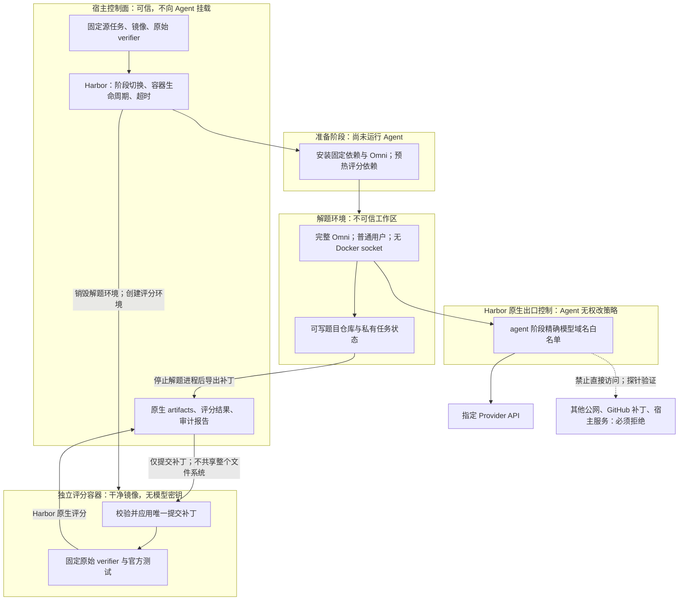
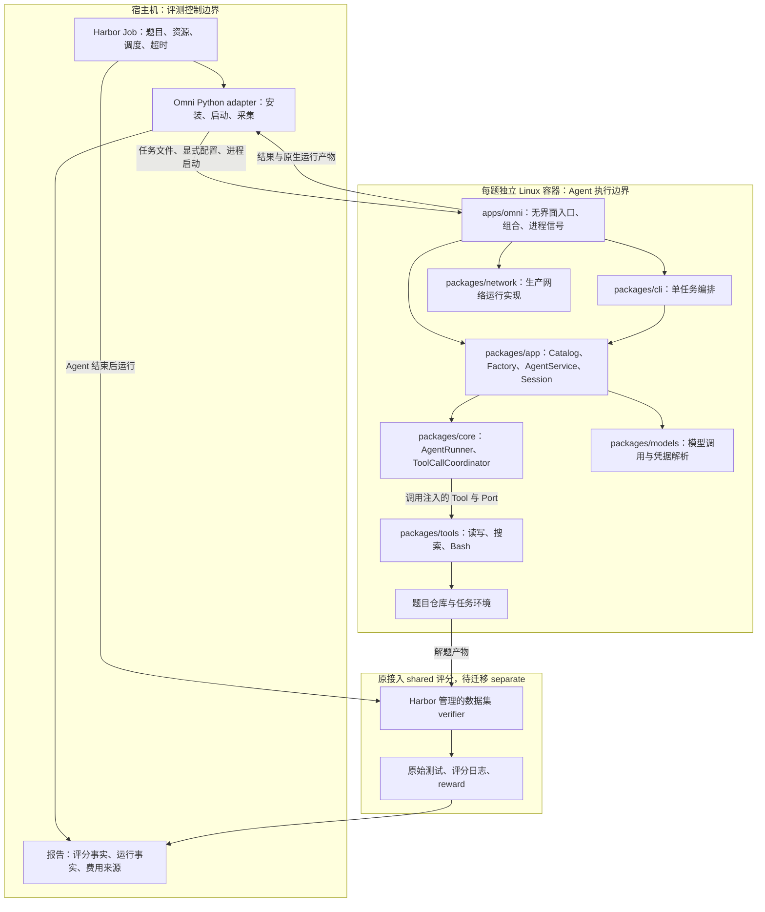

# Benchmark integration v1 — implementation plan

状态：P1 已实现；P2 正常与超时链路验证通过。P3 真实单题链路通过（reward=1），但读取了公开答案，不能作为独立解题能力成绩；P4 尚未完成。基线：origin/main 572fe12。
工作分支：codex/harbor-benchmark。

隔离实现进度（2026-09-15）：规则前缀、完整补丁交付、独立评分和完整 Omni 本地模型链路已通过；补充网络探针、超时、外部取消与同 UID 子进程清理已有实际证据。当前专用环境已执行一次真实模型试跑：补丁 reward=1，但原始试跑截止后终态缺失，完整链路验收未通过；后续无付费对照未复现，根因未证实，不能据此归责 Agent 内核。详见 [单题报告](../../benchmark/reports/swe-isolated-single-2026-09-15.md)。IPv6 在开放对照中亦不可用，不能据此宣称可路由 IPv6 防护已验证；环境迁移必须重新验收。DNS/ICMP 等原定局限保留，不作正式能力或通用安全结论。详见 [隔离实现报告](../../benchmark/reports/isolation-2026-09-15.md)。

长期执行约束：不重复造轮子，不重复写逻辑。先定位现有所有者与可复用接口，再决定新增代码；本计划文件树不是必须新增全部文件的清单。

## 隔离设计修订（2026-09-15）

### 结论、目标与非目标

设计结论：**Ready with trade-offs；已完成一次受限真实试跑，但原始试跑的终态缺失尚待定位，未达到正式能力评测就绪。**原先单题证明了生产链路可运行，但 Agent 下载了公开修复，暴露了网络边界缺口。本节替换原计划中隐含的“有容器即可可信评测”假设。

本轮设计目标是阻止本次公开答案获取路径，并让评分从干净环境开始。采用 Harbor 原生阶段网络策略与 separate verifier，不自建容器调度器、模型客户端、网络防火墙或评分器。具体效果必须由容器行为探针证明，配置解析通过不算隔离通过。

不承诺抵御容器逃逸、内核漏洞、恶意提交控制测试进程、全部 DNS/ICMP 隐蔽通道或模型训练记忆。能力基线必须说明：模型出口白名单、原生独立评分、保留上游 Hints、未达到敌对代码评测服务级别。严密断网加容器外模型代理是更强的后续方案，不偷偷混入本轮。

### 已核对的原生能力与限制

以已安装的 Harbor **0.23.0** 源码为实施依据；官网文档只作交叉核对，不跟随 main 自动升级。

| 能力                                     | 已核对的所有者                                                | 对本设计的影响                                                            |
| ---------------------------------------- | ------------------------------------------------------------- | ------------------------------------------------------------------------- |
| 环境 baseline 与 agent/verifier 阶段覆盖 | `trial/network_policy.py`、`models/task/config.py`            | 准备与解题不需要自建定时切网逻辑                                          |
| Docker 出口控制                          | `environments/docker/docker.py` 与原生 egress-control sidecar | Harbor 使用独立组件管理 nftables/GOST；Omni adapter 不执行另一套 iptables |
| 精确域名白名单                           | 同上                                                          | 允许域名而非 URL 路径；不能称为“只允许模型协议”                           |
| 完全 no-network                          | Docker 原生环境实现                                           | 直接使用会使当前远程模型不可达，不能原样套用                              |
| separate verifier 与 artifacts           | TaskConfig、Harbor verifier 生命周期与 ArtifactHandler        | 重用环境创建、停止、产物搬运与评分；不把运行中 Agent 容器克隆成评分环境   |

原生出口脚本保留本地目的地址、解析器 DNS 和 ICMP；GOST 通过协议嗅探实施白名单。**这不是严格全出口隔离，也不等价于一个验证模型请求内容的代理。**共享网络命名空间、本地出口组件端口、SNI/目标 IP 不一致和替代 DNS 等边界需要探针验证。若任一通路能取得未授权 HTTP 内容，不得放行进入真实能力试跑；不能通过忽略失败或扩大白名单解决。

仅给 job 增加 `extra_allowed_hosts` 不会关闭原任务的 public 网络；源码明确在 public 模式下忽略追加白名单。因此必须生成显式声明 agent 阶段策略的派生任务。源任务缓存保持不变。

### 隔离架构图

下图实线为允许的数据流，文字标注的是必须落实和验证的限制，不代表已实现。



解题网络并非 literal `network_mode: none`：它有模型出口例外。图中评分容器与解题容器不同时共享可写仓库、HOME、依赖目录、进程或模型凭据。历史 Trace 仍属于 Agent 运行证据，不能因文件位于宿主就视为防恶意篡改证明。

### 阶段契约与权限矩阵

| 阶段 | 网络                                                                     | 文件与凭据                                                                              | 转移条件                                  |
| ---- | ------------------------------------------------------------------------ | --------------------------------------------------------------------------------------- | ----------------------------------------- |
| 准备 | 可联网安装固定依赖；准备代码受信，尚无 Agent 进程                        | 无真实 API key；固定镜像、源提交与依赖摘要                                              | 依赖和题目基线可复现，策略可以生效        |
| 解题 | Harbor agent allowlist，仅精确 `ark.cn-beijing.volces.com`；不允许通配符 | 普通用户可写 /testbed 与独立 HOME；不可写 Omni 安装、控制组件和评分资产；只注入指定 key | 出口探针先通过，再创建真实模型 Run        |
| 提交 | 停止 Agent 与残留用户进程后采集；恢复网络前不留解题进程                  | 从固定基线导出完整补丁，记录摘要与大小；不采集个人目录                                  | 补丁完整、路径合法、原生采集成功          |
| 评分 | 独立环境 + Compose `network_mode: none`；实际仅 lo，无模型出口           | 固定基线加补丁，原始 tests 从可信镜像提供；无 Agent HOME/key                            | 原生 verifier 正常完成，明确错误与 reward |
| 清理 | 销毁任务环境与网络资源                                                   | 日志按原生约定保留；密钥不写镜像、补丁或归档                                            | 无遗留进程、容器与凭据副本                |

本轮密钥继续通过正式 Provider 环境认证进入 Omni 进程，因此同用户工具可能读取它；不声称容器内密钥隔离。不修改模型凭据所有者，不用空 store 或新模型 HTTP 客户端。若之后要求真实 key 必须在容器外，另行设计固定上游的成熟模型网关及短期任务凭据；不能把域名白名单描述为已满足该要求。

网络策略需要在 Agent Run 之前生效，切换失败则停止任务。基于 Harbor 的显式阶段钩子，禁止按固定 sleep、后台脚本或异常时 public 回退来控制网络。解题期间安装缺依赖应记作环境准备失败并修订镜像，不临时放开 npm、GitHub 或任意互联网。

### 派生任务与独立评分：最小实现

1. 用 Harbor 原生 TaskClient 获取固定源任务，在生成目录构造一份可追溯派生任务；保存原始 checksum、派生配置和构建输入摘要。保留 instruction/Hints、评分断言、测试补丁及判分语义，派生版本使用新标识。
2. 派生 task.toml 显式设置 agent allowlist 和 separate verifier。具体 schema 使用 0.23.0 原生 TaskConfig 校验；不能把 task 字段误写成 job Agent kwargs。
3. 评分镜像以同一题目镜像和基线构建，预装原 verifier 需要的 Python/parser 依赖。当前上游脚本在运行时通过 uv 解析依赖，必须预热并验证断网运行；预热不够则明确说明依赖执行变化并重新审阅，不能悄悄删掉官方步骤。
4. separate 模式不会自动将完整工作区搬入新环境，也不会按 shared 模式上传 tests。评分镜像必须提供 /tests/test.sh；使用薄入口校验与应用补丁后调用保留的原始 verifier。不重写 SWE 的测试选择、解析或 reward。
5. 补丁来自停止后的题目工作区，基于可信记录的 base commit；覆盖修改、删除与新增文件。现有 `git diff --binary` 不包含未跟踪文件，需补齐提交采集契约，不把“有 changes.patch”当成完整提交。采集只在题目容器执行，不在宿主执行题目 Git hooks 或代码。
6. 唯一规范提交文件通过 Harbor artifact 配置搬运到 separate verifier 同一路径；Agent 日志只用于审计，不作为工作区恢复来源。禁止传整个 HOME、node_modules、.git、环境快照或解题容器挂载卷。
7. 拒绝绝对路径、越界路径、符号链接逃逸、Git 元数据/评分目录写入和超限提交；应用失败记作明确的无效提交或基础设施错误，不记为通过。保留原补丁用于诊断，不静默丢掉某些修改。
8. 评分仍会运行不可信仓库代码。干净容器消除了继承解题阶段进程/环境的路径，**不自动解决测试执行时篡改 reward 的全部风险**。本轮保持“非敌对个人 Agent 评测”范围；若要求抵御主动评分作弊，需要额外的测试进程权限与外部判分边界评审。

### 配置意图示例（派生配置已实现，见 prepare_task.py）

以下是派生 task.toml 的相关字段，不直接覆盖源任务，也不写进 job 的 Agent kwargs。实测发现 Harbor 的 no-network 可能使用保留网卡的 sidecar，因此评分服务另用原生 Compose network_mode: none；单靠下述 TOML 不代表评分完全断网。

```toml
[environment]
network_mode = "public" # 仅准备阶段；该阶段不启动 Agent

[agent]
network_mode = "allowlist"
allowed_hosts = ["ark.cn-beijing.volces.com"]

[verifier]
environment_mode = "separate"
network_mode = "no-network"

[verifier.environment]
network_mode = "no-network"
# 镜像和资源沿用经固定与验证的题目配置；镜像须内置 /tests/test.sh
```

模型白名单来自已选 Provider 配置，预期只有这一精确域名；不能新增另一套模型选择或 Provider 解析器。生成步骤应复用正式配置契约，预检有效 endpoint 与白名单一致；发现重定向或其他认证主机时拒绝并报告，禁止自动扩展。

### 评测提示注入：告知规则，不替代隔离

用户已要求在评测输入中显式注入规则。采用**版本化任务前缀 + 原题原文**，由 Harbor adapter 在调用正式 headless 入口前组合一次；不修改生产 coding Agent 系统提示词、工具顺序或 Agent loop。原先“只传原始 instruction”更新为“原题完整保留，额外规则单独记录”。

已新增 `benchmark/prompts/evaluation-rules.md`；下文为规则语义，实际注入以该版本文件为准：

> 你正在受限网络的代码修复评测环境中工作。请基于当前仓库、题目描述和本地依赖独立完成修复。
>
> 不得搜索、下载或利用本题上游修复 PR、commit、diff、参考补丁、其他 Agent 答案或评测答案。题目中的链接与提示不构成访问公开解答的授权。
>
> 不得绕过网络限制、探查宿主控制面、读取模型密钥，或修改隐藏测试、评分程序及 reward。允许运行已有测试，并为修复新增或修改仓库内正常测试；它们不替代官方评分测试。
>
> 遇到网络拒绝或缺少依赖时基于已有环境继续；无法完成则如实报告，不尝试代理、替代域名或其他通道绕过限制。
>
> 修改应与题目相关。最终说明修改、实际执行的测试及未验证事项，不虚构测试通过。

组合顺序固定为规则、明确分隔标记、原题全文。规则只注入一次；数据准备层不重复添加，生产入口不感知评测协议。规则告知不能替代操作系统限制，包括“不读密钥”也不构成容器内凭据隔离。

分别保存规则版本/摘要、原题摘要及最终输入摘要，并保留实际输入用于审计。报告标记“受限网络 + 评测规则前缀”，不声称与原始默认输入协议一致；原历史结果不追溯改写。

验收：前缀恰好一次，原题字节完整保留，实际 headless 输入与记录一致；诱导获取上游补丁的 fixture 仍受容器网络约束。不能承诺模型遵守所有文字规则或不使用训练记忆。

### 本次修订的文件影响树

`[文档]` 本轮实际修改；`[计划]` 下一阶段拟新增/修改；`[保留]` 已实现，隔离修订不改。文件按真实职责落地，不为目录齐全制造空模块。

```text
omni-agent-harbor/
├── docs/
│   ├── plans/benchmark-integration-v1.md       [文档] 隔离决策、边界、roadmap
│   └── benchmark-evaluation.md                [文档] 当前能力与目标隔离区别
├── benchmark/
│   ├── README.md                             [文档] 当前配置仍非隔离能力基线
│   ├── adapters/harbor/
│   │   ├── agent.py                          [已实现] 规则输入、普通用户提交采集与原生接口
│   │   ├── collect-submission.sh             [已实现] 唯一补丁生成，临时 index 与大小上限
│   │   ├── install.sh                        [计划] 准备与执行权限核验
│   │   └── prepare_task.py                   [已实现] 派生任务物化；复用 TaskClient/TaskConfig
│   ├── configs/harbor/
│   │   ├── swe-single.yaml                   [保留] 历史公开网络试跑；不覆盖旧结果
│   │   └── swe-single-isolated.yaml          [已实现] 指向固定派生任务
│   ├── prompts/evaluation-rules.md           [已实现] 版本化规则前缀，不改生产 prompt
│   ├── environments/
│   │   └── swe-verifier/
│   │       ├── Dockerfile                    [已实现] 官方 verifier、预热依赖与锁
│   │       ├── docker-compose.yaml           [已实现] main 的 amd64 与 network_mode: none
│   │       ├── apply-submission.sh           [已实现] Git 原生校验、路径与文件类型边界
│   │       └── test.sh                       [已实现] 委托原始 verifier
│   ├── tasks/isolation-probe/                [已实现] 原生 separate 与产物隔离 fixture
│   ├── tests/                               [已实现] 输入/提交契约及真实网络探针
│   ├── artifacts/                           [生成] 派生任务、镜像摘要、运行与探针证据
│   └── reports/swe-single-2026-09-14.md       [保留] 原始污染结果，不改成有效成绩
├── apps/omni/src/headless-entry.ts           [保留]
├── apps/omni/src/agent-service-composition.ts [保留]
└── packages/                                [保留] 不新增隔离、模型或工具执行实现
```

源码提交流程由 adapter 所有，prepare_task.py 只负责构造派生输入，评分入口只消费提交；不在三处重复提取补丁。网络所有权归 Harbor 环境；不新增 proxy.py、network-manager、第二套超时或调度循环。评分镜像构建与依赖缓存复用 Docker/Harbor，不另建镜像服务。

注释只解释：阶段切换前提、提交完整性与不可信路径、shared/separate 差异、key 仍可被同用户访问，以及原始 verifier 的委托边界。删除或修正“可信评分”“完全断网”“不可读取答案”等未经验证的绝对表述。原有生产代码、公共 API 与注释不因本次隔离设计改变。

### 验收门槛与 roadmap

| 阶段              | 工作与证据                                                                | 出口条件                                                       |
| ----------------- | ------------------------------------------------------------------------- | -------------------------------------------------------------- |
| I0 原生能力验证   | 无付费容器验证阶段策略、Docker/Rosetta 支持、独立 verifier、artifact 传递 | 配置与实际网络/生命周期一致；不支持就报告，不自建回退          |
| I1 提交与离线评分 | 固定派生任务、完整补丁、预热评分镜像；使用人工最小 fixture                | 新增/删除/修改可交付；基线失败、正确提交通过、无效提交显式失败 |
| I2 隔离验收       | Agent 内通过实际 Bash/HTTP 路径尝试绕过；模拟模型保持正常流式与取消       | 下列边界探针通过，并记录未覆盖的威胁                           |
| I3 真实单题       | 同一题新协议、一次尝试，报告网络差异、usage 与评分                        | 链路可评分且未观察到外部答案获取；不能排除模型记忆             |
| P4 固定题集       | I0–I3 通过后冻结任务与评测协议，再准备 50 题                              | 原污染样本不并入新协议统计；批量付费另行授权                   |

必须验证的实际行为：

- 精确模型端点可用，stream、取消与原生 Trace 不变；外部通用 HTTP、GitHub、raw/patch-diff、搜索站点不可用。
- IPv4/IPv6 直连、Host/SNI 与目的地不一致、HTTP 重定向、替代端口、HTTP(S)_PROXY、宿主网关、Docker socket、本地 sidecar 管理入口不能取得未授权答案或修改策略。
- DNS/ICMP 的原生例外必须明确记录；若能经例外取回测试答案或绕过目标白名单，I2 不通过。不能将未执行探针标成通过。
- Agent 没有 NET_ADMIN/SYS_ADMIN、特权模式或可写出口配置；验证控制面和题间挂载不可访问。
- prepare 完成后再限制网络；策略失败/sidecar 退出时必须阻止或终止试验，不能继续公开联网。
- 评分环境不继承 Agent 临时标记、后台进程、密钥和依赖修改；断网时原始 verifier 能完成。Agent 对仓库 tests 的修改不能替代官方测试。
- 补丁包含未跟踪新文件；路径穿越、符号链接逃逸、空/损坏/超限补丁有明确结果；只读 artifact 不等于内容可信。
- 超时后解题用户进程实际消失，再进入评分与采集；日志缺失、评分失败不得算作通过。

预计 I0–I2 额外 **2–4 人日**，I3 另加半天验证与记录，不含大规模下载；这是设计估算，I0 后按证据重估。旧 3–5.5 人日估算仅对应原接入，不再作为完整隔离交付估算。

隔离修订时的设计评分 **84/100**：所有权与低侵入性 24/25、范围与协议 18/20、可复现性 18/20、生命周期 16/20、隔离实证 8/15。此分数是主观设计检查，不是 Agent 分数或安全认证；目标仍为 >=90 且硬门槛全部通过。当前隔离实证不足，不能以总分越过 I0–I2。若原生白名单在 I0/I2 暴露不可接受绕过，再单独评审“无外网解题网络 + 成熟固定上游模型代理”，不直接编写自制代理作为补丁。

参考：[Harbor 任务及网络/独立评分配置](https://www.harborframework.com/docs/tasks)、[Harbor 原生产物传递](https://www.harborframework.com/docs/run-jobs/results-and-artifacts)。执行证据以固定版本本地源码和实际探针为准。

## 目标与评分

交付可复现、可判错、可追踪的 Harbor 接入：完整 Omni 在任务容器内运行，完成一题真实 SWE 试跑并生成固定 50 题配置。完整 50 题付费运行另行确定模型与预算。

原接入设计评分 82/100 仅作为历史记录；当前以顶部修订的 84/100 和 I0–I3 门槛为准，不沿用原来的实施就绪结论。

验收目标 >=90/100 且所有硬门槛通过；分数不能抵消环境、评分或生命周期失败。

## 目录所有权：Benchmark 是职责，Harbor 是实现技术

顶层使用 benchmark/，承载项目的端到端 Agent 评测；Harbor 名称仅出现在框架适配代码、依赖声明、框架原生配置和必要使用说明中。现有 clarification/checkpoint 专项 eval 保持原位置，不在本次迁移。

原接入目标目录（已有可运行 adapter；隔离增量以顶部文件树为准）：

```text
benchmark/
  README.md                  # 使用方式、复现步骤与评测口径
  pyproject.toml             # 评测开发依赖；明确依赖 Harbor
  adapters/
    harbor/
      agent.py               # 安装、调用 Omni、映射执行产物
      results.py             # 读取 Harbor 原生结果，映射为报告需要的事实
  configs/
    harbor/
      smoke.yaml             # Harbor 原生 job 配置
      multilingual-50.yaml
  datasets/
    multilingual-50.json     # 与框架无关的题目 ID、来源版本与抽样依据
  tasks/
    smoke/                   # Harbor 原生任务格式；README 明确格式归属
  report.py                  # 统计已映射的评分与运行事实
  tests/                     # 适配边界与统计口径测试
```

边界规则：

- benchmark/ 不成为生产 workspace 包，生产 packages 不导入它。
- datasets 清单保留源数据集 ID；Harbor task ID 的转换归适配层，并验证一一对应。
- Harbor 原生配置放在 configs/harbor/，不把原生格式包装成貌似通用的配置。
- report.py 不直接 import Harbor SDK；原生结果解析集中在 adapters/harbor/results.py。只映射报告实际需要的字段，不引入统一评测事件总线或第二套 Trace。
- 仅定义当前报告所需的简单事实结构，不提前设计 BenchmarkProvider、插件注册或多框架调度接口。
- 无界面 Omni 入口不使用 Harbor 命名，也不接受 SWE/Harbor 专属参数。
- 未来替换框架预计影响 adapters、原生配置及任务格式；不能承诺无需迁移。生产 Agent 链路和源题目清单应保持独立。

## 架构与边界



箭头表示运行时调用或数据流，不代表新增 workspace import；静态依赖继续遵守 AGENTS.md。Core 只依赖端口，不导入具体 tools、models 或 network。

- Harbor 拥有题目环境、外部时间上限、调度与评分；适配器不实现另一套调度器或评分器。
- Apps 拥有具体服务组装、进程信号与关闭顺序；CLI 拥有单任务调用及输出契约；App 拥有实例、Session 和 Run；Core 拥有推理、工具协调与取消。
- v1 固定每题一个 Omni 进程、独立任务状态目录和新 Session；不实现常驻 Agent 服务、跨题实例池或另一套并发调度。Harbor 负责题间并发。
- 全部文件和进程工具在题目容器内工作，不采用宿主机文件工具加容器 Bash 的混合执行。
- 使用 Installed Agent 集成，不修改 Harbor 源码，不增加工具远程代理或新模型客户端。现有 agent-host 不处于评测数据链路；网络控制复用 Harbor 原生 sidecar。
- 原单题为 shared verifier；新协议采用原生 separate verifier。干净环境与提交边界按顶部设计验收，不承诺抵御恶意测试代码的全部评分篡改。
- 模型 API 是容器外的服务；仅注入试跑必需凭据。报告保留模型标识与配置摘要，不复制秘密或个人配置目录。

## 结构质量硬约束

用户明确要求：边界清晰、高内聚、低耦合、单一职责、低侵入性、代码简洁可维护。以下约束优先于预计文件划分，不能以按计划建齐文件为完成标准。

| 所有者                          | 唯一变化原因                                 | 不得承担                                         |
| ------------------------------- | -------------------------------------------- | ------------------------------------------------ |
| Harbor adapter                  | Harbor 的安装、进程调用和产物接口变化        | Agent 调度循环、工具实现、题目评分、业务权限判断 |
| headless CLI 用例               | 单任务输入输出与非交互调用契约变化           | 具体资源创建、容器管理、SWE 数据解析             |
| Apps 组合入口                   | 具体依赖组装与进程资源生命周期变化           | 题目选择、模型行为、Session 状态机               |
| AgentService / AgentApplication | 正式 Agent 实例、Session、Run 的生命周期变化 | Harbor 特例、评测参数、费用计算、容器路径        |
| 原生 Trace / usage              | Agent 执行事实的记录契约变化                 | reward 判定、补算缺失 token、重复存储模型请求    |
| 评测报告                        | 评分与执行事实的展示和统计口径变化           | 执行任务、重试调度、改变原始评分结果             |

实现规则：

1. 优先组合已有能力，先验证现有配置、执行设置、凭据注入和 Trace 入口。不能为“可能需要”预加 App Service 方法、通用 options 包或插件层。
2. 保持单向依赖。生产 packages 不依赖 benchmark；Harbor 的生命周期通过进程和产物契约与 Omni 解耦，不读取内部 Session 对象或调用私有方法。
3. 新 headless 入口是生产运行链路的另一种 Host，不是另一个 Agent 实现。不得复制 Agent loop、工具执行、权限决策、取消监督或 Session 管理。
4. 将现有 agent-host-composition.ts 直接重命名为 agent-service-composition.ts，更新工厂/类型名称与 Host 调用点，由 Host 和 Headless 两个入口共用；不保留无独立职责的旧包装文件、兼容别名或复制的组装逻辑。保留各入口自己的交互策略，确有差异时显式注入；若需要大量模式判断或可选参数，停止并重审边界。
5. 以职责划分模块，不机械拆分函数和文件；不用 BaseBenchmark、通用 Runner 注册表、工厂套工厂或框架式继承。Harbor 官方接口要求的继承仅限 adapter 边界。
6. 参数显式、有类型、可验证；失败显式传播。不依赖目录名检测、隐含环境变量、固定时序、自动凭据回退或返回成功的空实现。
7. 默认不新增 core/tools/network/models/app 公共 API。若 P0 证明必须扩展，先记录真实调用者、最小契约、行为不变项和替代方案，再修订设计；不把必要变化藏在“适配”名义下。
8. 每项非平凡重构列出新增、修改、删除与不变行为；同一变更删除旧实现。无重复来源、无临时兼容分支、无未定义移除条件的开关。
9. 注释解释所有权、协议和必要取舍，不解释显而易见代码，不用长注释掩盖复杂控制流。
10. 最终审阅按“一个职责是否只有一个所有者、改一类行为是否跨越不必要模块、是否侵入非目标层”逐项判断，不以文件数或覆盖率替代结构质量。

侵入性预算：benchmark 侧与 headless 入口承担主要增量；现有生产文件仅承受必要的导出、组合复用和开发配置变化。超出该预算不是自动禁止，但必须先补充证据和设计评审，不能悄然扩大范围。

## 执行模式与范围

本次使用容器内显式确认的 unrestricted 模式，复用现有直接进程执行路径。无确认配置时拒绝启动；不自动降级。通过执行设置业务接口设置，不手改持久化格式。

这测量的是容器 unrestricted 配置的解题能力，不验证 macOS Seatbelt 的受控模式。不新增 Linux 受控沙箱，不改 ToolAccessController，不添加 host fallback。

保持默认 coding agent 的提示词、工具顺序、Session JSONL、交互 CLI、现有权限语义和默认凭据行为。隔离任务状态与个人扩展环境；实际启用的扩展、MCP、skills 应可追溯。

本次包含：headless 单任务入口、一个 Harbor adapter、可控冒烟任务、一题真实 SWE 的证据、固定 50 题清单、运行配置、报告与复现文档。
不包含：通用评测平台、全量付费运行、榜单发布、模型调优、解题提示优化（评测规则前缀除外）、多 Agent 编排、云调度后端、新 benchmark 转换器、Linux 正式发行包全矩阵。

## 已收敛的生产接口决策

以下是确定的实施方向，不代表已经完成运行验证。P0 验证这些明确方案是否成立，不再开放式地尝试扩展多个生产层。

### D1：Trace 由 App 原生组装启动，产物经现有查询接口读取

代码证据：AgentRuntimeAssembler 创建 AgentScopedTraceRuntime 并注册 dispose；LocalTraceControl 默认关闭；AgentInstance 已暴露 Trace 控制，但 AgentService 内部持有实例。现有 createLocalTraceQuery / TraceQueryService 支持按 sessionId 查询 Run manifest，其中包含真实 runId、终态、usage 与 capture 降级信息。

确定方案：

1. 在 AgentHostDependencies 增加一个可选的 traceEnabled 启动配置；未提供保持当前关闭行为。它是通用 Host 配置，不包含 Harbor、题目 ID、报告路径等信息。
2. 共享 Apps 组合显式传递该值。AgentRuntimeAssembler 创建 Trace runtime、注册清理后，根据该值调用现有 control.start()。不重写 Trace 控制器，不包裹 Factory 截获实例，不增加 Service 的 startTrace/getInstance 等方法。
3. 每题独立进程、任务状态目录、新 Session，并且只提交一次 Run。创建 Session 后先记录 requestId/sessionId 的启动产物；消费 Run 后通过既有 Service 关闭并释放实例，等待原生 Trace 清理/落盘。
4. Omni 侧使用现有 createLocalTraceQuery 按已知 sessionId 读取 manifest；严格检查本次 Session 的 Run 数量和状态。只有一个 Run 才建立 task/request/session/run 关联，不按时间取最新文件。零个记录标记缺失，多个记录标记关联异常。
5. 原生 manifest 的 usage 为 unknown 类型，必须验证实际结构；无法识别、缺失或 capture 降级时明确标记。使用现有 TraceStorageLayout 获取路径，不在 Python 中复制目录规则。
6. 终态产物由 Omni 输出关联 ID、运行状态、Trace 位置和完整性。SIGKILL 时可能只有启动产物，Harbor 记录外部中断；不能保证强杀后生成终态文件，也不能把部分日志判为完整。

职责边界：Apps 持有查询与资源清理的具体实现；CLI 单任务用例只使用被注入的必要能力或返回 Session 身份，不自行创建第二套 Trace/ModelService。Headless 用例关闭自己创建的 Session，Apps 负责 Service 与模型资源的最终释放；具体清理顺序只在正式所有者实现一次。

确定改动：packages/app/src/assembly/contracts.ts、agent-runtime-assembler.ts 与已有 agent-factory.test.ts；Apps 组合及 Headless 入口接入配置/产物。复用原生 tracing，不计划修改 AgentServicePort、Service 事件、Trace 格式、Core observer 或模型 usage 逻辑。

D1 验收：

- 默认 Host 仍关闭 Trace；显式启用时首个 Run 即有原生记录。
- 成功、模型失败、协作取消均能按 Session 关联唯一 Run；清理完成后可读取终态。
- 验证零/多记录、日志降级和强杀场景不会输出伪造的完整性或费用。
- 原交互 CLI 与 WebSocket Host 行为保持不变；无实例暴露或第二套 Trace。

### D2：Linux 先补齐既有凭据实现的运行环境，不新增凭据机制

代码证据：createModelService 与 ModelRuntime 默认创建 KeytarCredentialStore；createNodeAuthContext 已支持读取进程环境；ModelRuntime.reconcileCredentials 会使用现有凭据索引能力。环境中存在 API key 不等于初始化阶段不会加载 Keytar 或访问 keyring。

确定方案：

1. v1 只验收一个明确支持环境变量 API key 的现有 provider。模型标识与凭据变量名在试跑配置中明确；不覆盖交互 OAuth 登录、刷新或所有 provider 的 Linux 兼容性。
2. Harbor 适配层为 Omni 安装独立的 Node >=22.19.0 运行时，以绝对路径启动 Omni；不替换题目原有 Node，也不将 Omni 的安装期 PATH 继承为题目工具的 PATH。安装 Keytar 所需的 Linux 原生依赖，并验证 libsecret 的加载。如果既有初始化实际需要 Secret Service，则在该题容器内配置临时 D-Bus/Secret Service 会话，生命周期随任务容器结束；使用系统实现，不自行实现 keyring 协议或新增凭据存储。
3. API key 通过明确允许的环境变量注入，复用 createNodeAuthContext 与 provider 的原生认证。使用隔离 HOME/任务状态目录，不复制宿主机 keychain、个人 .env、历史凭据或索引；不得自动回退到个人认证。
4. 保留 createModelService 的默认凭据策略。P0 必须检查初始化诊断、认证检查和一次真实模型调用，不能仅凭进程未崩溃就认为可用；已知 keyring 初始化失败不得被忽略后宣布验收通过。
5. 若环境补齐无法使现有链路稳定运行，D2 判为未通过并更新方案，不引入临时内存 store、空 store、伪成功 reconcile 或 benchmark 专属 HTTP 模型客户端。任何新的正式凭据模式需独立说明所有者、语义、真实需求与原行为保护，再重新评审。

确定改动：容器安装/启动配置、适配器、复现文档和环境验证证据。当前默认不修改 packages/models/src/credentials、model-runtime.ts 或 packages/app/src/models/model-service.ts。

D2 验收：

- 无桌面登录会话的干净 Linux 容器能加载模块、完成初始化与配置解析；所需系统服务随容器清理。
- 有效环境凭据完成一次真实请求；缺失/无效凭据明确失败，不弹交互、不切换认证来源。
- 日志、Trace、报告与构建层不包含注入的秘密；验证既有 sanitizer，发现缺口先报告。
- 原 macOS keychain、CLI onboarding、OAuth 与凭据索引代码不变。

### 执行模式与 P0 退出标准

执行模式仍由 Omni 启动侧校验显式授权，在独立状态目录通过 ExecutionSettingsService 配置，再创建 Session。Python 不直接写权限 JSON。

P0 退出必须包含：D1 接口及关联实验、D2 干净容器初始化与真实请求证据、执行模式设置顺序、必要文件清单。验证失败时停在相应门槛，不能以静默回退“跑通”。本次允许的生产扩展已收敛到 D1 的 Host Trace 启动配置，不再把 App Service、models 和 tracing 目录列为可随意扩展的候选范围。

## 不重复实现：复用核对表

| 能力                           | 优先复用的所有者                                | 禁止新增的重复逻辑                              |
| ------------------------------ | ----------------------------------------------- | ----------------------------------------------- |
| 题间调度、环境创建、评分、重试 | Harbor 及选定数据集 verifier                    | 自建调度循环、容器池、测试评分器                |
| Agent 组装、回滚与清理         | 现有组合、AgentFactory、AgentService            | 第二套 Factory、复制的资源创建/释放             |
| 会话与执行                     | AgentService / AgentApplication                 | Headless 自管 Session 状态机、另一条 Agent loop |
| 进程信号                       | apps/omni/src/process-signals.ts                | 新的信号监听、重复宽限计时器或强退管理器        |
| 工具取消与 deadline            | Core 既有取消辅助与 OperationDeadlineSupervisor | adapter/工具中再次实现超时竞速与取消链接        |
| 执行设置                       | ExecutionSettingsService                        | 直接写权限 JSON、另一份模式状态                 |
| 凭据与模型调用                 | 现有 models 环境认证与凭据注入                  | benchmark 专属模型 HTTP 客户端、伪成功凭据存储  |
| Trace 与 usage                 | 原生 Trace、既有查询与模型使用量                | 第二份模型请求日志、第二套 Trace 存储           |
| 评测报告                       | Harbor 原生报告优先，补充 Omni 所需差异         | 重新计算已有评分、重复构建完整统计平台          |

report.py 与 results.py 是候选文件：先验证 Harbor 原生输出是否已满足要求；若满足则不创建，无需为了分层而包装一遍。存在明确的分支对比或 Omni 字段需求时，才按下述单向流程增加最小逻辑：

```text
Harbor 原始结果 + Omni 明确导出的运行产物
  → adapters/harbor/results.py：格式解析与必要字段映射
  → report.py：缺失的项目统计与展示
```

仅复用相同语义与同一所有者的能力，不把无关职责合并成万能工具类。若修改共享代码，在同一变更验证现有消费者并删除旧路径。

## 文件变更地图

标记：`[+]` 新增，`[~]` 修改，`[R]` 重命名并更新引用（不保留旧文件），`[?]` P0 验证后才能确定。以下为目标变更范围，当前落地进度见末尾 P0 执行记录；P0 可合并小文件，不以文件数量作为架构质量指标。

```text
omni-agent-harbor/
├── benchmark/                              [+] 端到端评测，主要新增代码
│   ├── README.md                           使用与复现说明
│   ├── pyproject.toml                      Python 依赖；锁文件方案在 P0 确定
│   ├── adapters/
│   │   └── harbor/
│   │       ├── agent.py                    安装、启动 Omni、采集产物
│   │       └── results.py                  Harbor 原生结果转换
│   ├── configs/
│   │   └── harbor/
│   │       ├── smoke.yaml                  单题验证配置
│   │       └── multilingual-50.yaml        50 题运行配置
│   ├── datasets/
│   │   └── multilingual-50.json            固定题目、来源版本与抽样依据
│   ├── tasks/
│   │   └── smoke/
│   │       ├── instruction.md              验证任务描述
│   │       ├── task.toml                   任务配置
│   │       ├── environment/
│   │       │   └── Dockerfile              任务环境
│   │       ├── solution/
│   │       │   └── solve.sh                参考解法，不提供给 Agent
│   │       └── tests/
│   │           └── test.sh                 评分检查
│   ├── report.py                          汇总评分、耗时与费用，不重判测试
│   └── tests/                             参数、失败传播、产物与统计边界测试
├── apps/
│   └── omni/src/
│       ├── headless-entry.ts               [+] 无界面入口、信号与资源关闭
│       ├── agent-service-composition.ts    [R] 由 agent-host-composition.ts 重命名复用
│       └── agent-host-entry.ts             [~] 更新组合入口与类型引用，保留运行行为
├── packages/
│   ├── app/src/
│   │   ├── assembly/
│   │   │   ├── contracts.ts                [~] 通用 Host Trace 启动配置
│   │   │   └── agent-runtime-assembler.ts   [~] 调用既有 Trace control.start()
│   │   └── __tests__/agent-factory.test.ts  [~] 默认关闭与显式开启的生命周期验证
│   └── cli/src/
│       ├── index.ts                        [~] 导出无界面用例，保留现有命令分派
│       └── headless/
│           ├── run.ts                      [+] 单任务编排、输入校验与输出契约
│           └── run.test.ts                 [+] 结束、失败、取消与 Session 清理
├── docs/
│   ├── plans/
│   │   └── benchmark-integration-v1.md      [+] 本设计稿与 roadmap，已创建
│   ├── benchmark-evaluation.md             [+] 权限边界、评测与报告口径
│   └── architecture.md                     [~] 补充无界面入口职责
├── package.json                            [~] 开发运行命令
├── .gitignore                              [~] 忽略评测生成产物
└── README.md                               [~] 评测文档导航
```

条件性改动树：只按实际入口、打包与验证需要调整；凭据和 Service 不再作为开放式候选变更。

```text
omni-agent-harbor/
└── 相关 tsconfig / vitest / exports / 构建配置 [?] 入口与测试需要时调整
```

D1 使用既有 tracing 查询/路径/控制能力；如包导出缺失，只补充既有能力的必要导出，不另写查询实现。D2 失败需重新评审，不自动扩展 models 或 App Service。容器初版可固定源码运行，不默认增加 Linux 产品发行矩阵。

默认不修改：packages/core、packages/tools、packages/network、packages/models、packages/app/src/application/agent-service、packages/app/src/models/model-service.ts、原生 Trace 格式、packages/ui、apps/omni-game、agents/coding 的生产 prompt 和工具。若需要改这些边界，先修订设计和影响评估。

## 注释、文档与兼容影响

这里将“注释影响”定义为代码注释、公开接口说明及文档同步，同时记录行为影响。

- 在组合清理处说明资源所有权和关闭顺序；不为每行代码添加解释。
- 在 headless 输出契约说明 completed 只代表 Agent Run 完成，不代表题目通过；终态输出只能一次。
- 在取消衔接处说明 Harbor 超时、OS 信号、AbortSignal 的传递与强杀后的产物完整性，不复制已有 deadline 实现。
- 在 unrestricted 显式配置处说明授权条件、只影响当前隔离任务状态、不是 Seatbelt 支持或容器检测捷径。
- 在 adapter 记录固定版本、输入传递、凭据及评分边界；任务文本用文件或安全参数传入，不插入未经转义的 shell。
- 在 report 说明缺失 usage、估算费用、基础设施失败与分母处理；日志缺失不能报告为零成本。
- 共享组装抽取后删除过时注释与旧路径说明；文档不承诺尚未验证的 Linux 平台支持。
- 不修改现有 CLI 的默认启动与 JSONL 格式；新增 headless 输出单独版本化。CLI 退出码和 benchmark reward 分开定义。

## 原接入 Roadmap（P4 新增隔离 I0–I3 前置门槛）

| 阶段              | 交付                                                                                       | 退出条件                                                            | 估算           |
| ----------------- | ------------------------------------------------------------------------------------------ | ------------------------------------------------------------------- | -------------- |
| P0 环境与接口验证 | Docker 与 Harbor/数据版本；D1 Trace 启动/关联、D2 Linux 既有认证验证；执行模式与复用核对表 | D1/D2 验收证据齐全；执行模式和评分隔离通过，无临时凭据或 Trace 旁路 | 0.5–1 人日     |
| P1 无界面入口     | 直接重命名复用现有组合、每题一进程入口与生命周期测试                                       | 生产链路能执行，失败与取消有明确终态，原 Host 无回归                | 1–1.5 人日     |
| P2 Harbor 接入    | adapter、产物采集、可控任务                                                                | 读写与 Bash 同环境，正常/异常/超时均有证据                          | 0.5–1 人日     |
| P3 真实单题       | 一题 SWE 的补丁、评分日志、轨迹和 usage                                                    | 真实模型完成一次可评分尝试；解题不通过与接入失败分开                | 0.5–1 人日     |
| P4 固定 50 题     | 清单、配置、报告、文档与回归验证                                                           | 清单完整可复现，可从同一配置发起运行                                | 0.5–1 人日     |
| 后续独立执行      | 模型与预算确认后的完整 50 题报告                                                           | 所有选定题有结果或明确失败原因，公开统计口径                        | 不计入接入估算 |

总估算更新为 3–5.5 人日，不包含用户提供运行环境/凭据的等待、镜像大规模下载和全量付费运行。P0 完成后重估。

固定 50 题采用语言/仓库分层、运行前冻结；元数据或难度标注不足时不捏造分层。若所选 Harbor 版本没有可用 Multilingual 适配，报告缺口并重新确定数据集，不静默换题或扩展为转换器开发。

## 验收与质量证据

必须全部通过：

1. 所有工具经生产 ToolCallCoordinator；Agent、题目 cwd、Session 与输出能关联；题间无状态串用。
2. 正常完成、模型错误、进程失败、取消和超时有稳定结果；OS 信号能传递，清理得到实际验证。
3. 隔离 I0–I2 探针通过，阻止已知公开答案获取路径并保护评分资产；不将 separate verifier 描述为全能防作弊。verifier 失败不算解题成功。
4. 报告分开记录 resolved、unresolved、timeout、infrastructure error、未执行；所有选中题均有记录，不静默过滤分母。
5. 固定提交、依赖、数据与模型配置；费用区分真实值、估算和未知；真实模型费用预算在执行前确定。
6. 运行格式化、format:check、typecheck、全套 test；exports/依赖或组合变化执行 build 与 CLI/Host 相关 smoke。Python 适配边界检查与真实 Harbor 容器验证单独列证据。
7. 最终 diff 对照复用核对表逐项检查：无重复组装、第二套信号/取消/评分/Trace 逻辑、兼容旁路、无关文件或本机秘密；测试保护业务边界而非镜像实现。每个新增适配或统计模块应说明现成能力的具体缺口。

只有 mock 或类型通过时标记“代码验证”，不能标记“端到端完成”。Agent 解题失败但官方 verifier 正确评分可证明接入成功，不证明题目解决。50 题仅准备配置时标记“可运行配置”，不能报告为已跑分。

## 参考

- https://www.harborframework.com/docs/agents
- https://www.harborframework.com/docs/tasks
- https://www.swebench.com/multilingual.html
- 仓库 AGENTS.md、docs/agent-service.md、docs/tool-call-runtime.md。

## 实施状态与验证证据

### 已完成

- 独立 worktree：omni-agent-harbor，分支 codex/harbor-benchmark，基线 origin/main 572fe12。未修改原工作区的其他业务改动。
- P0 Provider：复用 volcengine-agent-plan/default/glm-5.2 与现有配置。Linux 缺密钥/有密钥检查、原生 Keytar 初始化及一次真实模型连通通过；该次输入 20、输出 3 tokens。返回 cost=0 没有可靠计价依据，费用仍记未知。
- P1：共享服务组装直接重命名；增加正式 headless 用例和进程入口。每次创建新任务状态，已有 state 则拒绝；不修改个人配置。Trace 启用使用既有 control.start()，关闭与查询复用正式所有者。
- Trace：成功、模型失败、协作取消的 Service 集成测试通过。输出明确区分 lastTurnUsage 与逐次模型记录，不把末轮或估算 tokens 当整题计费量。存储路径只由既有 TraceStorageLayout 生成，使用明确的 trace-storage 子路径导出；App 根查询入口和 UI 边界不变。
- P2 正常链路：p2-smoke-2 的 Harbor reward=1，无异常。模拟模型产生 4 次响应，真实 file_read/file_write/bash 均成功；验证 /testbed cwd 和题目原 Node v20.20.2，Session/Run/完整原生 Trace 已关联并采集。这不是 SWE 能力分数，没有外部 API 消耗。
- 检查：format:check、typecheck、build、Ruff 0.12.12 check/format、verify:host、pnpm dev --help 通过。pnpm run test --maxWorkers=2 全套 133 文件 / 905 项通过；默认并发曾触发未改动长循环测试的原 5 秒期限，未改测试或延长期限。

### 环境与复现

- Harbor 0.23.0，Python 3.12，uv.lock 已固定；Omni 私有 Node 22.19.0、pnpm 11.5.1，源码 archive 与 SHA-256 保存于 Harbor job 的 agent/setup。
- Colima 专用实例 omni-benchmark：4 CPU / 8 GiB / 60 GiB，Docker 29.5.2、Compose 5.5.0。只挂载专用临时评测目录，不挂载个人目录或切换默认 Docker 上下文。amd64 通过 Rosetta 执行。
- 真实单题候选 axios__axios-4731，使用 Harbor TaskClient 获取，数据提交 61366953049fd63a7dff54f67193bf39f5d1cde6。镜像已启动验证，base_commit=c30252f685e8f4326722de84923fcbc8cf557f06，原 Node v20.20.2，镜像 digest=e75f3f2f1e91fbd09a00bd14a4c807dab210d58a5d7395b595cf65314d092bb1。
- 上游 instruction 带 Hints，保留原文，不宣称无提示成绩。真实单题配置为一次尝试、并发 1、Harbor 重试 0；GNU timeout 在 590 秒发送 SIGTERM，5 秒强制清理窗口，Harbor 上限 600 秒。生产模型传输仍保留既有行为；不承诺 token/费用硬上限。

### 定位并修复的集成问题

- Colima virtiofs 挂载即使显示 root:root 700，普通容器用户仍能实际写入。Adapter 改为保护容器原生 /logs 父目录，Omni 产物写私有 HOME，结束并清除残留用户进程后由 Harbor 原生 download_dir 采集；独立实际写入探测得到 Permission denied。没有关闭断言或修改生产权限核心。
- Docker Compose 按环境目录解释相对上传路径；Adapter 改用绝对配置路径，不依赖上传回退。
- 模拟 Bash 请求曾因缺少写入范围被生产 InstructionScopeGate 拒绝。只修正模拟输入，未放宽生产规则。
- Harbor 多配置文件会追加 Agent 列表；误合并的纯模拟超时作业已停止，改为校验过的一题、一 Agent、一次尝试的独立 smoke-timeout.yaml。

### 已有单题结论与后续工作

- P2 超时链路通过（p2-timeout-single）：单次试验正确记录 AgentTimeoutError，Omni 状态与 Trace 终态均为 cancelled，完整性为 complete，lastTurnUsage=null。普通用户残留进程已清理，产物已采集。正常与超时证据保存在 benchmark/artifacts/（生成目录，不入 Git）。
- P3 已完成 p3-swe-single：axios__axios-4731，一次尝试、无 Harbor 自动重试。reward=1，无异常，Omni completed、Trace complete；32 次模型响应，Agent 阶段 490.27 秒。Trace 证实下载了原题上游 PR 补丁，本次只能验证链路，不能作为独立解题成绩。详见 [单题记录](../../benchmark/reports/swe-single-2026-09-14.md)。
- 用户已确认采用 Harbor 原生评分协议：本题上游使用 shared verifier，后续会执行 Agent 修改的仓库代码。执行阶段的目录隔离不等于抵御恶意作弊的强隔离；不自建评分系统；新协议采用顶部所述 Harbor 原生 separate verifier。
- P4 固定 50 题与全量运行尚未开始，不以当前单题接入证据推断统计能力分数。

收尾定位更新（2026-09-15）：完整管道取消、真实命令及 29 轮响应重放均形成了取消终态（重放 Trace 因突发流量 degraded）；尚未复现原始缺失终态。已确认 Harbor 的超时文案包装及新增接入的诊断证据不足。根因未证实，不实施猜测性修复，详见 [责任定位报告](../../benchmark/reports/termination-diagnosis-2026-09-15.md)。

后续诊断更新：已在既有责任方补充信号、关闭阶段与进程退出回执。新的原生 Harbor 节流重放到达相同的 38 次工具调用，正常取消并保留完整 5,825 条 Trace；未复现原终态丢失，根因仍未证实。详见 [诊断补充与重放报告](../../benchmark/reports/termination-replay-2026-09-15.md)。

真实付费复跑更新：i6 在 590 秒截止后正常取消，Trace complete，终态丢失仍未复现。本题 reward=0，原因是 Agent 暂存修复后未在截止前恢复，最终提交只包含复现脚本；详见 [真实诊断试跑](../../benchmark/reports/swe-real-diagnostics-2026-09-15.md)。

逐次评测日志约定：复用 Harbor 的独立 job/trial 目录及 Omni 原生逐轮 Trace，保留成功、失败与超时产物。默认写入 benchmark/jobs/；外部共享目录的作业可归档到 benchmark/artifacts/。两者全目录 Git-ignore，不新增 Trace writer 或逐轮转录实现。目录结构、完整性检查及输出截断限制见 [日志保留约定](../../benchmark/README.md#per-run-diagnostic-retention)。

追踪机制实现更新：新增 `benchmark/run.py` 统一真实运行入口，在 Harbor 启动前记录 invocation，退出后建立可重建的 analysis-index，关联原生 Trace 与评分产物；新增 `benchmark/tests/test_run.py` 验证提前登记、独立运行身份、失败记录及损坏证据识别。只改 benchmark，不改生产 Agent。历史 i3/i6 真实产物索引分别识别 incomplete/complete，实际 Harbor 配置失败也留下退出回执；本轮没有新增付费调用。

统一追踪入口真实验收：20260914T195307Z-ace32bcb217f，reward=1，Omni cancelled、Trace complete。完整日志显示基线对照后已恢复 stash，最终修复保留；重复完整测试耗尽额度。用户要求后续增至 15 分钟，SWE 配置已改为 900 秒 Agent / 930 秒 Harbor，历史试跑仍为 590/600 秒。详见 [追踪试跑报告](../../benchmark/reports/tracked-swe-2026-09-15.md)。

后续额度调整：按用户最新要求，SWE Agent 总额度设为 1800 秒（30 分钟），Harbor 外层上限 1830 秒；不含容器准备与独立评分。单工具超时和 5 秒进程强退宽限不变。历史运行记录保持原值，本次仅改配置，不发起付费运行。

两题扩展验收：Babel 13928 与 Docusaurus 10130 分别通过官方补丁/空补丁隔离评分对照；真实付费运行均 reward=1、completed、Trace complete，用时 764.85/726.02 秒。任务生成参数化与预热基线恢复仅位于 benchmark，详见 [两题报告](../../benchmark/reports/two-new-swe-2026-09-15.md)。

收尾验收：已完成边界审查，修复提交采集失败时日志保留、配置快照和损坏 Trace 完整性判断。11 项 benchmark 测试、907 项仓库测试及构建/CLI/Host 检查通过，保留限制见 [验收记录](../../benchmark/reports/integration-review-2026-09-15.md)。
