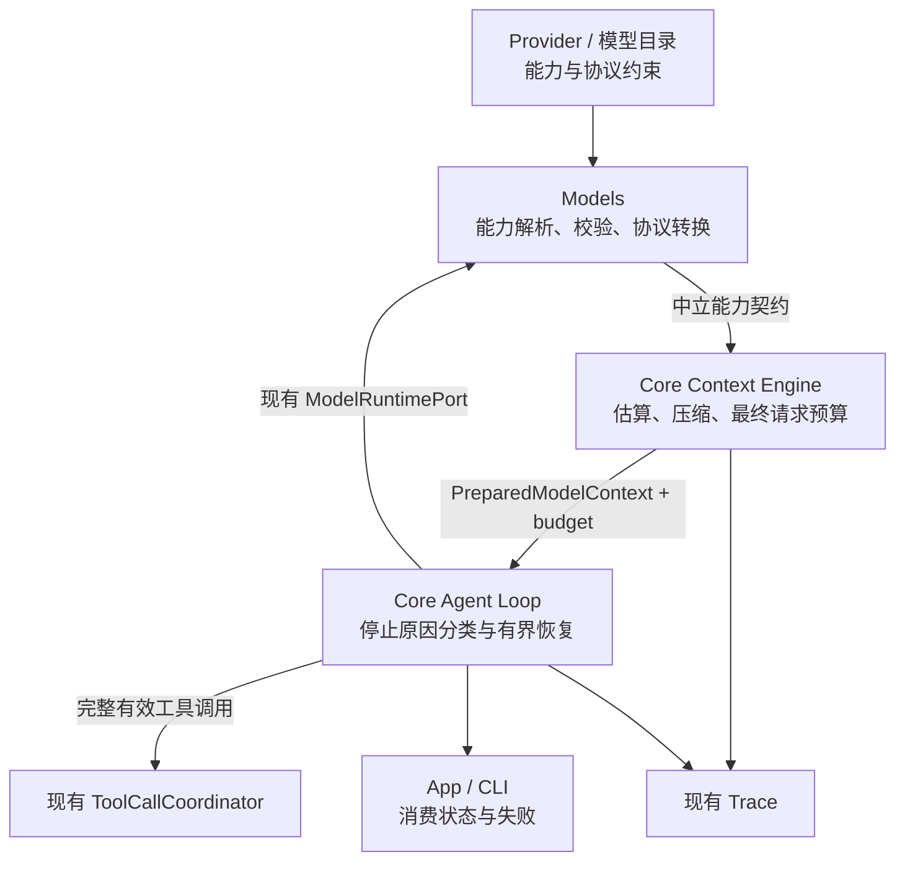
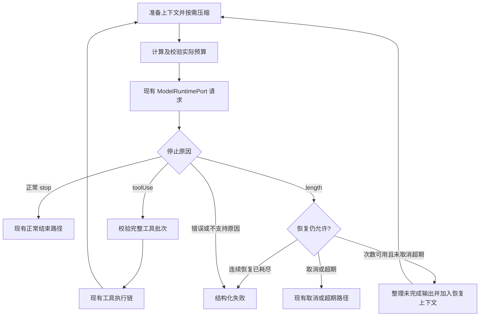

# Provider 驱动的动态输出预算与截断恢复 — implementation plan

状态：Ready with trade-offs。允许按下面阶段执行；P0–P5 已完成，真实单题 reward=0、期限取消；预算机制生效，解题/效率改善未验证；详细证据见实施记录。P0 的 Provider 能力与协议检查是代码实施前的门槛，不得用未经核实的目录数字绕过。

工作目录：`/Users/tanghaoyi/Documents/work/omni-agent-harbor`。

本计划承接通用执行策略试验，独立管理 Models/Core 运行能力改造，不覆盖或重写 `benchmark-integration-v1.md`。后者仍负责评测框架边界。本文件是本次实施、review、验证和范围核对的依据；实施中改变下述行为契约，须先更新本文件并记录原因。

## 1. 问题、目标与已知证据

真实 Django 11885 试跑中，Provider selection 声明 contextWindow=200000、modelMaxOutputTokens=128000，Omni 使用默认 requestedOutputTokens=16384。最后模型响应 stopReason=length，输出 16384；Core 非 toolUse 分支却生成 run.completed。官方评分为 0，两项既有回归失败。完整 Trace 不等于任务完整完成。

目标：取消统一固定的主请求输出上限；由 Provider/模型目录提供能力，Context 对每次准备后的请求计算预算；截断进入有界恢复，恢复失败不得标为 completed。改造适用于所有 Agent，不依赖 SWE、Django 或 coding prompt。

证据来源：

- `benchmark/reports/verified-medium2-prompt-v2-2026-09-16.md`。
- Omni：`packages/models/src/vendors/output-budget.ts`，`packages/core/src/agent/loop/orchestrator.ts`。
- 本地 Verdent Deck：`packages/agent-base/core/src/agent-loop/agentLoop.ts` 的 Provider 输出预算解析及截断恢复分支。借鉴职责和行为，不复制其执行器、隐式兼容逻辑或产品特例；本地源码不代表线上部署。

128000 当前只是配置声明，不是服务端能力已验证的结论。P0 核查实际 Provider API 路由的上下文、输出及推理预算约束，保存官方依据或接口证据；不能以远端套餐余额推断单次输出能力。

## 2. 设计结论与边界

Ready with trade-offs：所有权可保持在现有 Models、Context、Agent Loop 三个 owner 内。主要代价是更大的单次输出可能增加延迟和费用，恢复最多增加三次模型调用；本地 token 估算也不是精确 tokenizer。通过显式能力、动态安全余量、原 Run 取消/期限和结构化失败约束，不承诺所有模型永不截断或恢复后必然解题成功。

新增：一个纯预算计算模块、一个恢复策略模块及必要行为测试、观测事实。

修改：能力与请求契约、Context 准备结果、模型发送、Loop 停止原因处理、失败投射验证、文档。

删除：统一 16K 默认值、主请求静态预算贯穿调用的旧路径、静默二次缩减预算、所有非 toolUse 一律 completed 的旧分支及旧断言。

保留：显式用户配置、现有 ModelRuntimePort、Context Engine、压缩流程、ToolCallCoordinator、取消/期限、Trace、Provider 凭据来源、独立摘要请求预算、无关工作区改动。

不做：benchmark 专用修复、coding prompt 叠加、模型自动切换、无限重试、新调度器、第二套工具执行器、崩溃后的自动续跑、全局工具 exactly-once 承诺。已完成工具不得因本次恢复被再次自动派发；模型在后续正常响应主动提出重复动作仍由现有循环保护处理。

## 3. 架构图与唯一职责



- Models 决定模型允许的能力及 Provider 协议，不决定任务恢复策略。
- Context 唯一决定本次实际请求预算，预算随准备结果不可变；中间件如改变上下文必须在最终计量前完成。
- Agent Loop 唯一决定是否恢复与何时终止。网络传输重试和截断恢复是不同原因，分别观测，不能在多个层同时补截断重试。
- App、CLI、benchmark 消费既有 failed/cancelled/completed 投射，不分析 token 数猜测结果。
- 所有工具执行仍走 ToolCallCoordinator；截断不能绕过权限或执行校验。

## 4. 能力与动态预算契约

### 4.1 数据语义

- C：Provider 声明的上下文容量。
- M：Provider 声明的最大输出容量。
- U：用户显式配置的输出上限，可选；保持现有配置字段及含义，不补固定值。
- I：最终请求的输入估算，包含系统提示、环境、工具 schema、历史、工具结果和恢复上下文。
- S：输入估算安全余量。
- O：本次实际请求的输出上限，记录在准备结果并传给 Provider。

Provider 能力缺失、非正整数或相互矛盾时，按当前 Provider 配置契约明确失败。模型目录刷新复用现有路径，不每轮访问远端，不增加猜测值或按模型名字硬编码的兜底表。

### 4.2 首版确定策略

```text
S = ceil(C × 5%)
B = C − S
O = min(M, U（存在时）, C − I − S)
```

5% 是首版显式、可观测的估算安全策略，与现有 Context 5% headroom 思路一致，但职责独立；不是模型能力，也不是输出 token 固定上限。用具名常量和策略版本描述，修改须有 token 估算偏差证据。它不保证覆盖任意语言和协议的估算误差。

压缩的 usable input 基准采用稳定的 B，复用现有 Micro/Heavy 触发、进度和恢复目标；不再从静态 requestedOutputTokens 推导。先执行现有压缩策略，再对最终输入计算 O。压缩后触发条件不得依赖 O，避免输入越多 O 越小、压缩反而永远不触发的自抵消关系。

不为取满 M 强制每轮压缩，也不通过缩小 O 绕过已有压缩触发。若 O 小于 1，或违反 Provider 已声明的最小请求/推理协议约束，不能发送：使用现有压缩流程争取空间；压缩无进展或达到现有保护边界后明确 context budget failure，禁止 while 循环压缩。

若 Provider 没有声明最小输出要求，不自行发明一个“至少 16K”门槛。小预算仍可能截断，由有界恢复保证不无限消耗。

### 4.3 发送与服务端拒绝

Context manifest、ModelRuntimePort options、实际 wire 参数、Trace 必须是同一 O。Models 仅验证和转换，不再静默 Math.min 改写预算。发现能力/selection 不一致时，在发送前显式失败。

服务端即使拒绝本地认为合法的预算，也不解析自由文本后猜数字无限重试。首版通过现有结构化模型失败路径报告，Trace 保留安全的诊断、能力来源及预算；只有已有明确协议支持的处理可以复用。新增服务端预算协商不在本轮范围。

不通过省略 max_tokens 来假设服务端无限输出。摘要/压缩等辅助调用仍保留其职责明确的独立输出预算，不机械替换成主请求模型上限。

## 5. 恢复流程与状态契约



### 5.1 次数、取消与执行

- 连续 length 最多恢复 3 次，初次调用不计入，即最多初次加三次；正常有效 stop/toolUse 重置连续截断计数。原有 maxTurns/循环保护继续约束交替截断等情况。
- 每次恢复有独立 modelCallId、相同 runId 和关联的前次 modelCallId。次数与原因由 Core owner 管理，不落在 Provider、CLI 或 benchmark。
- 沿用原 Run 的 signal 和总期限，不新建不关联的 timer，不重置截止时间。恢复准备前和模型派发前检查取消。
- length 响应的工具调用全部不执行，即便局部 JSON 可解析。完整成功响应中的工具仍走现有路径。
- 恢复耗尽使用结构化失败代码，例如 model_output_recovery_exhausted；不能发 final_response 或 run.completed。具体错误枚举复用现有 failure 定义位置，不建平行状态系统。
- deferred 等已有停止原因必须审计实际语义后显式分类，不一律重试，也不继续用非 toolUse 等价成功的写法。

### 5.2 未完成内容、持久化和回放

原始模型响应（含真实 stopReason）保留在现有 Trace/消息记录，不伪造为正常完成。不改变历史 JSONL 格式，不把恢复提示持久化成用户提出的新任务。

恢复提示及请求专用投射由当前 Run 的恢复状态管理，并随请求被 Trace 捕获；原始消息与 Provider 实际回放内容区分。复用现有消息投射、thinkingHistoryPolicy 和协议转换，禁止直接拼接第二条 messages 管线。

截断文本可作为带未完成语义的上下文参与下一次准备，且计入 I。截断的工具请求不回放为悬空 toolUse，也不能伪造工具执行结果；如果现有协议无法安全投射某类响应，明确恢复失败，禁止静默丢失后声称恢复成功。

推理内容只按已有 Provider 规则回放，不转成普通文本，不重写签名内容。仅推理耗尽时使用专门的简洁恢复提示；首版不盲传 Provider 未声明的 effort 参数。

恢复过程中已流出的文本仍是部分响应，只有正常完整响应产生 final_response。首版不要求 UI 撤回已展示内容，也不把完整 Trace 等同于任务成功。

恢复状态仅存在当前 Run；崩溃/重启后的自动继续不属于本轮。不承诺恢复补丁能通过测试，也不以“无工具调用”自动证明用户目标已实现。

## 6. 文件改动范围

M=修改，A=新增；目录项表示该目录内与契约直接相关的文件，实施时在变更登记表列出实际路径。禁止借此扩展无关重构。

```text
packages/
├── models/src/
│   ├── vendors/
│   │   ├── output-budget.ts                 M 删除固定默认值；能力及显式配置解析
│   │   ├── selection-resolver.ts            M 统一解析，避免重复决策
│   │   └── types.ts                        M 能力与覆盖的语义
│   ├── providers/volcengine/index.ts        M 自定义选择解析对齐
│   ├── runtime/model-runtime.ts            M 校验并发送最终预算
│   ├── cache/cacheAwareRuntime.ts           M 移除旧静态预算兜底
│   └── __tests__/                          M 能力、选择、实际请求参数
├── core/src/
│   ├── models/runtime.ts                   M 中立能力和请求契约
│   ├── context/
│   │   ├── contracts/types.ts              M 能力、压缩基准、请求预算
│   │   ├── request-budget.ts        A 唯一逐请求预算计算
│   │   ├── policy/estimator.ts             M 输入计量与稳定压缩基准
│   │   ├── policy/validator.ts             M 新契约校验
│   │   ├── assembly/assembler.ts           M 最终预算写入准备结果
│   │   └── compression/                   M 预算消费对齐，复用压缩算法
│   ├── agent/
│   │   ├── workingConversation.ts          M 未完成响应及请求专用上下文
│   │   └── loop/
│   │       ├── preparation.ts              M 恢复重走上下文准备
│   │       ├── modelPhase.ts               M 使用 O 并保留真实停止原因
│   │       ├── orchestrator.ts             M 原有 Loop 中衔接恢复
│   │       ├── output-recovery.ts          A 计数、恢复决策与提示
│   │       └── types.ts                    M 恢复状态
│   ├── types.ts                            M 用量/失败契约同步
│   ├── runtime-observation/                M 预算和恢复事实
│   ├── tracing/runtime-observer/           M 现有 Trace 投射
│   └── __tests__/                          M 预算、压缩、恢复生命周期
├── app/src/
│   ├── context/runtimeSummaryGenerator.ts  M 适配契约，保留独立摘要预算
│   └── __tests__/                          M 失败终态、配置保留及夹具
└── 相关既有契约消费者/测试夹具             M 仅类型传播和必要投射，不新增策略

docs/
├── plans/model-output-budget-recovery.md   A 本文件，唯一实施对照
├── context-engineering.md                  M 预算、估算和压缩契约
├── architecture.md                         M 职责和请求链路
└── agent-service.md                        M 恢复耗尽与服务终态

benchmark/
└── reports/                                A 同题真实对照证据
```

P0 必须完成引用扫描，将实际消费者登记；若发现持久化破坏性变更或需要兼容层，停止该部分，先更新方案并对齐，不以兼容别名偷偷保留旧架构。

正常情况下不修改 Tools、coding prompt、benchmark runner、容器、评分器和凭据配置。CLI/Host 若不能消费已有结构化失败，应先证明现有投射缺口再纳入范围，不能自行另判成功。

## 7. 注释和观测要求

代码注释用英文，解释原因与不变量，避免逐行翻译和题目特例：

- 预算：压缩基准不能取决于随输入缩小的 O；安全余量不是输出硬上限。
- Models 发送：预算必须与 Context/Trace 一致，禁止静默缩减。
- 恢复：截断工具不执行，已执行工具不因恢复自动重派。
- 消息：原始响应、请求专用投射与用户消息的边界；遵守推理回放规则。
- 生命周期：恢复不能重置 Run 期限，length 不是正常完成。

复用现有 Trace，记录 C/M/U/I/S/O、策略版本、能力来源/配置摘要、停止原因、恢复序号与原因、父 modelCallId、最终状态。敏感凭据不入日志。不新增平行 JSONL 或额外日志框架，不在报告中暴露推理全文。

## 8. Roadmap 与验收门槛

| 阶段 | 工作                                            | 验收                                                 | 状态   |
| ---- | ----------------------------------------------- | ---------------------------------------------------- | ------ |
| P0   | 能力与协议核对、引用扫描、现有消息/状态行为复现 | 证据有来源；无未解决的持久化或回放障碍               | 已完成 |
| P1   | 能力契约及动态预算替换                          | Context、wire、Trace 三方相同；无固定 16K 主请求默认 | 已完成 |
| P2   | 停止原因分类与有界恢复                          | 成功恢复、耗尽、取消路径及工具不重放成立             | 已完成 |
| P3   | 不付费的可控流与完整服务链测试                  | 下列核心场景全部通过，终态端到端一致                 | 已完成 |
| P4   | 同 Provider、同题、同评分器一次真实对照         | 预算和恢复可追踪；题目质量与运行完整性分开报告       | 已完成 |
| P5   | 清理旧逻辑、最终 diff/文档审核                  | 无平行预算源、无重复恢复器、证据与实现匹配           | 已完成 |

P1/P2 的针对性回归应先展示旧行为失败再实施；不为提示文案逐字断言编写测试。

### 核心验证矩阵

1. Provider 输出能力高于 16K、输入空间充分且无 U：实际请求允许超过 16K。
2. 显式 U 被尊重；非法能力/配置发送前失败；目录能力不能误当套餐余额。
3. 上下文增长、压缩后预算重算；schema 和恢复内容计入；压缩不会因动态 O 自抵消。
4. 实际发送参数与 manifest/Trace 完全相同；Models 不另取 min。
5. length 后正常恢复：相同 Run、新 modelCallId，最终完成；仅推理截断也覆盖。
6. 连续四次 length：初次加三次恢复，结构化失败，无 completed。
7. 恢复前/准备中/流式中取消，原期限触发：后续无请求，无新增独立 timer。
8. 截断中有完整或残缺工具 JSON：均不执行；此前完成的工具结果不重派。
9. 原始截断证据保留、恢复提示不伪装用户任务、Provider 回放消息没有悬空工具引用。
10. Core 失败经过 App/CLI 既有链路正确反映到 headless result 和 Trace，benchmark 不独立修正。
11. 服务端预算拒绝明确失败、不出现猜测重试循环；辅助摘要预算继续有效。
12. 正常 stop/toolUse、现有压缩、显式配置及凭据读取没有回归。

验证命令按仓库规范执行：格式化改动、定向行为测试、format:check、typecheck、全量 test；公共导出/依赖/构建契约变化时 build；涉及配置/CLI 组合时执行合适的启动 smoke。测试数量与关键不变量匹配，不复制大量 mock 或机械字段断言。

P4 不以提高超时、换题或反复抽样掩盖结果。沿用 1800 秒、一次尝试、无整题自动重跑。恢复带来的额外模型调用属于该次 Run，需单独记录其用量；付费执行前确认现有授权与预算仍适用，不将本计划落盘视为无限付费许可。

## 9. 交付和清理清单

- [x] P0 能力证据和协议约束已归档
- [x] 实际变更文件登记完成，所有越界项解释清楚
- [x] 固定 16K 默认及旧静态传播路径删除
- [x] 旧非 toolUse 成功分支及过时测试删除/替换
- [x] Provider 能力与用户显式配置保留为单一来源
- [x] 无 CLI/benchmark/Provider 各自增加截断恢复
- [x] 生命周期、消息回放、预算一致性测试通过
- [x] Trace 可区分响应截断、恢复成功、恢复耗尽、取消
- [x] 格式、类型、测试及必要构建/smoke 有证据
- [x] 同题结果与运行完整性分别报告，不以 token 更少或退出更早冒充优化
- [x] 真实产物仍 gitignore；未泄露凭据
- [x] 文档、最终 diff 和残余风险核对完成

## 10. 实施记录

已实施预算和恢复链路；915 项测试、类型/格式检查、构建通过。真实 headless + 本地 HTTP 模型验证恢复成功与耗尽均通过。付费同题对照已完成：reward=0，1800 秒期限取消，完整 Trace；未证明整体效率改善。

| 阶段 | 实际文件/证据 | 结果及偏差原因                                     |
| ---- | ------------- | -------------------------------------------------- |
| 计划 | 本文件        | 补齐安全余量、回放、恢复边界、服务端拒绝及验收门槛 |

### 实施中边界调整

- 预算纯函数位于 `context/request-budget.ts`，而不是 `context/policy/`：现有架构测试禁止 assembly 依赖 policy，共享 Context 计算应保持层内中立。没有放宽架构测试。
- Runtime selection 的 `requestedOutputTokens` 保留字段名但明确为 Provider/用户请求上限；manifest 同名字段为本次实际值，发送端只消费 manifest。避免破坏已有显式用户配置；不是旧固定预算路径的兼容别名。
- Provider 原厂能力依据：https://docs.bigmodel.cn/cn/guide/models/text/glm-5.2（最大输出 128K）。火山文档抓取未获得此路由的完整能力，因此原配置暂不扩大；路由级验证留在真实运行前，通用实现依赖已有显式目录能力并在服务端拒绝时失败。后续路由探测已完成，证据及能力边界见下文。

### P0–P3 实施证据

- 动态预算、输出恢复、请求投射、摘要截断处理已实施；未修改 coding prompt、Tools 或 benchmark runner。
- 旧实现先出现三项预期回归失败；最终 133 个测试文件、915 项通过，类型、格式、构建通过。
- 实际 headless + 本地 OpenAI 协议 HTTP 服务：恢复用 2 次请求完成，耗尽用 4 次请求失败，退出码分别 0/1；所有 wire 请求 max_tokens=128000，截断工具没有执行，Trace 完整。
- 首次宿主 headless 因受限环境下 credential_reconcile_failed 未发模型请求；允许正常凭据初始化后成功，不是恢复逻辑失败。验证未绕过生产凭据链。
- 火山路由探测：thinking.type=disabled 返回明确 400，说明不能默认降低或关闭推理；移除该参数后请求 max_tokens=128000 返回 200、stop，总用量 52 tokens。只证明此参数被路由接受，不证明满 128K 生成、上下文最大容量或未来路由均相同。
- 请求名 glm-5.2，服务端 response model=glm-5.3。上一轮 prompt-v2 的 47 个响应同样记录 glm-5.3；原始超时基线未找到相同完整模型身份记录，不能声称三次实际后端完全相同。
- 路由级探测在通用免费验证后、整题付费前完成，与原计划“所有 P0 在代码前”顺序不同。通用实现未扩大 Provider 配置，真实运行仍受路由探测门槛；此偏差明确记录，不声称事前已核验。
- App Trace 既有失败状态名是 error，headless 对外状态是 failed；沿用当前映射，不新增终态。
- 签名截断的可回放性由 Context 消息投射统一校验，包括后续 Run 对历史的回放，避免只在当前恢复分支校验。

### P4–P5 完成记录

- [真实对照报告](../../benchmark/reports/verified-medium2-output-recovery-2026-09-16.md)：同题同评分器，一次付费运行；参考/空补丁对照 1/0，收据有效。
- 39 次请求预算 87037–128000，公式全部一致；单响应 26178 tokens 正常转工具调用，证明旧 16K 默认已移除。本次没有 length，付费恢复效果仍未验证。
- reward=0，新增测试 1/1、回归 41/43；1802.424 秒结束，cancelled，Trace 27097 个连续事件。不得以实现完成冒充解题或性能提升。
- 生产文件未在镜像构建后变更；最终 diff 检查通过，未新增并行预算/恢复链。无 coding prompt、Tools、benchmark runner 或评分器改动。
- 真实产物已忽略归档，实际密钥字节扫描无命中，容器已清理。

### 实际文件登记

下列 23 个源码文件（含测试）相对上一轮镜像发生变更；另有 context-engineering、architecture、agent-service 三份文档和本计划，共 27 个实施文件。本次新运行报告独立于此计数。

```text
packages/app/src/__tests__/agent-application.test.ts
packages/app/src/context/runtimeSummaryGenerator.ts
packages/core/src/__tests__/agent-loop.test.ts
packages/core/src/__tests__/context-compression.test.ts
packages/core/src/agent-loop.ts
packages/core/src/agent/loop/modelPhase.ts
packages/core/src/agent/loop/orchestrator.ts
packages/core/src/agent/loop/output-recovery.ts
packages/core/src/context/assembly/assembler.ts
packages/core/src/context/assembly/messageProjection.ts
packages/core/src/context/compression/toolCycle.ts
packages/core/src/context/contracts/types.ts
packages/core/src/context/policy/estimator.ts
packages/core/src/context/request-budget.ts
packages/core/src/models/runtime.ts
packages/core/src/runtime-observation/facts.ts
packages/core/src/tracing/runtime-observer/model-request.ts
packages/models/src/__tests__/model-cache.test.ts
packages/models/src/__tests__/model-runtime.test.ts
packages/models/src/__tests__/vendor-plugins.test.ts
packages/models/src/cache/cacheAwareRuntime.ts
packages/models/src/runtime/model-runtime.ts
packages/models/src/vendors/output-budget.ts
```
