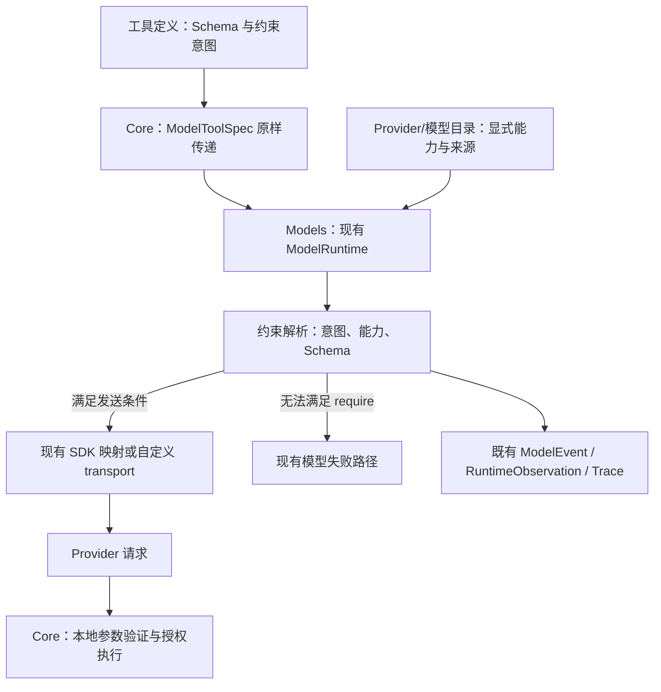
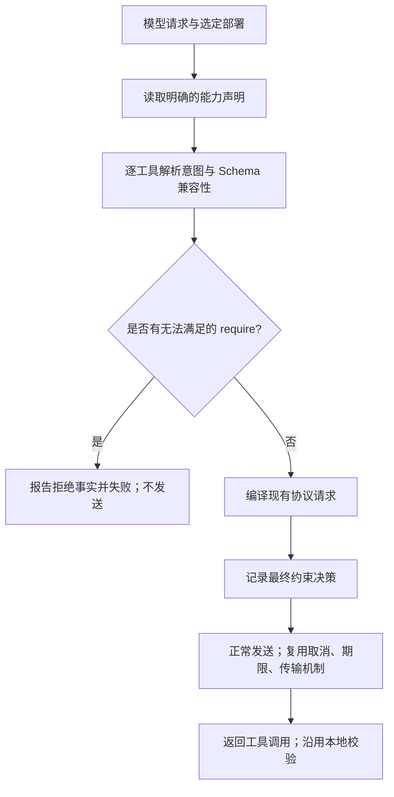

# Provider 工具生成约束 — implementation plan

状态：R0–R4 已完成并通过本地验证；R5 已获授权并完成两次真实请求，确认接口接受 strict 字段，服务端强制约束仍未确认。2026-09-17 用户已批准推荐迁移语义。
日期：2026-09-17。
工作树：`/Users/tanghaoyi/Documents/work/omni-agent-harbor`。

本计划独立管理工具生成约束在 Models 层的契约，不重写输出保留、动态预算或 benchmark 计划。第 8 节记录已批准的语义决定；仓库内消费者迁移已完成，仓库外独立扩展须按 README 更新，尚未验证其迁移。

## 1. 目标和证据

目标：工具约束意图、Provider 能力判断、最终请求和 Trace 一致。消除已声明 strict 却在映射中丢失的问题；不承诺提高解题通过率或杜绝工具参数错误。

实施前已确认的缺口（下列源码描述是修复前状态）：

- Core `agent/contextInput.ts` 保留工具的 `strict` 字段。
- Models `runtime/message-mapper.ts` 仅映射名称、描述和 Schema，丢弃 strict。
- 本地通过真实 ModelRuntime、compatible Provider 和 SDK 序列化，替换 fetch 返回模拟响应：声明 true、false、未声明，三个最终 OpenAI Completions 请求均得到 `strict: false`。这是客户端序列化证据，不是服务端支持证据。
- 当前 SDK 使用 `constrainedSampling: { type: "json_schema", strict: "prefer" | "require" }`，而非 Tool.strict。
- 自定义 ModelTransportRequest.tools 无生成约束字段；配置型 Provider 的 compat 无严格模式支持声明。
- 内置 Bash、file_read、web_fetch、web_search、request_user_input、output_read 等带 strict 的工具有可选参数；file_edit、file_write 顶层没有可选参数，但仍须递归检查 Schema。
- 金融 Agent compute-indicators 也声明 strict；影响不限于 coding Agent。
- 原回放 grep 未声明 strict，当时的 Schema 正确提供 search_path（当前契约已统一改为 path，历史回放保持原样）；这次参数名错误不能直接归因于 strict 映射缺口。范围声明缺失也不能靠 Schema 严格模式自动解决。
- 火山 Agent Plan/GLM 当前部署的服务端支持情况未确认，不能依据 OpenAI 兼容协议或 SDK 的默认值推定支持。

本地核查证据：`/tmp/omni-strict-wire-probe.mts`、`/tmp/omni-strict-wire-probe.json`。临时文件不作为长期唯一证据；等价无凭据 case 已落入 `packages/models/src/__tests__/tool-constraints.test.ts`。

## 2. 设计结论和边界

Ready with trade-offs：正确 owner 是现有 Models。主要风险是原本无效的声明开始生效，可能阻断旧配置；不同协议的 Schema 支持范围不同；插件属于独立消费者，不能假定全部随仓库升级。通过显式语义迁移、能力来源记录和发送前检查处理，不采用隐式降级或错误重试换协议。

新增：一个 Models 内聚的纯约束解析模块，以及必要的中立契约/观测字段。
修改：工具意图声明、Core 传递、Models 请求编译、Provider 能力声明、自定义 transport、现有 Trace 事件链、边界测试和文档。
删除：旧 strict 布尔声明及其所有仓库内消费路径；不允许新旧字段并行，也不增加自动兼容别名。
保持：工具 Schema、默认值、输入校验、权限、执行顺序、取消、预算、凭据、工具名称与排序、Session 业务消息格式。

不做：新 Proxy 服务/网关/中间件框架；benchmark/coding 特例；参数猜测、自动纠正、补 null；自动探测付费 Provider；Provider 名称白名单；自动改写 Schema 语义；自定义语法约束扩展。

## 3. 契约和责任

已采用中立 `inputConstraint?: "off" | "prefer" | "require"` 替换 strict。未声明表示不主动请求生成约束，与 off 的本次执行效果一致；Trace 保留声明来源差异。

- off：不请求服务端工具参数生成约束。
- prefer：仅在能力已知支持且 Schema 已确认兼容时启用；其余情况不启用，并报告原因。这是调用方显式选择的策略，不是异常后的隐式 fallback。
- require：不能确认满足时，发送前结构化失败，不调用 Provider。

Provider 能力属于具体模型/部署和协议，不属于套餐额度：状态 supported / unsupported / unknown，记录来源。优先使用显式模型声明，其次显式连接声明，其次上游模型目录的明确元数据；无明确证据为 unknown。连接声明只在明确承诺适用全部所列模型时使用。配置值冲突/非法组合必须诊断；不通过失败后重试来推测能力。

Schema 兼容性单独解析为 compatible / incompatible / unknown，并附有界字段路径/原因。复用上游已有验证能力；只实现实际接入协议所需且有依据的检查，不新增通用 JSON Schema 引擎。没有可靠验证依据时标 unknown，不能默认为兼容。Core 现有 AJV 仍负责真实参数验证；它不等同于 Provider Schema 子集兼容性检查。

### 处理矩阵

| 意图       | 能力                | Schema               | 行为                         |
| ---------- | ------------------- | -------------------- | ---------------------------- |
| 未声明/off | 任意                | 本地定义合法         | 不启用约束；正常调用         |
| prefer     | supported           | compatible           | 启用约束，记录实际协议设置   |
| prefer     | unsupported/unknown | 任意                 | 不启用；记录 capability 原因 |
| prefer     | supported           | incompatible/unknown | 不启用；记录 schema 原因     |
| require    | supported           | compatible           | 启用约束                     |
| require    | 其余                | 任意                 | 发送前失败；零 HTTP 请求     |

Schema 本身非法沿用注册失败，不进入 prefer 分支。Provider 调用失败沿用既有错误路径，不能改成非严格请求再试。一次调用的能力和解析结果必须固定，不能在多个出口重新决策。

### 架构图



Models 中一个解析结果同时供映射与观测消费，不新增中立的第二份工具 Schema。SDK 的 constrainedSampling 留在 Models，不泄漏到 Core。

### 请求流程



## 4. 出口、观测和缓存

兼容协议出口：根据解析结果生成 SDK constrainedSampling。必须显式关闭未启用分支，防止 SDK 默认策略意外开启；最终 wire 测试覆盖协议实际行为。

自定义 transport：扩展现有中立请求类型传递已解析的约束结果，并由该 transport 的 Provider contribution 声明支持能力。默认 unknown，不能假装透传等于实现。require 无支持声明不得进入 transport。SDK 往返桥接必须保留该信息，不能通过工具名映射的全局旁路表恢复。

Trace：复用模型事件链，增加工具约束决策事实。逐工具记录 modelCallId、toolName、意图、能力状态/来源、Schema 判断、planned enabled/disabled/rejected、原因。HTTP onPayload 只作为协议验证证据；不能把发送了 strict 写成“服务端已强制执行”。失败分支也必须可追踪。不要保存密钥、请求头或完整重复 Schema；不新增日志存储。

缓存：现有工具请求指纹覆盖新意图字段；审查实际能力/协议变化是否影响已有缓存语义和租约，需要时在现有版本/指纹中体现，不增加第二套缓存。测试区分意图和最终请求约束，不声称缓存命中等于协议一致。

## 5. 预期文件树

以下是边界范围，不要求机械新增每个文件；同一职责优先在原 owner 内修改。

```text
packages/core/src/
├── types.ts                             # 替换工具 strict 声明
├── models/runtime.ts                    # 中立模型工具意图和决策事件契约
├── context/{assembly,policy}/            # 上下文克隆、校验与估算迁移新字段
├── agent/contextInput.ts                # 保留意图，不解释 Provider
├── tool-calls/tool-definition-validator.ts # 校验新枚举，拒绝旧/非法声明
├── agent/loop/modelPhase.ts              # 将决策事件接入现有观测
├── runtime-observation/facts.ts          # 中立决策事实
└── tracing/runtime-observer/             # 写入现有 replay 链路
packages/models/src/
├── runtime/tool-constraints.ts           # 新：内聚的纯解析与兼容性判断
├── runtime/model-runtime.ts              # 一次解析，驱动发送和观测
├── runtime/message-mapper.ts             # 转换已决策约束，消除丢字段
├── providers/custom/types.ts             # 能力及 transport 中立契约
├── providers/custom/stream-adapter.ts    # 自定义出口不丢失意图/结果
├── providers/factories/                  # 在现有工厂接入能力声明
├── vendors/provider-contribution*.ts     # 复用 Provider 贡献边界
├── config/provider-repository.ts         # 显式能力配置与协议合法性
├── cache/                               # 仅修改被证明需更新的指纹/事件透传
└── __tests__/                           # HTTP、transport 和矩阵验证
packages/tools/src/
├── shell/bash.ts                        # 仅迁移声明，不改 Schema
├── filesystem/{file-read,file-edit,file-write}.ts
├── web/{web-fetch,web-search}.ts
├── user-input/request-user-input.ts
└── output/output-read.ts
agents/
├── financial-analysis/src/tools/compute-indicators.ts # 同步迁移
└── coding/evals/clarificationRouting/contract.ts        # 评估入口同步契约
packages/app/src/mcp/catalog/mcp-catalog-service.ts # MCP 工具声明同步迁移
packages/cli/src/agent-scaffold/template.ts # 脚手架不再生成旧字段
packages/models/src/index.ts             # 必要契约导出
packages/core/src/index.ts               # 必要契约导出
README.md                               # 若对外配置使用变化则更新
docs/
├── architecture.md                      # Models 约束职责
├── tool-call-runtime.md                  # 生成约束不替代执行校验
└── plans/provider-tool-constraints.md    # 本计划、决定和实施记录
```

grep/glob/skill_read 未声明 strict，本轮保持未声明，不借机扩大启用范围。UI、benchmark 和 Provider 凭据文件不属于行为修改范围；CLI 只更新工具脚手架声明；若公开事件引发类型适配，先在 plan 补齐理由及文件范围。

## 6. Roadmap 与验收

| 阶段 | 工作                                                     | 退出条件                                                     |
| ---- | -------------------------------------------------------- | ------------------------------------------------------------ |
| R0   | 核对所有声明、出口、独立插件、SDK/服务端能力依据         | 明确第 8 节决定；确认可同步升级的消费者；未知能力不冒充支持  |
| R1   | 定义意图/能力/决策契约及矩阵；将复现落入测试             | 三态、未知、不兼容行为唯一且可测试                           |
| R2   | 替换 Models 映射、能力配置和 custom transport            | 模拟 HTTP 的最终字段正确；require 拒绝时零网络；不改输入语义 |
| R3   | 同步所有内置声明、Trace、缓存契约和文档；删除旧路径      | 无 strict 旧声明/双字段并存；观测与协议相符                  |
| R4   | 聚焦集成验证、类型/格式/全测、导出变更构建及必要启动验证 | 验证真实边界；报告未覆盖协议和所有失败                       |
| R5   | 如另获授权，运行一轮真实 Provider 验证                   | 仅证明目标部署接口行为；不把请求接受等同服务端强制约束       |

R1–R3 属于同一个可交付变更，不发布中间双轨状态。R5 于后续用户授权后执行；其真实证据与局限见第 10 节。

核心测试：

1. 明确支持的 compatible Provider，真实 SDK 序列化 true/off/未声明的正确 wire 字段（fetch 模拟，不调用远端）。
2. require 在 unsupported、unknown、Schema 不兼容时失败，无 HTTP 调用，Trace 有原因。
3. prefer 对应不启用分支有明确决策事实，不在失败后重试改协议。
4. custom transport 接收正确中立决策，能力未知时 require 不调用 transport。
5. 可选参数、嵌套对象、nullable/default 的工具语义不被自动改写；继续由原校验器判定真实参数。
6. Trace 意图/决策/wire 一致；缓存指纹对语义变动敏感，密钥不进入日志。
7. 取消、预算和错误仍走现有链路；不增加特殊工具执行入口。

不为描述文案逐字新增测试。全量检查失败要如实记录，不能扩大超时或删除断言掩盖问题。当前工作树曾出现 agent-loop 516 次工具调用测试在全量并发时超时、单独运行通过；是已知验证风险，不能把它直接归因本计划或自动归为无关。

## 7. 质量和验收边界

- 高内聚：Provider 能力、兼容性和协议决策全部归 Models。
- 低耦合：Core 不认识厂商、协议和 SDK 类型；工具不认识 Provider。
- 单一事实源：一次决策供发送与 Trace 使用，不多出口各自推断。
- 低侵入：修改有限公开契约和已有 owner，不增加 Proxy/Hook/全局状态。
- 无隐式兼容：旧字段一次迁移删除；若无法同步升级独立消费者，停在设计门槛，记录发布/迁移决定后再继续，不偷偷接旧字段。
- 不承诺：更少模型错误、更快 benchmark 或更高通过率。确定收益是工具约束声明不会悄悄丢失，无法满足的要求可以定位。

## 8. 已对齐的产品语义

旧 `strict: true` 没有文档定义“优先”还是“必须”，也没有在当前请求生效，不能直接解释成强制报错。

已采用：仓库内旧 true 明确迁移为 prefer，旧 false 为 off，未声明保持未声明；未来确有硬性契约的工具显式选择 require。prefer 在未知/不兼容时保留现有非严格调用能力，但必须给出决策记录。这不是同时接受旧字段的兼容层。

未采用的替代方案：旧 true 全部迁移为 require。约束更强，但会阻断当前能力未知的火山配置及不兼容 Schema 的工具，必须先解决这些配置才能继续正常运行。

用户已选择推荐方案：true → prefer；false → off；未声明保持未声明。批准同步迁移生产代码，不授权付费验证。

## 9. 实施记录

2026-09-17（规划阶段）：完成源码与 wire 复现核查，创建本计划。此时尚未修改生产代码。随后用户批准推荐语义，按下列记录完成实施。

### 实施细化（2026-09-17）

- 查明 MCP 工具包装与 CLI 脚手架同样写入旧 strict，加入同步迁移，避免新建工具继续产生废弃契约。
- Schema 初期只启用 OpenAI Completions/Responses、Anthropic 和自定义 transport 的保守共同子集；未核实协议或关键字报告 unknown。共同子集不代表各厂商支持能力的全集，不改写 Schema；后续扩展必须有协议证据和测试。
- 自定义 transport 只接收已解析的 off/require 执行要求；原始意图和原因由 Models Trace 保留，transport 不再次决策。
- Provider 能力配置复用 supportsStrictMode；具体协议的字段名转换属于 Models。请求部署名覆盖目录模型且无法验证能力时按 unknown 处理。
- 现有缓存工具指纹天然覆盖新意图，语义版本升级用于失效旧协议语义；能力变化后的实际请求由 Provider 缓存协议识别，Omni 不保证服务端命中。

### 完成记录（2026-09-17）

- 旧工具 strict 字段已从仓库内声明、Core 上下文克隆/校验、MCP 包装、CLI 脚手架和评估入口删除；统一为 inputConstraint。旧字段注册时明确报迁移错误，不接受双字段。
- 新增 Models 内唯一约束解析模块；兼容协议和 custom transport 共用决策，不新建 Proxy。发送前编译请求快照，观察者不能在报告之后改变已检查的 Schema。
- 添加显式连接/模型 supportsStrictMode 配置；模型优先，当前目录刷新可改变有效能力。未声明和部署名覆盖仍保守为未知。当前火山配置没有改动。
- 新增中立模型决策事件并写入既有 replay，关联 modelCallId；本地事件不计入模型首响应时间。require 失败保留结构化失败、不执行工具；普通调用继续接受本地 Schema/权限检查。
- SDK 的 strict/constrainedSampling 字段和 AJV strict 选项属于各自协议/校验器，不是废弃工具声明，不作误删。
- 仓库内消费者已同步迁移；仓库外独立扩展未做兼容承诺，README 明确迁移方式。没有兼容层、自动付费能力探测或自动非严格重试。

验证结果：

| 验证                           | 结果                                                                                                                        |
| ------------------------------ | --------------------------------------------------------------------------------------------------------------------------- |
| pnpm run format / format:check | 通过                                                                                                                        |
| pnpm run typecheck             | 通过                                                                                                                        |
| pnpm run test --maxWorkers=2   | 136 个测试文件、959 个测试全部通过；仅控制并发，不修改超时/断言                                                             |
| pnpm run build                 | 全仓构建通过，包含当前平台 sandbox 和 UI                                                                                    |
| pnpm dev --help                | 开发入口帮助页启动通过；未进行交互式模型会话                                                                                |
| agent validate coding --json   | 默认 coding Agent 配置验证通过                                                                                              |
| git diff --check               | 通过                                                                                                                        |
| 协议边界                       | Completions/Responses/Anthropic 最终序列化、自定义 transport、拒绝前零网络、Schema 不改写、取消与请求快照稳定性均有本地测试 |
| Trace / 缓存                   | 决策回放及调用关联、缓存事件转发、意图指纹和旧语义版本失效有验证                                                            |
| 真实服务端                     | 后续已完成两次请求，详见第 10 节；不声称远端已强制执行或模型出错率下降                                                      |

剩余限制：Mistral/Google 的严格 Schema 适配及不在保守子集内的关键字仍标 unknown；不能根据这个结果说厂商不支持。未知场景的 prefer 正常调用并报告原因，require 发送前失败。当前能力改动不会自动改善此前未声明约束的 grep 调用。

## 10. R5 小规模真实 Provider 验证（2026-09-17）

- 目标：现有 `volcengine-agent-plan` / `glm-5.2`，复用项目 Provider 配置及主工作区 `.env` 的 `ARK_AGENT_PLAN_API_KEY`，未修改正式配置。
- 执行入口：项目 `ModelRuntime.stream` → 现有 Provider factory → SDK → 真实接口。工具仅声明，不执行；无 benchmark 或 Agent loop。每次最多 2,048 输出 tokens、90 秒，自动重试为 0。
- 严格模式请求在探测实例中显式设置 `supportsStrictMode: true`，只是待验证假设，不能把这一注入产生的 supported 决策当作服务端能力证据。
- Harness run：`run_48057a6b-02e9-4bd6-b838-1a2e41a2cc62`。持久化原始证据在 Harness 工作区运行目录的 `files/provider-constraints.json`，未进入 Git。未保存凭据或模型思考文本。

| 对照             | 运行时决策                       | SDK payload   | HTTP | 返回停止原因 | 输入 / 输出 tokens |
| ---------------- | -------------------------------- | ------------- | ---- | ------------ | ------------------ |
| 普通模式 off     | disabled / not_requested         | strict: false | 200  | toolUse      | 226 / 214          |
| 严格模式 require | enabled / verified_schema_subset | strict: true  | 200  | toolUse      | 226 / 213          |

两次共 879 tokens，约 12.2 秒。输出数包含推理计数，不重复相加。项目自定义模型价格默认为 0，故 usage.cost 的 0 不能解释为免费，也不能据此计算套餐扣费。

证据局限：临时脚本过滤返回内容时误用 `tool_call`，实际类型为 `toolCall`，导致工具参数未保存；保留的 stopReason 和文本不能代替参数验证。脚本已修正供后续使用，本轮未再付费执行。即使参数正确，两次样本也无法区分模型主动遵守 Schema 与服务端强制执行。Harness 未采集业务断言的可信 provenance，本次只能依据保存的请求、HTTP 元数据及 ModelRuntime 事件作有限结论，不能宣称完整业务验证通过。

执行准备曾遇到 Harness 默认信任根不包含主工作区凭据文件，随后通过正式 SDK 显式声明用户已授权的文件范围并重新通过预检。首个执行尝试 `run_7de8e64c-997a-4586-8d90-4b5f2a87756b` 在 TypeScript 模块导入阶段失败，未读取凭据或发出网络请求、清理完成；使用项目已有 tsx 加载器后执行上述两次请求。

结论：真实请求的约束字段与决策记录一致，接口接受两种设置；参数符合性及服务端强制约束仍属 inconclusive。正式 Provider 能力维持 unknown，R5 不标记为服务端能力认证通过。
