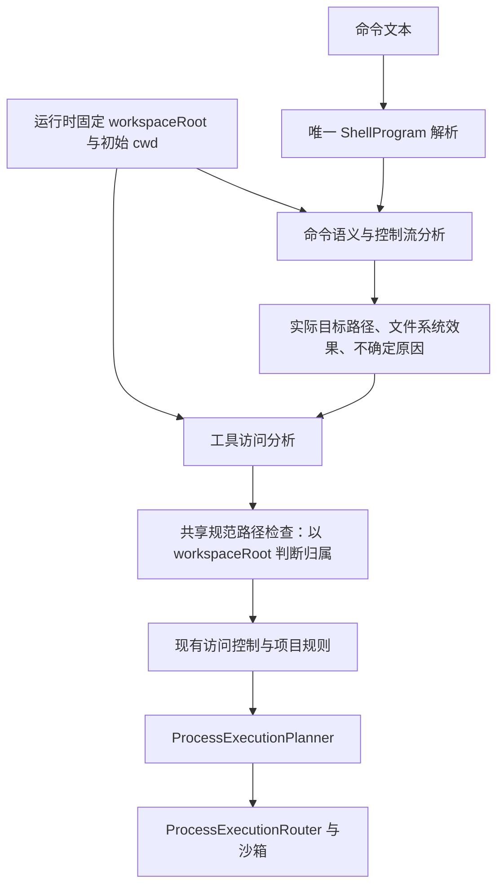
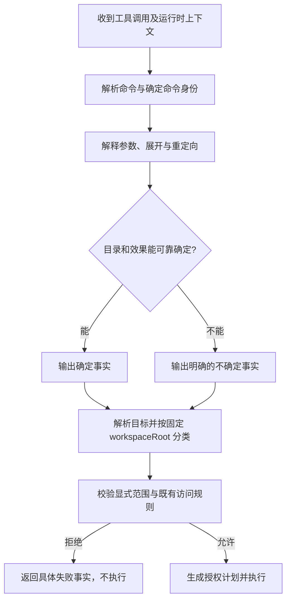

# 工作区边界与 Shell 语义一致性 — implementation plan

状态：2026-09-28 状态模型收敛修订已完成；证据与删除清单见第 10 节。此前完成判断曾因函数定义状态泄漏撤回，本轮重新验证。

## 1. 目标和证据边界

目标：修正工具层工作区归属判断，并使 Shell 上下文变化与文件系统效果保持一致。收益是减少错误分类、误拒绝与无效重试，不以某道 benchmark 通过为验收标准。

已核查事实：

- inspectPathSecurity(value, cwd, environment) 同时使用 cwd 解析路径和判断工作区归属；上游 ToolAccessContext 已区分 workspaceRoot 与 cwd。
- 调用实际 analyzeShellAccess 的免费探针复现：cwd 是工作区子目录时，工作区内父目录文件被标为 external；cwd 在工作区外时，该目录文件被标为 workspace。此证据覆盖访问分析，不等于证明突破 OS 沙箱。
- 现有默认装配将初始 cwd 和 workspaceRoot 设为同值；没有证据表明上述混用导致历史 9461 失败。
- 9 月 19 日 9461 Trace seq 19935–19936 的 `cd … && grep …` 被 project_instruction_scope_undetermined 拒绝。原命令分析复现：cd 的 pathAccess 为 unknown；移除 cd 后写入不确定性消失。
- applyCommandState 直接把 cd 第一个参数视为目录；changeDirectory 只做 path.resolve。不能直接将所有 cd 放进只读名单后认定语义完整。
- 不存在的目录不能声明为 subtree 是现有契约；错误缺少失败声明的定位信息。
- 原生 Bash 管道默认返回最后一个命令的退出状态；已有说明和回归测试，不属于本次修复。

设计结论：边界分离可直接实施；Shell 修改必须先完成 P0 的身份、参数和控制流核查。无法证明的语义保留不确定，不猜测，不扩大权限。不实现完整 Bash 解释器。

## 2. 职责与不变量

| 概念           | 唯一职责                                 | 禁止行为                           |
| -------------- | ---------------------------------------- | ---------------------------------- |
| workspaceRoot  | 运行时指定的固定工作区边界               | 从 cwd、cd 或推导路径重新生成      |
| 初始 cwd       | 本次调用的相对路径基准及子进程初始目录   | 自动成为授权根目录                 |
| Shell 分析 cwd | 命令内部的工作目录状态                   | 修改运行时工作区、授权、父进程 cwd |
| Shell 语义     | 命令身份、参数、上下文变化及文件系统效果 | 在权限层重新解析命令               |
| 访问控制       | 消费事实并按既有模式授权                 | 根据命令名称特判放行               |
| 进程规划/执行  | 使用注入目录及已授权计划                 | 新增 host fallback 或权限          |

继续使用 Tree-sitter ShellProgram、analyzeShellCommand、ToolCallCoordinator、现有规范路径处理与沙箱执行链。保持工具名称、参数 schema、输出保留、退出码、取消和超时语义。

## 3. 架构图



文件和搜索工具直接复用共享路径检查，不经过 Shell 分析。Shell 内部目录只用于解析该命令的相对路径，不参与定义工作区。

## 4. 具体改动

### 4.1 路径与工作区边界

- 将路径检查的输入改为明确区分 cwd、workspaceRoot 的命名上下文；复用现有类型字段，不建立全局上下文或服务。
- 相对路径按 cwd 解析；目标和 workspaceRoot 分别规范化，再判断包含关系，保留符号链接和敏感路径处理。
- ShellAnalysisInput 显式携带固定 workspaceRoot；路径分析使用 Shell 局部 cwd 解析相对路径，使用固定 workspaceRoot 分类。
- 同步迁移 Bash、文件、搜索及范围策略内部的所有调用方，不能仅修 Bash。
- Preflight 只检查目标就绪状态，不新增授权；如保留完整路径检查结果，显式传递所需上下文，不回退使用 cwd 作为工作区。
- 删除旧函数签名及错误传参；不保留可选 workspaceRoot、默认回退、兼容重载或第二条路径判断实现。

### 4.2 Shell 语义一致性

- 先验证现有命令身份判断：内建命令、同名函数、显式路径可执行文件与包装调用。只有确认相应身份，才能应用内建命令的状态变化。
- 参数含义在语义归属处解释一次；状态推导、路径分析消费结果，不重复解析原始字符串。
- 区分上下文变化与文件系统写入。内建 cd 本身不产生写入，但参数展开中的嵌套命令、重定向和后续命令仍独立分析。
- 普通确定目录、选项与 `--`、无参数、`cd -`、变量路径、CDPATH、符号链接及逻辑/物理路径语义逐项列出支持边界。无法保证与执行一致的形式返回不确定，不把选项误当目录。
- 沿用现有条件、顺序、管道、子 Shell 的控制流归属；验证目录变化成功/失败路径及合并结果。不确定状态必须同步失效相关 PWD 事实，不能保留相互矛盾的路径依据。
- 对已有相同状态处理检查一致性，不批量扩大命令白名单，不顺带实现无关命令语义。
- 如现有类型足够，只补齐原有定义；仅当复现证明无法承载必要事实时，增加最小内部事实字段。不预设注册器、插件、策略类或完整命令框架。

### 4.3 范围错误反馈

- 在已有错误链中保留失败路径、read/write、exact/subtree、实际目标类型和原因；保留现有错误码。
- 由拥有检查事实的层生成原因，声明所属层补充参数定位，统一出口展示，避免重新检查或重复拼接解释。
- 不自动创建目录、扩大授权、替模型补参数或自动重试。
- 若结构化详情确需 Core 契约变更，先核对现有拒绝投影；选择最小字段并迁移唯一投影路径，不建立平行错误体系。

## 5. 预期文件范围与注释

下列为修改范围；带“条件”项只在复现证明需要时修改。P0 后补齐实际文件清单，不能借机扩展模块。

```text
packages/tools/src/
├── security/path/
│   ├── inspect-path-security.ts          # 分离解析目录与工作区边界
│   ├── filesystem-scope-policy.ts        # 正确边界传递、范围失败事实
│   └── path-preflight.ts                 # 路径检查签名迁移，不承担授权
├── filesystem/access/
│   ├── filesystem-access-assessor.ts     # 显式消费 workspaceRoot
│   ├── create-file-access.ts             # 传递运行时上下文
│   └── create-file-path-preflight.ts     # 同步 preflight 调用
├── search/access/
│   ├── create-search-access.ts           # 搜索权限复用同一边界
│   └── create-search-path-preflight.ts   # 同步 preflight 调用
├── shell/
│   ├── access/analyze-shell-access.ts    # 传递固定边界、保留范围错误定位
│   └── security/
│       ├── analysis/analysis-input.ts    # 固定边界的明确输入
│       ├── analysis/shell-analysis-context.ts # 局部状态及不确定性一致性
│       ├── analysis/analyze-shell-program.ts  # 条件：控制流/身份修正
│       ├── analyzers/command-facts.ts    # 内建状态变化消费统一语义
│       ├── analyzers/path-analyzer.ts    # 局部解析与固定归属分离
│       └── semantics/command-semantics.ts # 命令效果与参数语义归属
└── __tests__/
    ├── path-security.test.ts             # 边界、符号链接及目标类型
    ├── shell-access.test.ts              # 历史误拒绝与读写不变量
    └── shell-parser.test.ts              # 条件：只保护实际解析/控制流风险
packages/core/src/
├── access/types.ts                       # 条件：已有拒绝结构不足时补详情
└── access/tool-access-controller.ts      # 条件：沿唯一拒绝路径保留详情
agents/coding/src/__tests__/
└── instruction-scope-gate.test.ts         # 正常查询与已知路径规则加载；未知目标行为以文末对齐契约为准
docs/
├── tool-call-runtime.md                  # 固定边界、分析限制与失败反馈契约
└── plans/workspace-boundary-and-shell-semantics.md
```

不预设新增生产文件。删除旧签名、重复语义判断及替代前的过时测试预期；不保留新旧架构并行。不改 benchmark、Provider、Agent prompt 或执行模式。

注释仅解释三类不变量：固定边界与局部目录的区别；无法确定时为何降级；内建状态变化为何不等于文件写入。不写题号、机器绝对路径或案例专属规则。

## 6. 流程图



不确定不是自动允许；仍按现有访问和项目规则处理。拒绝必须能区分目标不存在、声明无效、访问未授权和写入范围无法确定。

## 7. Roadmap 与验收

| 阶段          | 工作                                                                                 | 进入下一阶段条件                                            |
| ------------- | ------------------------------------------------------------------------------------ | ----------------------------------------------------------- |
| P0 契约核对   | 保存原始 diff 基线；确认全部调用方；核对身份、参数、分支和拒绝投影；建立最小失败案例 | 明确修改/删除清单；有可失败的回归证据；不确定形式有保守规则 |
| P1 固定边界   | 迁移共享路径检查及全部文件/搜索/Shell 调用方                                         | cwd 与 workspaceRoot 不同时分类正确，默认相同时行为保持     |
| P2 Shell 语义 | 修正内建身份、参数与状态/效果一致性，消除历史误拒绝                                  | 查询不误拒绝；写入及动态形式不错误放行                      |
| P3 错误反馈   | 保留范围失败事实，复用既有投影                                                       | 多项范围中可准确识别失败项，错误码与拒绝行为保持            |
| P4 收尾       | 回放历史命令；完成相关回归、全仓必需检查和 diff 清理；更新文档                       | 无旧签名、重复实现、兼容回退、机器路径或题目定制逻辑        |

免费验收矩阵：

| 行为                                      | 核心断言                                           |
| ----------------------------------------- | -------------------------------------------------- |
| cwd 等于/位于/不位于 workspaceRoot        | 目标归属只由规范化 workspaceRoot 决定              |
| 工作区根/目标含符号链接                   | 使用既有规范路径能力，无词法前缀绕过               |
| Bash、文件、搜索访问同一目标              | 归属与授权判断一致                                 |
| 历史 cd + grep 查询                       | 不因内建目录切换产生虚假写入需求                   |
| cd + 写入、重定向、嵌套命令               | 真实写入目标不遗漏，范围检查保持                   |
| 条件失败、分支合并、管道、子 Shell        | 分析目录与执行语义一致，状态不跨不应跨越的边界泄漏 |
| 同名函数、路径可执行文件、动态参数        | 不冒充确定的内建语义，不错误授予范围               |
| 选项、特殊目录形式、环境/符号链接歧义     | 支持形式正确推导；不支持形式明确不确定             |
| 多项 read/write 声明中一项 subtree 不存在 | 返回准确失败项，不执行、不自动扩大范围             |

优先在真实 owner 使用少量参数化行为测试；对 Shell 高风险形式，在临时目录用无害本地 Bash 执行结果对照分析，不调用 LLM。访问分析探针不等于完整沙箱验证；如修改影响最终授权计划，须补实际 sandbox 拒绝越界的验证，环境不具备时明确保留缺口。

按仓库要求执行 format、聚焦测试、format:check、typecheck、test；导出/依赖变化时 build；启动/装配变化时 smoke-test。全仓已有失败与本次回归分开记录，不为无关失败扩大修改范围。

## 8. 完成标准与限制

- 各层不再依赖 cwd 与 workspaceRoot 相等，工作区边界不随 Shell 状态改变。
- 已复现的 cd 查询误拒绝消除；真实写入、访问权限、进程计划与原生退出语义保持。
- 所有调用方迁移完成，无隐含兼容回退，无第二条解析/执行链。
- 免费验证结果及未覆盖条件落盘；不以类型检查代替运行行为证据。
- 不宣称本次修复解释 9461 最终失败，不承诺模型遵守反馈或题目通过率提升。
- 本计划不授权新增付费请求或全量 benchmark；如后续需要，单独明确运行范围。

## 9. 实施记录（2026-09-28）

定性：workspaceRoot/cwd 混用是共享路径边界缺陷；cd 查询误拒绝是 Shell 语义缺口。控制流核查进一步发现目录切换失败和重定向时序不能按成功路径处理，已在原分析链修正。均未证明导致 9461 的补丁答错。

实际方案调整：

- Preflight 改用同文件内共享的目标检查，不传入它不需要的工作区信息；两个 preflight 工厂无需修改。
- 显式范围详情沿现有 reason 传递，不修改 Core 类型或拒绝投影。
- 包装命令的状态归属由 wrapper-analyzer 声明 current/child；下游消费该事实，不新增 cd 判断。
- 脚本依赖发现新增显式、稳定的文件本地分析根；不将单次调用的工作区混入按文件版本缓存的事实，执行授权仍取实际 workspaceRoot。
- 未新增生产模块；旧路径检查签名直接替换，所有调用方迁移，不保留默认值或兼容重载。

已执行免费证据：

- 39 项聚焦测试通过；首次全仓 140 文件、1,022 项测试通过。
- 本地真实 Bash 对照覆盖目录切换成功/失败、顺序、条件、子 Shell、管道、重定向与包装调用；分析给出正确目录或明确 unknown。
- 实际 ToolAccessController → ProcessExecutionPlanner → ProcessExecutionRouter → Rust/Seatbelt：工作区子目录读取父级工作区文件成功；工作区外初始 cwd 和 cd 外部读取均被访问控制拒绝；固定沙箱政策直接读取外部文件失败。只在临时目录操作，无联网、模型或 benchmark 调用。
- 以上沙箱探针验证权限到执行边界，不宣称覆盖完整 Agent 对话、所有 Bash 语法或 Linux 容器。

最终回归：

- `pnpm run format`、`pnpm run format:check`、`pnpm run typecheck` 通过。
- `pnpm run test`：140 个文件、1,023 项测试通过。
- 历史 seq 19935 原始命令经当前 analyzeShellAccess 回放：filesystemMutation=none，denial=null，hardStop=null。仅回放访问分析，没有重新执行题目命令。
- `git diff --check` 通过；检索确认 inspectPathSecurity 全部调用方显式传递边界上下文。没有新增兼容签名、生产模块或第二条执行路径。
- 未运行 build 或 CLI smoke：没有修改包导出、依赖、CLI 启动或装配。没有运行 Linux 容器或付费模型，因此不宣称端到端 benchmark 成功率改善。

实际额外文件：`shell/security/analyzers/wrapper-analyzer.ts` 承担包装器 current/child 状态归属；`process/executable/shell-script-runtime-requirements.ts` 明确缓存分析根。Core、Agent prompt、benchmark 均未修改。

## 10. 状态模型收敛修订

设计判断：Ready with trade-offs。只收敛现有 Shell 分析结果及组合，不扩大命令支持范围，不改变工作区修复。

删除：AnalyzedShellProgram 的独立 context、可选 successContext/failureContext、所有缺失状态回退；删除 mergeAnalysis 隐式丢弃结果状态的旧接口；删除各语法分支只覆盖部分状态的返回方式。

修改：分析结果必须包含唯一 outcomes（success/failure）。普通后续上下文从 outcomes 合并计算，不存储第三份结果状态。事实合并只合并事实，语法分析显式选择本作用域的完整 outcomes；定义和隔离作用域收集内部事实但不传播内部执行状态。保留 ShellAnalysisContext 作为输入状态及变量/目录事实，不删除必要的运行上下文。

验证：先使函数定义泄漏回归失败，再覆盖定义、分组、条件、子 Shell、管道、后台、包装调用的组合；使用真实 Bash 输出对照。保留危险函数体的安全检查，不通过跳过函数体分析修复。完成格式/类型/全仓检查后再更新完成状态。

### 本轮实施与清理清单

| 文件                              | 删除                                                                           | 修改/保留                                                                               |
| --------------------------------- | ------------------------------------------------------------------------------ | --------------------------------------------------------------------------------------- |
| analysis/analysis-accumulator.ts  | 结果 context、可选 successContext/failureContext、旧 mergeAnalysis             | 必填 outcomes；mergeAnalysisFacts 只收集事实；continuedContext 按需合并结果，不保存副本 |
| analysis/analyze-shell-program.ts | 所有旧字段读取和空值回退、只覆盖部分状态的返回、事实聚合期间冗余的结果状态构造 | 各语法分支显式给出完整 outcomes；统一使用输入状态与结果状态；函数体仅贡献安全事实       |
| **tests**/shell-access.test.ts    | 无需删除原有有效用例                                                           | 新增定义不执行回归、36 组真实 Bash 作用域组合对照、危险函数体事实保留                   |
| docs/tool-call-runtime.md         | 不再使用三份结果状态的隐含契约                                                 | 明确唯一结果状态和事实/状态职责                                                         |

新增生产文件：无。没有修改工作区归属修复、权限模式、Prompt、benchmark 或执行器。没有保留新旧状态接口并行。

验证进展：修改前 4 项定义回归中 2 项失败；收敛后聚焦 46 项通过，类型检查通过。最终全仓 140 文件、1,029 项测试通过；format、format:check、typecheck、git diff --check 通过。36 组真实 Bash 组合对照通过。此前 1,023 项通过仅代表当时覆盖范围，不能证明当时状态模型完整；本节纠正此前的完成判断。

本轮未运行 build/CLI smoke（无导出、依赖、启动或装配改动），未重复 OS 沙箱测试（授权计划、权限边界与执行器未改动，前轮结果不扩大解释），未运行付费 benchmark。复杂 Shell 语法仍按既有支持边界保守分析，本轮不声称覆盖完整 Bash 解释语义。

## 11. 可重复边界回归（2026-09-28）

新增 `tests/process-workspace-boundary.test.ts`，把临时探针纳入已有 Vitest：固定 workspaceRoot 的父目录读取、外部 cwd/cd 拒绝、Linux 不支持沙箱时明确失败；显式 OS 检查复用 ToolAccessController → ProcessExecutionPlanner → ProcessExecutionRouter → Rust Seatbelt，验证真实隔离与失败输出。测试直接复用正式实现，不增加运行时执行路径。

新增命令 `pnpm run verify:sandbox`：先构建当前机器 Rust 二进制，再启用真实 OS 检查。普通测试明确跳过 OS 检查，显式命令在不支持的平台或缺失/损坏沙箱时失败。专门绕过静态目标发现的负对照只存在于测试，用于独立证明操作系统边界仍能阻止越界。夹具使用临时目录并自动清理，无用户路径或题目绑定。

Linux benchmark 的容器隔离与 macOS Seatbelt 属于不同边界：前者显式 unrestricted 并依赖外层容器；不伪装成 Linux Seatbelt 支持，不增加 host fallback。README 同步说明入口和范围。生产代码、权限策略、提示词均不变。

验证结果：全仓 141 文件、1,031 项通过，默认跳过 2 项 OS 检查；`pnpm run verify:sandbox` 4 项全部通过。format、format:check、typecheck、git diff --check 通过。没有包导出、依赖或启动装配变更，未运行全包 build/CLI smoke；专用命令已构建 Rust release。

同一份测试在 Linux amd64、Node 22.19.0、`--network none` 临时容器中 2 项通过、2 项 macOS 专属项明确跳过。临时依赖准备使用 pnpm 11.5.1，直接依赖版本与本机一致；精简镜像的 C++ 运行库不能加载 Tree-sitter 预编译模块，因此仅在临时环境从源码构建 Tree-sitter 0.25.1 后再断网执行。此前 npm 解析异常及临时编译命令路径错误均发生在准备阶段，不作为运行时失败或通过证据。该验证不是完整 benchmark 镜像验收，也未运行付费 Agent。

最终日志保存在 gitignore 排除的 `benchmark/artifacts/workspace-boundary-20260928/`；临时测试依赖已清理，启动的 Colima 虚拟机恢复停止。

减法复核：将工作区内真实读取、失败输出投影和 OS 越界负对照收敛为一项生命周期测试，减少一次重复的授权、规划和沙箱启动；删除辅助函数内与类型收窄守卫重复的成功断言。保留路径单测、授权集成检查与操作系统负对照，它们分别保护不同边界。上面的 4 项/跳过 2 项是合并前的历史结果。

减法复核验证：全仓 141 文件、1,031 项通过、1 项 OS 检查默认跳过；真实沙箱专用命令 3 项全部通过。format、format:check、typecheck、git diff --check 通过。本轮只合并 macOS 专属测试及删除重复断言，Linux 可移植行为未改动，未重启容器复验。

## 12. 重定向误拒绝修订

根因：独立重定向被套用普通命令的 write 语义；路径分析跳过设备目标后，又将缺少写入路径等同于未知写入。修改 path-analyzer，使命令操作数与重定向的写入不确定性独立计算；analyze-shell-program 中无执行体的重定向不再伪装成普通写命令。删除笼统 SAFE_REDIRECTION_TARGET 跳过规则，仅对已知空设备与数字描述符语义消除文件目标需求，其他描述符别名及终端去向保持不确定。

边界：复用既有解析、路径规范化、硬拒绝和执行链；无新模块、无 Git 白名单、无 prompt/Provider/benchmark 生产改动。未知程序不能借已知输出目标变成只读或已知写入。实际 stdout/stderr、退出码与取消逻辑不变。

测试在原 shell-access.test.ts 覆盖空设备、描述符复制/关闭、普通文件覆盖/追加、未知变量目标、混合命令及硬拒绝；已有真实沙箱测试增加空设备读取和越界重定向写入负对照。解析器原有 `<>` 支持缺口由 partial → unbounded 保护，本轮不扩展语法或增加补解析。文档合并于本计划与 tool-call-runtime.md，不新增文档。

验证结果：修改前新增回归复现 7 项失败；修复并明确现有 `<>` partial 边界后，Shell 访问与解析聚焦 61 项通过，真实 Seatbelt 专用验证 3 项通过。全仓 141 文件、1,052 项通过，默认跳过 1 项已由专用命令执行的 OS 验证。format、format:check、typecheck、git diff --check 通过。历史 seq 14015 原始命令回放从 unbounded 变为 none；seq 36 Git 原始命令仍为 unbounded，未扩大到 Git 规则。

本轮实际修改 6 个既有文件：两处生产分析文件、两处现有测试、两份现有文档。没有新增模块或文档；没有包导出、依赖或启动装配变化，未运行全包 build/CLI smoke，专用验证已构建 Rust release。未启动 Linux 容器或付费模型；Linux 环境事实回放不能替代容器端到端验收。日志保存在 gitignore 排除的 `benchmark/artifacts/redirection-analysis-20260928/`。

### 历史批量回放与 Git 副作用核查

2026-09-28 免费验证：以最近付费运行 preparation/omni-source.tar 的 Shell 源码为修复前基线；目录比较确认只差本节两处生产文件。共读取 verified 历史归档中 20 个 Run 的 715 条 Bash 调用，以 runId + seq 去重，保留原始 command 与 sandbox_scope；只调用正式访问分析，不执行历史命令、不调用模型。

结果：689 条结果不变（688 条完成分析，另 1 条原始 sandbox_scope 格式错误，两侧同样拒绝）；26 条仅 filesystemMutation 变化：18 条 bounded → none、7 条 unbounded → none、1 条 unbounded → bounded。全部变化命令包含 /dev/null，逐项断言其余字段完全一致，包括资源、未覆盖资源、拒绝、可执行文件需求。另有 8 个负对照确认未知程序、未知重定向、间接描述符、partial 语法以及 Git 仍保持 unbounded。未发现本次修复额外消除权限边界。

限制：这是同一宿主文件系统上的分析差分，使用 /testbed cwd/workspaceRoot 和 Linux 环境事实，不还原历史文件树、符号链接或目录存在性；因此不能将分类变化数当成真实运行错误减少数，也不宣称权限端到端或题目通过率提升。715 条中 1 条格式错误不是成功分析，其余 714 条完成分析。

Git 实证使用隔离临时仓库和本机 Git 2.50.1：git log --output 创建文件；修改已跟踪文件 mtime 后，git status 更新 .git/index。当前 inferPathAccess 按可执行文件分类，Git 子命令识别只参与网络效果判断，因此保留 unknown 不是 -C 参数回归。不能仅用子命令白名单解决；本轮不改 Git 语义、不改命令或增加 GIT_OPTIONAL_LOCKS 等执行覆盖。

额外观察：那条 unbounded → bounded 的命令保留了 sed 普通替换的保守 write 路径事实，非本次新增，也未因此获得权限。进一步细化命令参数语义需要独立证据与范围，不在本轮扩大修改。证据与可重跑脚本保存在 benchmark/artifacts/redirection-analysis-20260928/batch-replay/（gitignore 排除）。本轮只补充既有文档与忽略的验证资产，无生产代码变更，未重复全仓测试、容器或付费运行。

### 2026-10-02：撤销子树扫描扩张，核查权限与规则准备边界

撤销本轮尚未提交的 Coding 递归子树扫描、10,000 条目上限、目录符号链接一律拒绝，以及配套测试和契约描述。恢复 HEAD 中的规则发现和检查实现；未改变 Core、Tools、权限、沙箱或 benchmark，也未删除原有 `project_instruction_scope_undetermined` 拒绝。

免费对照直接调用正式 Bash access assessment、ToolAccessController 和 InstructionScopeGate；使用临时工作区，不执行这些对照命令，不调用模型：

| 输入                                     | controlled / autonomous 权限结果 | Coding 规则结果                    |
| ---------------------------------------- | -------------------------------- | ---------------------------------- |
| `git diff`，未声明写入范围               | allowed，sandbox 路由            | scope_undetermined 拒绝            |
| 动态 Python 写入嵌套文件，声明工作区子树 | allowed，sandbox 路由            | executable，但未加载嵌套规则       |
| 精确重定向写入嵌套文件                   | allowed，sandbox 路由            | deferred，加载嵌套规则             |
| 读取未批准的工作区外文件                 | denied                           | executable；规则放行不等于权限放行 |

unrestricted 对照由权限层返回 host 路由，规则结果保持上述区别；外部文件访问按该模式允许。测试没有执行动态 Python 或 Git 命令。结果证明规则拒绝与权限判断是独立决策，不能把删除前者描述为移除重复权限校验；同时，当前有界子树声明本身并不能保证发现动态目标的全部嵌套规则。

验证：`OMNI_TEST_SANDBOX=1 pnpm exec vitest run agents/coding/src/__tests__/instruction-scope-gate.test.ts packages/core/src/__tests__/tool-access-controller.test.ts packages/core/src/__tests__/tool-call-coordinator.test.ts tests/process-workspace-boundary.test.ts`，4 文件、34 项通过，包括真实 macOS Seatbelt 外部访问拒绝、退出码及错误输出保持。该证据不等于验证所有运行模式或 benchmark 容器；本轮没有付费运行。

后续修改前需明确的契约：Coding 是否仅承诺加载已知目标的规则，并允许动态目标未知的调用继续进入独立权限与执行流程。未对齐前保留旧拒绝。不得通过 Git 白名单、忽略目录名单、自动补宽范围或替代执行链路绕过这一决策。

### 2026-10-02：已对齐并实施已知目标规则契约

用户明确接受：Coding 加载已知目标及祖先规则，未知动态目标不承诺完整提前覆盖；不再仅因 filesystemMutation 为 unbounded 而拒绝调用。此决策替代上一节的待对齐状态。

删除 scope-gate 中的 project_instruction_scope_undetermined 分支及要求补充 sandbox_scope 的提示，未更改 Tools 的分析事实或 Core 权限策略。保留已知目标发现、完整规则快照、规则变化后的 deferred 流程和 Hook 激活限制。未引入命令白名单、自动补范围、递归扫描、兼容分支或第二条执行链路。测试覆盖未知目标放行仍会检查根规则变化，以及混合命令中的已知目标仍需先加载规则。

实施后验证：上述 12 组访问/规则对照中，三个运行模式的未知目标调用均不再被 Coding 拒绝；精确嵌套目标仍 deferred 并加载规则；controlled/autonomous 的外部路径仍 denied，路由仍为 sandbox。`pnpm run typecheck` 通过；`OMNI_TEST_SANDBOX=1 pnpm run test` 为 141 文件、1063 项全部通过，包含真实本地沙箱验证。未改包导出、依赖、CLI 启动或组合根，因此未额外构建或运行交互启动；未进行付费 benchmark，不据此声明耗时或解题成功率改善。

### 2026-10-02：历史调用免费差分回放

从已归档的 8035 Run `6d70aa51-4e06-4f46-af99-4b35b797b761` 提取全部 21 次 Bash 输入。以 HEAD `733ec792` 的原始 scope-gate 为旧版、工作区修改为新版，两侧复用相同正式 Bash 访问分析与规则发现。分别在仅根规则、含嵌套规则两种临时布局上顺序回放，合计 42 次前后对照。只调用访问分析与规则准备，不执行历史命令，不调用模型。

两种布局结果均为 19 次不变、2 次从 scope_undetermined 变为 executable；变化对应 tool.call.started seq 16（ls 与 git log）和 13462（git diff），其历史错误结果分别在 seq 19、13463。无效目录声明 seq 13913 的 sandbox_scope_invalid 访问事实保持不变；Coding 的 executable 不代表授权通过。未重放整批 67 次工具调用，不能声称 glob 连带阻塞或所有工具执行已经端到端验证。

限制：归档没有每次调用的完整文件系统快照；/testbed 在命令与范围字段中统一映射至临时工作区，外部 /tmp 路径仍使用本地状态。两种布局都不是历史文件系统恢复，也没有复现历史模型状态。差分结果仅验证规则准备变化，不能推导整题耗时或通过率。原始输入、差分结果和本地回放脚本保存在 Git-ignore 的 benchmark/artifacts/scope-gate-replay-2026-10-02/，脚本包含当前机器的源码引用路径。

负面对照：不声明范围的 Python 动态写入 nested/out，目录有嵌套 AGENTS.md。旧版拒绝，新版 executable，均未提前加载嵌套规则。这是已接受的契约取舍，不能描述为完整规则覆盖或由权限层补足。没有发现超出该已对齐取舍的差分，因此保留小范围删除，不追加特殊处理。当时尚未进行付费整题验证；后续已完成 8035 复验，见下方补充。

### 2026-10-03：付费复验与当前证据边界

598dcba0 已完成 [8035 同题复验](../../benchmark/reports/verified-8035-2026-10-02.md)：自然完成，目标 1/1、回归 2/2，未出现范围拒绝。随后 [8548](../../benchmark/reports/verified-8548-2026-10-02.md) 首次因 Provider 过载中断，用户另行授权后通过；[12262](../../benchmark/reports/verified-12262-2026-10-03.md) 通过，[12325](../../benchmark/reports/verified-12325-2026-10-03.md) 自然完成但修复覆盖不足，目标 0/2。均未观察到旧范围拒绝，不将不同题目的结果或一次耗时差异当作因果收益证明。未知动态目标的嵌套规则覆盖限制保持不变。
