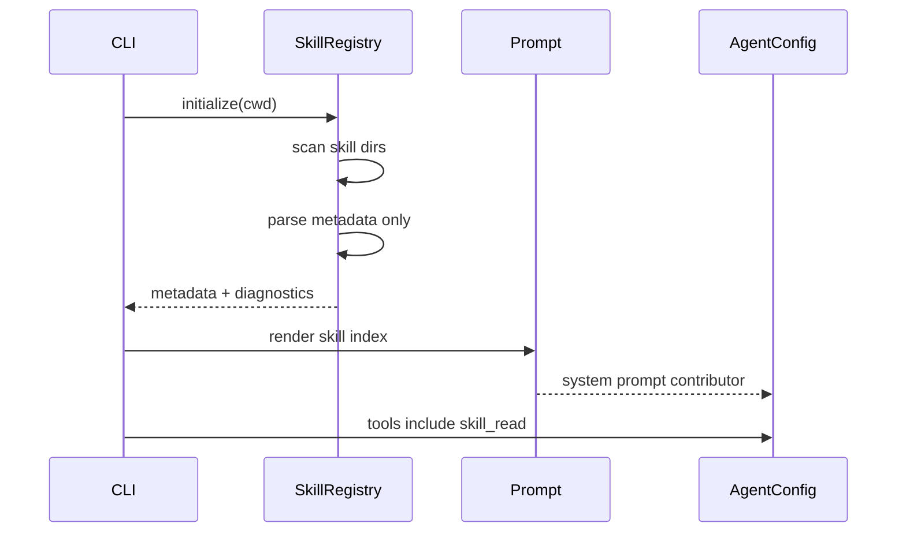
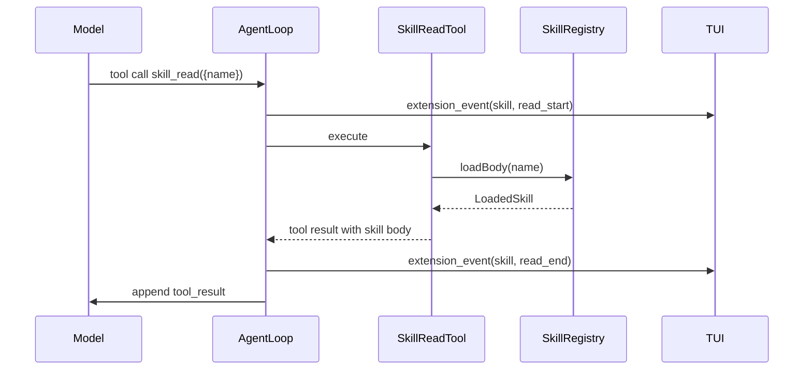
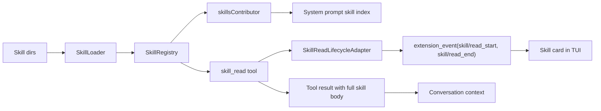

# omni-agent Skill System Architecture

> Status: proposal  
> Scope: `omni-agent` core + CLI/TUI  
> Goal: add a complete, progressive skill loading system that fits omni-agent's "small and refined" local-agent positioning.

## 1. Design Position

`omni-agent` should treat skills as local, inspectable task expertise packages. A skill is not a plugin runtime and not a hidden prompt blob. It is a structured directory with a small metadata index, a full `SKILL.md` body, and optional supporting files.

The model should see only a compact skill index by default. Full skill content is loaded only when the task needs it, and the TUI should show that loading as a first-class event, not as an incidental file read.

This gives us:

- Low context pressure: skill bodies are not injected until selected.
- Clear user visibility: the TUI can say "Reading skill frontend-design".
- Auditable behavior: the loaded skill body enters the conversation as an explicit tool result.
- Future compatibility: MCP, plugins, and richer skill packs can later contribute skills through the same registry without changing the agent loop.

## 2. Non-Goals

The skill system should not become a heavy extension host.

Not in the core design:

- Running arbitrary code from skills during discovery.
- Installing marketplace packages.
- Remote skill fetching.
- Per-skill model switching.
- Background daemons or long-running skill processes.

Those can be layered later through plugins or MCP. The base skill mechanism should stay file-based, deterministic, and easy to inspect.

## 3. Concepts

### Skill

A skill is a directory containing `SKILL.md`.

```text
<skill-dir>/
  SKILL.md
  references/
  scripts/
  templates/
  assets/
```

`SKILL.md` uses YAML frontmatter plus Markdown body.

```md
---
name: frontend-design
description: Build polished frontend UI and verify it visually.
user-invocable: true
disable-model-invocation: false
allowed-tools:
  - file_read
  - file_edit
  - file_write
  - bash
---

# Frontend Design

Use this skill when the task involves building or modifying frontend UI.
```

The first stable schema should be:

```ts
export interface SkillMetadata {
  name: string;
  description: string;
  filePath: string;
  baseDir: string;
  source: SkillSource;
  userInvocable: boolean;
  disableModelInvocation: boolean;
  allowedTools?: string[];
}

export type SkillSource =
  | { scope: "project"; path: string }
  | { scope: "user"; path: string }
  | { scope: "plugin"; pluginId: string; path: string };

export interface LoadedSkill extends SkillMetadata {
  body: string;
  loadedAt: number;
  tokenEstimate: number;
}
```

### Skill Index

The skill index is the compact list injected into the model-visible prompt. It contains only metadata needed for selection:

```xml
<available_skills>
  <skill>
    <name>frontend-design</name>
    <description>Build polished frontend UI and verify it visually.</description>
  </skill>
</available_skills>
```

It should not include full bodies. It also should not require exposing absolute paths to the model once we have `skill_read`.

### Skill Read

`skill_read` is a first-class tool that loads the complete skill body by name.

```ts
skill_read({ name: "frontend-design" });
```

The tool result becomes a regular conversation message:

```xml
<skill name="frontend-design" source="project">
...full SKILL.md body...
</skill>

<skill_context>
base_dir: /abs/path/.agents/skills/frontend-design
When this skill references relative paths, resolve them against base_dir.
</skill_context>
```

This is the "progressive loading" boundary: metadata is prompt-time, body is tool-time.

## 4. Module Layout

Recommended package layout:

```text
packages/core/src/skills/
  types.ts
  frontmatter.ts
  loader.ts
  registry.ts
  prompt.ts
  skill-read-tool.ts
  policy.ts

packages/core/src/system-prompt/
  contributors.ts

packages/core/src/stream/
  types.ts
  stream-session.ts

packages/cli/src/
  skill-renderer.ts
  commands/skills.ts
```

Responsibilities:

- `frontmatter.ts`: parse and validate YAML frontmatter.
- `loader.ts`: discover skills from configured directories.
- `registry.ts`: cache metadata and load full bodies on demand.
- `prompt.ts`: render the compact index and selection rules.
- `skill-read-tool.ts`: expose `skill_read` as an `AgentTool`.
- `policy.ts`: apply per-skill allowed tools later when the runtime supports tool policy.
- `skill-renderer.ts`: render skill lifecycle events in TUI.
- `commands/skills.ts`: `/skills`, `/skills reload`, and slash invocation support.

## 5. Search Paths and Precedence

Use a small path model that matches the local CLI nature of omni-agent while leaving room for plugins.

Initial paths:

```text
project: <cwd>/.agents/skills
user:    ~/.agents/skills
```

Optional omni-native aliases:

```text
project: <cwd>/.omni-agent/skills
user:    ~/.omni-agent/skills
```

Recommended precedence, high to low:

```text
project .omni-agent
project .agents
plugin
user .omni-agent
user .agents
```

First-wins by skill name. If two skills share the same name, the higher-priority one is active and a diagnostic records the hidden duplicate.

## 6. Lifecycle

### Startup



Startup scans only metadata. It may open `SKILL.md` files to parse frontmatter and validate body presence, but it should not store or inject full bodies.

### Model Selection

The model receives:

```text
Skills are progressive context. If a task matches a listed skill, call skill_read with the skill name before acting. Do not assume skill instructions from the description alone.
```

This keeps selection explicit and auditable.

### Reading a Skill



The loaded body is appended as a normal tool result. The next LLM turn sees the complete skill content and can continue with the task.

### Reuse Within a Session

The registry should keep a per-process cache of loaded skill bodies keyed by `{name, filePath, mtimeMs}`. Repeated reads return the same content without re-reading disk unless the file changed.

The conversation still contains the tool result from the first read, so the model usually does not need to call `skill_read` again. If it does, the TUI should show a cached read:

```text
Reading skill frontend-design (cached)
```

## 7. Progressive Context Contract

The progressive contract has three context layers.

### Layer 1: Always-On Index

Injected into system prompt by `skillsContributor`.

Contains:

- skill names
- descriptions
- invocation rule

Does not contain:

- full Markdown body
- supporting file contents
- long examples

### Layer 2: Loaded Skill Body

Added via `skill_read` tool result.

Contains:

- full `SKILL.md` body
- base directory
- source scope
- optional warnings

Does not automatically include:

- referenced `references/*`
- templates
- scripts

If a skill refers to supporting files, the model should read those with normal file tools after seeing the skill body. This keeps the system recursive but bounded.

### Layer 3: Supporting Files

Loaded only through normal tools such as `file_read`.

The skill body must tell the model which supporting files matter. The base directory in the tool result makes relative paths unambiguous.

## 8. Tool Design

`skill_read` should be registered like other `AgentTool`s:

```ts
export const skillReadTool: AgentTool = {
  name: "skill_read",
  description:
    "Read the full instructions for a named skill. Use this when the user's task matches an available skill. The result is added to context for the next step.",
  schema: {
    type: "object",
    properties: {
      name: {
        type: "string",
        description: "The exact skill name from the available_skills list",
      },
    },
    required: ["name"],
  },
  execute: async (params, signal) => { ... },
};
```

Error behavior:

- Unknown skill: return error plus nearest available names.
- Disabled model invocation: return error unless the read was triggered by explicit user slash invocation.
- Parse error: return diagnostic summary and ask the model to continue without that skill.
- Oversized body: out of scope for the first architecture pass. Return the full body for now. Once omni-agent has a general context compression / long-context compaction layer, route oversized skill handling through that layer instead of inventing a separate skill-only chunking protocol.

The initial `skill_read` schema should stay minimal. Avoid offset/limit until there is a shared compression design that can handle large files, large tool results, and large skill bodies consistently.

## 9. Event Extension Schema

Generic tool events are not enough for a polished skill experience, but core should not grow one new event type for every extension. Add a generic extension event schema to the core stream model, then let each feature define its own namespaced payload contract.

```ts
export interface ExtensionEvent {
  type: "extension_event";
  namespace: string;
  event: string;
  toolCallId?: string;
  payload: Record<string, unknown>;
}
```

Skill reads use that generic envelope:

```ts
export const SkillEventNamespace = {
  Skill: "skill",
} as const;

export const SkillEventName = {
  ReadStart: "read_start",
  ReadEnd: "read_end",
} as const;

type SkillReadStartPayload = {
  skillName: string;
};

type SkillReadEndPayload = {
  skillName: string;
  status: "loaded" | "cached" | "failed";
  source?: SkillSource;
  filePath?: string;
  durationMs?: number;
  tokenEstimate?: number;
  error?: string;
};
```

This gives core a stable extension point:

- `AgentLoop` and `StreamSession` understand only `extension_event`.
- Skill rendering subscribes to `namespace === "skill"`.
- Future features can add events under their own namespace without changing the base stream union.
- The event body stays typed at the extension boundary through constants and payload adapters.

To avoid making the TUI parse tool result text, `ToolResult` should grow optional metadata:

```ts
export interface ToolResult {
  content: Array<{ type: "text"; text: string }>;
  isError: boolean;
  meta?: Record<string, unknown>;
}
```

`skill_read` returns:

```ts
{
  content: [{ type: "text", text: renderedSkillBody }],
  isError: false,
  meta: {
    kind: "skill_read",
    skillName,
    status: "loaded",
    source,
    filePath,
    tokenEstimate,
  },
}
```

`runAgentLoop` remains the single event source:

1. It emits the existing `tool_start` / `tool_end` events for compatibility.
2. Tool lifecycle adapters can emit `extension_event` before and after a matching tool call.
3. `SkillReadLifecycleAdapter` emits `skill/read_start` before execution and `skill/read_end` after execution.

This keeps the skill tool pure, keeps UI concerns out of the tool implementation, and avoids coupling core stream types to skill-specific events.

The TUI should render:

```text
◇ Reading skill frontend-design
  project · .agents/skills/frontend-design/SKILL.md
  loaded · 1,840 tokens · 12ms
```

For cached reads:

```text
◇ Reading skill frontend-design
  cached · 1,840 tokens
```

For failures:

```text
◇ Reading skill frontend-design
  failed · description missing in SKILL.md
```

Rendering rules:

- Skill reads should be compact and visually distinct from file reads.
- Do not dump the skill body into the TUI preview. The body is for the model context, not user display.
- The ordinary tool result preview should be suppressed or shortened for `skill_read`, otherwise the user sees huge prompt text.
- `/skills` can list loaded and available skills separately.

## 10. Slash Commands

Skills can be user-invocable.

```text
/frontend-design build this page
```

This should not rely on the model to infer the skill again. Because the user explicitly invoked the skill, the CLI/runtime should preload the skill body and prepend it to the next user message as a normal context block:

```text
<explicit_skill name="frontend-design" source="project">
...full SKILL.md body...
</explicit_skill>

User request:
build this page
```

Recommended behavior:

- Model-inferred skill use: model calls `skill_read`.
- User slash skill use: CLI preloads the skill and prepends an explicit skill context block to the user request before the agent loop starts.

This makes explicit user intent deterministic while preserving progressive loading for inferred cases.

## 11. Context Stitching

There are two stitching paths.

### Inferred Skill

```text
user message
assistant tool_call skill_read
tool_result <skill ...>...</skill>
assistant continues
```

The existing agent loop already supports this shape. `skill_read` simply returns text content.

### Explicit Slash Skill

```text
system/user context block <skill ...>...</skill>
user message
assistant continues
```

The previous draft mentioned "synthetic tool results". The uncertainty is that most LLM providers require tool results to follow a real assistant tool call in the immediately preceding assistant message. If the CLI inserts a standalone `toolResult` during slash-command preprocessing, some providers or normalization layers may reject the conversation as an orphan tool result.

The deterministic design is therefore: explicit slash invocation does **not** fabricate tool calls. It preloads the skill body in the CLI/runtime and prepends a normal context block to the next user message.

```text
<explicit_skill name="frontend-design" source="project">
...full SKILL.md body...
</explicit_skill>

<explicit_skill_context>
base_dir: /abs/path/.agents/skills/frontend-design
The user explicitly invoked this skill with /frontend-design.
</explicit_skill_context>

User request:
build this page
```

The TUI should still render this as a skill read:

```text
◇ Reading skill frontend-design
  explicit · project · loaded · 1,840 tokens
```

But the conversation does not contain an artificial `toolResult`. This avoids provider-specific tool-call sequencing issues and keeps explicit user intent deterministic.

## 12. Diagnostics

Skill loading should never fail the whole agent startup unless the registry itself crashes. Bad skills produce diagnostics.

Diagnostic types:

```ts
type SkillDiagnostic =
  | { type: "warning"; code: "missing-description"; path: string; message: string }
  | { type: "warning"; code: "invalid-name"; path: string; message: string }
  | { type: "warning"; code: "collision"; path: string; winnerPath: string; message: string }
  | { type: "error"; code: "parse-error"; path: string; message: string };
```

TUI exposure:

- On startup: no noisy output if all skills load cleanly.
- If diagnostics exist: status hint `skills: 2 warnings`; `/skills diagnostics` shows details.
- If a requested skill has diagnostics that make it unreadable: show the failure in the skill read card.

## 13. Caching and Reloading

`SkillRegistry` should maintain:

- metadata cache from startup scan
- body cache by `name + filePath + mtimeMs`
- diagnostics from last scan

Commands:

```text
/skills
/skills diagnostics
/skills reload
```

`/skills reload` rescans metadata, clears body cache entries for changed files, and updates slash autocomplete.

File watchers are optional. For a small local TUI, explicit reload is simpler and more reliable than long-lived watchers.

## 14. Security and Policy

Skills are instructions, not code execution. Reading a skill is safe, but following a skill may cause tool calls. This means policy belongs at tool execution time, not skill discovery time.

Still, skills can declare `allowed-tools` as an experimental future policy hint:

```yaml
allowed-tools:
  - file_read
  - file_edit
  - bash
```

Policy semantics:

- If a skill is loaded, its `allowed-tools` can narrow the visible tool set for subsequent turns.
- It must not expand capabilities beyond the host's allowed tools.
- Multiple loaded skills should combine by intersection only when all declare `allowed-tools`; otherwise default host policy applies.

This should be implemented after a general `ToolPolicyResolver` exists. Until then, `allowed-tools` is **parsed-only** metadata. It must not be documented to users as enforced behavior.

## 15. Fit With omni-agent Code

Current code maps cleanly:

- `buildSystemPrompt(cwd)` already uses contributors. Add `skillsContributor`.
- `AgentConfig.tools` is already an array. Add `skillReadTool`.
- `runAgentLoop` already emits tool start/end. Add tool lifecycle adapters that can emit namespaced `extension_event`s around matching tools.
- `StreamSession` already routes events to callbacks. Add `onExtensionEvent` once, then keep feature-specific rendering outside the generic stream layer.
- `TUI` already renders tool calls. Add a special renderer for `skill_read` and suppress full-body preview.
- `CommandRegistry` already supports slash commands. Add dynamic skill commands and `/skills`.

No rewrite is required. The architecture introduces a small vertical slice.

## 16. Implementation Shape

Final intended flow:



Suggested implementation phases without changing the final architecture:

1. Add skill metadata loader, registry, prompt contributor, and `/skills`.
2. Add `skill_read` tool with generic extension events and skill-specific TUI rendering.
3. Add explicit slash skill preloading.
4. Add reload/diagnostics polish.
5. Add policy integration once tool policy exists.

These are phases of one architecture, not an MVP fork.

## 17. API Contracts

These contracts make the architecture concrete enough to implement without changing the intended design during coding.

### SkillLoader

`SkillLoader` is stateless. It performs filesystem discovery and returns a scan result.

```ts
export interface SkillLoaderOptions {
  cwd: string;
  includeOmniDirs?: boolean;
  includeAgentsDirs?: boolean;
  pluginSkillDirs?: Array<{ pluginId: string; dir: string }>;
}

export interface SkillLoadResult {
  skills: SkillMetadata[];
  diagnostics: SkillDiagnostic[];
}

export class SkillLoader {
  constructor(options: SkillLoaderOptions);
  loadAll(): Promise<SkillLoadResult>;
}
```

Rules:

- `loadAll()` reads enough of each `SKILL.md` to parse frontmatter and validate that a body exists.
- It returns metadata only; it does not return full body content.
- It applies precedence internally so callers receive only active skills plus collision diagnostics.

### SkillRegistry

`SkillRegistry` is stateful. It owns the current metadata snapshot, diagnostics, and body cache.

```ts
export interface SkillRegistryOptions {
  cwd: string;
  loader?: SkillLoader;
}

export interface SkillReadOptions {
  explicit?: boolean;
}

export class SkillRegistry {
  constructor(options: SkillRegistryOptions);

  initialize(): Promise<SkillLoadResult>;
  reload(): Promise<SkillLoadResult>;

  list(): SkillMetadata[];
  get(name: string): SkillMetadata | undefined;
  diagnostics(): SkillDiagnostic[];

  renderPromptIndex(): string;
  read(name: string, options?: SkillReadOptions): Promise<SkillReadResult>;
}

export interface SkillReadResult {
  status: "loaded" | "cached";
  skill: LoadedSkill;
  renderedText: string;
}
```

Rules:

- `read(name)` is the only API that loads full body content.
- `read(name, { explicit: true })` may read a `disable-model-invocation` skill if `userInvocable` is true.
- `read(name)` without `explicit` must reject skills hidden from model invocation.
- `renderPromptIndex()` must not include full bodies or absolute file paths unless we intentionally choose path-visible discovery later. With `skill_read`, name + description is enough.

### SkillReadTool

`createSkillReadTool` binds an `AgentTool` to the registry.

```ts
export function createSkillReadTool(registry: SkillRegistry): AgentTool;
```

The tool returns:

```ts
{
  content: [{ type: "text", text: result.renderedText }],
  isError: false,
  meta: {
    kind: "skill_read",
    skillName: result.skill.name,
    status: result.status,
    source: result.skill.source,
    filePath: result.skill.filePath,
    tokenEstimate: result.skill.tokenEstimate,
  },
}
```

Rules:

- Tool output is model context.
- Tool metadata is renderer/runtime context.
- TUI must use metadata, not output parsing, to render the skill card.

### Slash Preload

Current `createUserMessage(content: string)` and `toContextMessages()` already treat user messages as plain text. Therefore explicit slash preload should be implemented as a text transformation before `createUserMessage()`.

```ts
export interface SkillSlashPreload {
  displayInput: string;
  modelInput: string;
  skill: LoadedSkill;
  status: "loaded" | "cached";
}

export async function resolveSkillSlashPreload(
  input: string,
  registry: SkillRegistry,
): Promise<SkillSlashPreload | null>;
```

Example:

```text
displayInput:
/frontend-design build this page

modelInput:
<explicit_skill name="frontend-design" source="project">
...full SKILL.md body...
</explicit_skill>

<explicit_skill_context>
base_dir: /abs/path/.agents/skills/frontend-design
The user explicitly invoked this skill with /frontend-design.
</explicit_skill_context>

User request:
build this page
```

Rules:

- `displayInput` is what the TUI shows in the user message bubble.
- `modelInput` is what `createUserMessage()` stores and sends to the model.
- No synthetic assistant message or `toolResult` is created.
- The TUI emits/renders a skill preload card before appending the visible user message.

### TUI Skill Card State

Skill card rendering is a tiny state machine keyed by `toolCallId` for inferred reads and by `skillName + timestamp` for explicit preload.

```text
pending -> loaded
pending -> cached
pending -> failed
```

State payload:

```ts
interface SkillCardState {
  id: string;
  skillName: string;
  mode: "inferred" | "explicit";
  status: "pending" | "loaded" | "cached" | "failed";
  source?: SkillSource;
  filePath?: string;
  tokenEstimate?: number;
  durationMs?: number;
  error?: string;
}
```

Rendering:

```text
◇ Reading skill frontend-design
  pending

◇ Reading skill frontend-design
  loaded · project · 1,840 tokens · 12ms

◇ Reading skill frontend-design
  explicit · cached · project · 1,840 tokens

◇ Reading skill frontend-design
  failed · missing description
```

Rules:

- The pending card is created at `extension_event(namespace: "skill", event: "read_start")` or explicit slash preload start.
- The same card is updated in place on end when the TUI framework makes that practical; otherwise render a compact completion line immediately below it.
- Full skill body is never displayed in the card.

## 18. Roadmap and Execution Flow

This roadmap is the recommended implementation order. Each phase should leave the system internally coherent and should not introduce behavior that contradicts the final architecture.

### Phase 1: Skill Domain Model and Loader

Files:

```text
packages/core/src/skills/types.ts
packages/core/src/skills/frontmatter.ts
packages/core/src/skills/loader.ts
packages/core/src/skills/registry.ts
packages/core/src/skills/prompt.ts
packages/core/src/skills/index.ts
```

Tasks:

1. Define `SkillMetadata`, `LoadedSkill`, `SkillDiagnostic`, and `SkillSource`.
2. Parse frontmatter with support for both kebab-case and snake_case keys.
3. Scan all configured search paths in precedence order.
4. Deduplicate by `name` using first-wins behavior.
5. Store diagnostics for invalid files and collisions.
6. Implement `SkillRegistry.initialize(cwd)` and `SkillRegistry.renderPromptIndex()`.

Acceptance:

- A project skill overrides a user skill with the same name.
- Missing or invalid skills do not crash startup.
- The rendered prompt index contains names and descriptions only.
- Skill body text is not stored in the prompt index.

### Phase 2: System Prompt Integration

Files:

```text
packages/core/src/system-prompt/contributors.ts
packages/core/src/system-prompt/index.ts
packages/cli/src/index.ts
```

Tasks:

1. Add a `skillsContributor` that renders the skill index.
2. Ensure the contributor can use the same registry instance that backs `skill_read`.
3. Add selection guidance:

```text
Skills are progressive context. If a task matches a listed skill, call skill_read with the skill name before acting.
```

Acceptance:

- Startup prompt includes available skills when skills exist.
- Startup prompt omits the section when no skills exist.
- The prompt references `skill_read`, not `file_read`, as the primary skill loading mechanism.

### Phase 3: `skill_read` Tool and Metadata

Files:

```text
packages/core/src/skills/skill-read-tool.ts
packages/core/src/types.ts
packages/cli/src/index.ts
```

Tasks:

1. Add optional `meta?: Record<string, unknown>` to `ToolResult`.
2. Implement `skill_read({ name })`.
3. Load the full `SKILL.md` body on demand.
4. Cache by `name + filePath + mtimeMs`.
5. Return a formatted skill context block with `base_dir`.
6. Return `meta.kind = "skill_read"` so the runtime and TUI can render without parsing body text.

Acceptance:

- `skill_read` loads the body only when called.
- Repeated reads of an unchanged skill return `status: "cached"`.
- Unknown skill returns a structured error with available candidates.
- `disable-model-invocation` hides a skill from the prompt index and rejects model-triggered `skill_read`.

### Phase 4: Event Extension and TUI Rendering

Files:

```text
packages/core/src/types.ts
packages/core/src/extension-events.ts
packages/core/src/stream/types.ts
packages/core/src/stream/stream-session.ts
packages/core/src/agent-loop.ts
packages/core/src/tool-lifecycle.ts
packages/core/src/skills/lifecycle-adapter.ts
packages/cli/src/tui.ts
packages/cli/src/skill-renderer.ts
packages/cli/src/index.ts
```

Tasks:

1. Add generic `ExtensionEvent` to core `AgentEvent` and stream event unions.
2. Extend `StreamCallbacks` with one `onExtensionEvent` callback.
3. Add `ToolLifecycleAdapter` so extension events can be emitted around tool execution without embedding feature logic in `runAgentLoop`.
4. Implement `SkillReadLifecycleAdapter` that maps `skill_read` execution to `skill/read_start` and `skill/read_end`.
5. Keep existing `tool_start` / `tool_end` events for compatibility.
6. In TUI, render a compact skill card from `extension_event` and suppress full body preview for `skill_read`.

Acceptance:

- TUI shows "Reading skill <name>" when a skill loads.
- TUI distinguishes `loaded`, `cached`, and `failed`.
- TUI does not print the full skill body in the tool preview.
- Non-skill tools render exactly as before.
- Adding another extension event namespace should not require changing `StreamEvent` beyond the generic envelope.

### Phase 5: Slash Commands and Explicit Preload

Files:

```text
packages/cli/src/commands/skills.ts
packages/cli/src/commands/index.ts
packages/cli/src/index.ts
```

Tasks:

1. Add `/skills`, `/skills diagnostics`, and `/skills reload`.
2. Register user-invocable skills as slash commands.
3. For `/skill-name request`, preload the skill body in CLI/runtime.
4. Prepend the loaded skill as a normal context block to the user message.
5. Render the same TUI skill read card with `explicit` status metadata.
6. Do not fabricate assistant tool calls or orphan tool results.

Acceptance:

- `/frontend-design build this page` deterministically includes the skill body in the next model request.
- The session remains provider-valid because no synthetic tool result is inserted.
- Slash autocomplete includes user-invocable skills.
- `disable-model-invocation` does not block explicit user slash invocation unless `user-invocable: false`.

### Phase 6: Reload and Diagnostics Polish

Files:

```text
packages/core/src/skills/registry.ts
packages/cli/src/commands/skills.ts
packages/cli/src/tui.ts
```

Tasks:

1. Implement `/skills reload`.
2. Refresh metadata and invalidate changed body cache entries.
3. Update slash command autocomplete after reload.
4. Display diagnostics only when requested or when a requested skill fails.

Acceptance:

- Adding a skill and running `/skills reload` makes it available without restarting.
- Removing a skill and reloading removes it from prompt index and autocomplete.
- Diagnostics are visible through `/skills diagnostics`.

### Phase 7: Policy Integration

Prerequisite: a general `ToolPolicyResolver`.

Tasks:

1. Treat `allowed-tools` as a narrowing policy after a skill is loaded.
2. Never let a skill expand host-visible tools.
3. Surface active skill policy in `/skills`.

Acceptance:

- Loaded skills can narrow subsequent tool visibility.
- Skills without `allowed-tools` do not change tool policy.
- Multiple policy-bearing skills combine predictably.

## 19. Test Matrix

### Loader

- Loads project skills from `.agents/skills`.
- Loads user skills from `~/.agents/skills`.
- Supports `.omni-agent/skills` aliases.
- Applies precedence correctly.
- Reports collision diagnostics.
- Rejects missing `description`.
- Accepts kebab-case and snake_case frontmatter keys.
- Hides `disable-model-invocation` skills from prompt index.

### Prompt

- No skills: no skill section.
- Some skills: index contains name + description only.
- Index does not contain skill body content.
- Index guidance tells model to use `skill_read`.

### Tool

- `skill_read` loads full body.
- `skill_read` includes `base_dir`.
- `skill_read` returns `meta.kind = "skill_read"`.
- Cached read returns `status: "cached"`.
- Unknown skill returns error and candidates.
- Disabled model invocation returns error for model-triggered reads.

### Stream and TUI

- `extension_event(namespace: "skill", event: "read_start")` emits before tool execution.
- `extension_event(namespace: "skill", event: "read_end")` emits after tool execution.
- Non-skill extensions can add their own namespace without changing the core stream union.
- TUI renders loaded skill card.
- TUI renders cached skill card.
- TUI renders failed skill card.
- TUI suppresses full skill body preview.
- Existing tool start/end display is unchanged for non-skill tools.

### Slash

- `/skills` lists available skills.
- `/skills diagnostics` lists diagnostics.
- `/skills reload` updates registry and autocomplete.
- `/skill-name request` preloads skill as a context block.
- Slash preload does not create orphan tool results.
- `user-invocable: false` skills are not registered as slash commands.

### Session and Regression

- Loaded skill context is included in the model request that follows `skill_read`.
- Explicit slash skill context is included in the same request as the user's task.
- Restarting the CLI rescans skills.
- Existing sessions without skills continue to work.
- Existing tests for built-in tools and slash commands still pass.

## 20. Design Rule of Thumb

The smallest correct mental model should be:

```text
Skill index tells the model what expertise exists.
skill_read loads the chosen expertise.
The TUI shows that expertise being loaded.
The loaded skill body becomes explicit conversation context.
Supporting files are loaded only if the skill asks for them.
```

That is the core system. Everything else should preserve this shape.
