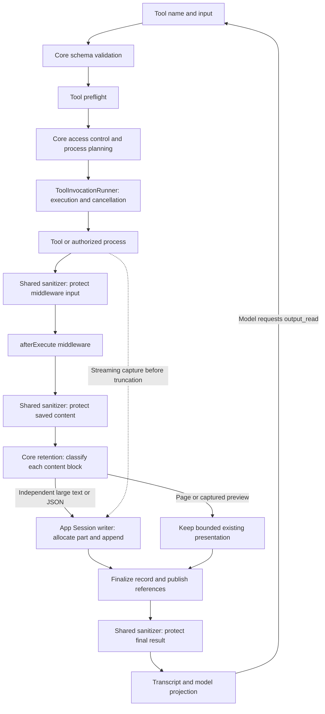

# Tool Call Runtime, Access, and Sandbox

Runtime reporting uses the existing TokenUsage, Tool metrics, and Observation paths rather than
a separate cumulative Run counter. There is no Run budget configuration or cumulative-budget
termination path. Tool deadlines, cancellation, per-operation
size limits, prompt/catalog budgets, Hook recursion protection, and behavioral loop detection remain
independent protections. Repeated-action detection is not a guarantee of eventual termination for
all non-progressing workloads; users can cancel a Run.

This document is the authoritative contract for Tool validation, access control, execution,
cancellation, and the macOS process sandbox.

## Runtime Flow

```text
LLM Tool Call
-> ToolCallCoordinator
   -> prepareBatch
      -> resolve registered Tool
      -> validate JSON Schema
      -> bind input and domain preflight
      -> assess access facts once
   -> batch preparation policies (for example InstructionScopeGate)
   -> authorizeAndRun
   -> ToolAccessController
      -> load workspace execution settings
      -> assess ToolAccessIntent
      -> obtain controlled network or filesystem consent when required
      -> create access grant and base process policy
   -> NetworkRuntime (network grant only)
      -> bound in-process client and per-call authenticated proxy
   -> ProcessExecutionPlanner (Process Tools only)
      -> create ProcessInvocation
      -> resolve executable provenance and runtime closure
      -> create final ProcessExecutionPlan
   -> create AuthorizedToolCall
   -> lifecycle start
   -> ToolInvocationRunner
      -> middleware beforeExecute
      -> deadline and linked cancellation
      -> in-process execute or ProcessExecutionRouter
      -> middleware afterExecute
   -> lifecycle end
-> structured ToolResult
```

Schema, preflight, and preparation-policy failures never enter authorization, lifecycle, middleware,
or execution. A deferred batch does not count as executed Tool work.
A failed batch policy must declare its source explicitly: `batch` for a shared failure,
or `calls` with nonempty, distinct IDs of ready calls in that batch. This attribution does
not permit partial execution. The triggering calls retain the original error code and message;
other ready calls receive `tool_batch_blocked`, the triggering IDs, and the original cause in
structured metadata. They are not described as having failed their own validation. Core owns
this projection for both the Agent Loop and command Hooks, including post-consent revalidation.
Invalid source references fail closed as a batch preparation error. Deferred context updates
and existing per-call preparation errors retain their existing behavior.

Access denials never enter lifecycle, middleware, or execution. Deadline timing begins only after
access control completes.

Every settled model-requested Tool call is reported to `LoopProtection`, including schema,
preparation-policy, and access failures. The Agent Loop supplies the runtime disposition;
`LoopProtection` alone exempts context-update and turn-barrier deferrals from repetition statistics.
Tool result metadata cannot request an exemption. Existing repetition thresholds and per-operation
timeouts are unchanged; this does not introduce a cumulative Run limit.

## Responsibility Boundaries

| Owner                     | Responsibility                                                            |
| ------------------------- | ------------------------------------------------------------------------- |
| `ToolCallCoordinator`     | Two-stage preparation/authorization, ordering, events, lifecycle, metrics |
| `ToolAccessController`    | Mode evaluation, capability matching, consent, and access grant           |
| `ProcessExecutionPlanner` | Invocation creation, executable trust, runtime closure, and final plan    |
| Tool domain               | Path, shell, web, and other resource facts                                |
| `ToolInvocationRunner`    | Authorized execution, middleware, timeout, abort, and late settlement     |
| `ProcessExecutionRouter`  | Execute an already-final host or sandbox plan without adding capabilities |
| Rust `omni-sandbox`       | Validate protocol, compile Seatbelt policy, apply limits, and exec target |
| Network Gateway           | Exact targets, DNS/IP/redirect policy, body limits, and loopback proxy    |
| App settings              | Persist mode, network, and approved roots by workspace and Agent          |
| UI                        | Render mode management and access consent only                            |

Core never parses shell commands or paths. Tools never read settings or render UI. App never
interprets Tool inputs. The Rust binary knows nothing about Agents, prompts, Tool schemas, or UI.

## Tool Contract

Every Tool declares access, execution, and timeout explicitly. There is no metadata fallback.

```ts
type ToolAccessDescriptor =
  | { kind: "internal" }
  | { kind: "dynamic"; assess(input, context): ToolAccessIntent | Promise<ToolAccessIntent> };

type AgentToolDefinition = InProcessToolDefinition | ProcessToolDefinition;
```

In-process Tools implement `execute`. Process Tools implement `createProcessInvocation` and
`createToolResult`. Bash and grep are Process Tools. Filesystem, web, Skill, user interaction, and
pure computation Tools are in-process. In-process Tools are trusted local code and are not inside
Seatbelt; their declared resources are enforced by `ToolAccessController` before invocation.
`createProcessInvocation` runs during planning, before lifecycle and middleware. It must be a pure,
bounded mapping from validated input and execution context to process arguments; it must not start a
process, access the network, mutate the filesystem, or read mutable permission state.

Optional preflight validates domain readiness, such as file type or target existence. Execution
must revalidate mutable state because preflight and execution occur at different times.
`ToolAccessIntent.denial` reports an invalid or unsupported access request, while `hardStop`
is reserved for security facts that must override mode-specific access evaluation.

## Execution Modes

### Controlled

Processes run under Seatbelt with workspace and private-call-temp writes. An ordinary external
path may propose a canonical read or read/write capability for user approval. Approved subtree
capabilities cover descendants, are shared by file, search, and Bash Tools, and are persisted only
for the current workspace and Agent. Ordinary subtree capabilities never cover sensitive files;
sensitive reads require exact-file approval and sensitive writes remain denied. A network call asks
for its missing exact targets; at most 64 targets may be persisted per workspace and Agent. Web
Tools receive a bound client, while Process Tools can reach only their per-call proxy port.

### Autonomous

Processes still run under Seatbelt. Bash may declare per-call `sandbox_scope` resources:
`read_paths`, `write_paths`, and exact `network_targets`. Ordinary external resources are allowed only for that
call. Sensitive reads must be exact; protected paths and sensitive writes remain denied. No access
scope is persisted.

### Unrestricted

After explicit mode confirmation, Process Tools run directly through `HostProcessRunner`.
Access boundaries and shell hard-stops are skipped, but Schema validation, preflight, timeout,
abort, output limits, process-group cleanup, file type validation, and file consistency checks
remain active.

Controlled and autonomous never fall back to host execution. Sandbox protocol v4 represents only
`disabled` or an exact loopback proxy port. Missing binaries, protocol mismatch,
policy errors, and launch failures return structured sandbox errors.

## Process Sandbox

The formal Rust package lives under `sandbox/`. On macOS, the launcher:

```text
resolve direct and Shell-internal executables in Node
-> project bounded read-only runtime dependencies
-> validate protocol and absolute paths in Rust
-> apply RLIMIT_NOFILE and RLIMIT_FSIZE
-> compile a Seatbelt profile
-> install the Seatbelt profile in the Rust process
-> exec the target process directly
```

`pnpm dev` and `pnpm run build` compile the current-host release binary before the TypeScript
runtime starts or builds. `pnpm run build:cli` owns the separate arm64/x64 cross-build and copies
both binaries into the standalone distribution.

The wrapper preserves stdio and the process group. `HostProcessRunner` remains the single owner of
output collection, AbortSignal handling, SIGTERM/SIGKILL escalation, and close/error settlement.

Seatbelt permits required system/runtime reads, workspace/private-temp writes, projected approved
roots or per-call scopes, and at most one authenticated loopback proxy port. The Runtime projects only roots needed by the
current call, not the full approval history. Protocol v4 protects the workspace and projected
read/write subtree roots from deletion or rename while allowing real changes below those roots.
The runner verifies the binary's advertised protocol before each launch and fails closed on a
mismatch. Each launch also carries a random diagnostic token so target stderr cannot be mistaken
for a Rust startup failure.
Sensitive directory and filename denials are generated from the shared tools-layer policy
snapshot. Exact sensitive-read exceptions are represented in the same deny expression so they do
not rely on rule ordering.

The host PATH, platform, and HOME are captured once by the composition root. Shell analysis,
controlled/autonomous executable lookup, and the environment passed to Bash consume that immutable
snapshot. Shell executable requirements retain both their static token and effective cwd, so the
same relative token used after different `cd` operations is not collapsed. Relative PATH entries
must resolve to a canonical target already covered by the call's access policy; an in-workspace
symlink cannot turn them into an external trust source. The direct Process invocation is resolved
to a canonical executable; Bash source remains unchanged. The resolver follows bounded package or
installation roots, shebang interpreters, bounded shell shims, and macOS Mach-O dependencies. It
does not recognize installer or CLI names, open HOME, persist runtime scopes, retry after a deny,
or fall back to host execution. Lookup always honors the first executable in immutable PATH order;
it never substitutes a later same-name executable after a trust failure. Runtime-only plugins and other undiscoverable dependencies can
still fail inside the sandbox.

The first release supports macOS arm64 and x64 source builds. Platform-native dependency discovery
and Rust policy/exec are explicit adapter boundaries: future Linux support requires an ELF resolver
plus a complete Linux enforcement backend, and Windows requires PE/DLL lookup plus a complete
Windows backend. Partial backends return `sandbox_unsupported_platform`. The first release does not
claim overlay filesystems, fake deletion, rollback, cgroup isolation, strict memory isolation, or
process-count isolation.

## Filesystem Tools

Filesystem Tools share canonical path resolution, preflight, path/inode mutexes, snapshots, text
validation, streaming reads, and direct writes. `file_read` defaults to 500 lines, accepts 1-2000,
caps final text at 64 KiB, and returns versioned line or long-line continuation metadata in both
Tool metadata and model-visible text.

`file_edit` and `file_write` build complete content in memory before one `fs.writeFile` call. This
is deliberately not an atomic commit. An I/O failure can leave the target state unknown. There is
no temporary-file recovery, rollback, or automatic backup.

## Settings and Migration

`~/.omni-agent/execution-settings.json` uses version 6 and keys state by stable workspace ID and
Agent ID. Each entry stores mode, at most 64 exact approved network targets, and at most 64 approved
filesystem roots. New workspaces default to controlled mode with no network targets or extra roots.
Updates use the shared inter-process lock, atomic JSON replacement, and file mode `0600`.

The v5-to-v6 migration preserves mode and roots, deletes the coarse network boolean, initializes
targets empty regardless of its old value, and diagnoses discarded coarse grants. Earlier one-way
migrations remain isolated readers. Successful v6 persistence stops reading v5. Corruption or
migration failure fails closed.

## Cancellation and Timeouts

`OperationDeadlineSupervisor` owns linked cancellation, deadlines, bounded cooperative cleanup,
and late-settlement observation. Tool execution maps its deadline to `tool_timeout`; the separate,
fixed runtime-projection budget maps dependency inspection stalls to
`sandbox_runtime_projection_timeout` before lifecycle or middleware starts. User cancellation
propagates `AbortError` and does not create a normal Tool result. Late completion cannot run
after-middleware or enter the session, and late rejection is consumed.

## Residual Boundaries

- Local extensions are trusted in-process code and are not sandboxed.
- Autonomous scopes are requested by the Agent and remain bounded by Runtime validation.
- A proxy-unaware Process cannot use its network grant.
- Final instruction-manifest validation and OS execution retain a small external TOCTOU window.
- Allowed deletion is real and has no automatic recovery.
- Symlink TOCTOU and PATH executable replacement are not completely eliminated.
- Dynamic executable plugins and dependencies that cannot be discovered before launch are not
  automatically granted or retried.
- Direct file writes retain their documented truncation risk.

## Tool input diagnostics and shell outcomes

ToolInputValidator derives bounded field diagnostics from the existing JSON schema validator. `invalid_tool_input` results retain paths, validation keywords, field names and numeric/type constraints in metadata and readable text. Input values and enum/const contents are not echoed. Diagnostics are limited to 16 issues and 256 characters per textual component to bound amplification, not to specialize individual tools. Invalid inputs never execute and are not automatically corrected.

Bash retains native `/bin/bash -c` semantics. Its result metadata includes process exitCode (including null), signal, stdoutTruncated and stderrTruncated; textual output includes the available exit status. Exit zero means the shell succeeded, not that a business check passed. Ordinary pipelines normally return the final command status. Callers that need upstream failure propagation must explicitly use `set -o pipefail` or preserve and return the command's exit code. The runtime neither rewrites commands nor classifies log keywords.

## Session output retention

Agents select the generic output reader explicitly. App binds its Session capability; ToolInvocationRunner sanitizes raw results before afterExecute, sanitizes middleware results before retention, and sanitizes the final result after storage navigation is added. All checkpoints reuse Core's shared sanitizer and apply with or without optional output storage. Retention owns storage/presentation, not sanitization policy. Host and sandbox processes share streaming capture before preview truncation. Captured content is sanitized text, not original binary bytes. Retention completeness is separate from process exit status, tool errors, and Run status.

Human-facing process output explicitly selects a bounded head/tail preview. Bash uses the smaller of its 10 KiB body budget and the Session preview budget, reserving half for each stream and borrowing unused capacity after capture. UTF-8 boundaries and truncation markers are preserved. Exit status is a separate text block; labels, status and saved-output references are outside the body budget. Machine-readable process consumers (including ripgrep JSON) retain prefix capture semantics and are never fed a head/tail splice.

The output writer alone allocates part IDs through `createPart({ label, mediaType })`. Each returned part handle can only append to that part; it owns no separate lifecycle state. Labels may repeat and are descriptive only. Creation, append, quota accounting and finish share the existing storage lock and writer state. Creation persists part intent and creates its empty body; append never recreates a missing body. Finish rejects subsequent creation and append. Existing version-1 records without labels remain readable by their original IDs without rewriting them. The old caller-selected `append(partId, ...)` entry is removed.

Process capture keeps one handle per nonempty stream and passes the actual stream-to-part-ID association to tools. Independent result text/JSON creates new parts through the same writer, so matching labels cannot merge bodies.

Process capture returns runtime-only output provenance; tools attach outputSource directly to each text block that previews captured parts. Reordering and deep cloning preserve that association. Trusted middleware must omit the source when replacing a preview with independent content, or declare the new preview source explicitly. Core validates capture identity, part membership and the Session binding before publishing a reference, removes block-local runtime provenance before persistence/model projection, and does not save those previews again. Unmapped text and structured content remain independent output. A transformed search result with file-size/navigation metadata is independent of its captured raw JSON, not a duplicate preview. The final OutputRecord remains the only persisted completeness fact. On storage or provenance failure, bounded text and the tool's original error state remain available with an explicit retention failure; no unverified reference is published. Opened captures are finalized on contract failure without retrying an uncertain finish.

`output_read` accepts a logical outputId and partId within the bound Session, with versioned line/byte pagination or tail. It cannot select a filesystem path or another Session. Only text blocks declaring `outputSource: { kind: "page" }` are exempt from offloading; the runtime consumes this block-local declaration before transcript/model projection. Independent text/JSON appended by middleware follows normal retention. The removed result-wide page flag must not be restored. Large structuredContent uses an application/json part and `meta.structuredOutputPart`; native multimodal blocks remain unchanged. An output_read result records its existing source under `meta.outputRead` (outputId and partId); `meta.output` is reserved for output created by the current call. New attachments cannot overwrite the read source. If attachment storage fails, validated page blocks retain their exact text and pagination; their read source remains available. Only independent content participates in the fallback body budget, using the same allocator as normal retention. Captured previews and unvalidated read sources do not receive this page exemption. The failure is reported explicitly.

Independent raw text blocks share the Session preview budget across the result rather than each receiving a full budget. Small blocks keep their text when possible; larger blocks share the remaining bytes. Structured JSON shares that allowance and is retained intact when text plus JSON would exceed it. Saved body references are added outside the body budget. Already-declared process previews and explicit pages retain their upstream bounds; they are not treated as new raw bodies. Storage failures use the same aggregate raw-text bound while preserving the tool error flag. This is a presentation budget, not a Run, iteration or spending limit. It is not a single total-byte ceiling over arbitrary combinations of captured previews, pages, navigation metadata and multimodal content; images and other non-text content retain their existing semantics.

Every output_read response includes model-visible record/part completeness, the retention reason when present, retained byte count and the page range. Reading an incomplete or interrupted record can succeed without claiming that its retained tail is the original output tail. The status accompanies the page through model-message projection; it is not available only in metadata.

App's SessionArtifactStore owns resource limits and a Session lifetime lease; short metadata locks protect operations. Clear fails while a live lease exists and old capabilities reject work after closure. Storage lives outside process workspaces and grants no additional sandbox access. See the output retention plan for defaults and verification limits.

Output capture now propagates AbortSignal through create, append, finalization and queued reads. Cancellation finalization uses OperationDeadlineSupervisor with its existing cleanup bound. Execution cancellation facts retain either the sealed output descriptor or a sanitized outputPersistenceFailure diagnostic. Already-issued OS I/O still settles under Session ownership before cleanup.

## Provider-side tool input constraints

Tools may declare `inputConstraint: "off" | "prefer" | "require"`. This replaces the removed
`strict` boolean. All first-party tools that declared `strict: true` now declare `prefer`;
undeclared tools remain undeclared. Local extensions must migrate their declarations;
registration rejects the old field instead of accepting parallel contracts.

Core preserves the intent and still validates every returned tool input before authorization
and execution. Models alone resolves the selected deployment's explicit capability and the
schema's verified protocol compatibility. `prefer` enables constrained generation only when
both are confirmed. Otherwise the request remains unconstrained with an explicit reason.
`require` rejects the request before network access if it cannot be satisfied. No parameter
aliases, null insertion, default rewriting or non-strict retry are introduced.

Configured providers may declare `compat.supportsStrictMode` on a connection and
`supportsStrictMode` on individual models. A model declaration overrides the connection.
Absence is unknown, not support; OpenAI-compatible routing alone is not evidence. A changed
request deployment name cannot inherit a catalog model's capability automatically. Native
providers use explicit SDK catalog metadata. No paid probe runs automatically.

The initial schema checker admits a conservative bounded subset for OpenAI Completions,
OpenAI Responses, Anthropic Messages and custom transports: closed objects with required
properties, simple scalar types/enums and arrays of those values. Optional properties and
unverified keywords/protocols do not silently change shape to fit the provider. Limitations
are reported as incompatibility or unverified schema, not claims about the provider's entire
feature set. Expanding this subset requires protocol evidence and boundary tests.

Custom transports receive resolved `inputConstraint: "off" | "require"` on each tool.
They must enforce `require` if their provider declares support. Original intent and the
reason for the decision remain in Models' report, so transports do not decide policy again.

`model.tool_constraints.reported` in the existing replay records per-tool intent, capability
source, schema assessment and enabled/disabled/rejected decision under the model call ID.
These are planned request settings, not proof that a remote server enforced its promise.
Reports contain neither credentials nor complete schema bodies. They are not model output
and do not start time-to-first-model-event measurement.

### Input/output ownership flow



Input validation/access remains in the existing coordinator. The runner owns security checkpoints and tool lifecycle; middleware can modify content but cannot implicitly exempt independent additions. Retention owns content classification and previews. The Session writer owns storage identity, quota and finalization; a part handle only appends. output_read uses the bound Session read capability and returns a bounded page, with a distinct read source. Storage availability never controls final sanitization. These are sequential stages and existing process/in-process strategies, not parallel implementations of result processing.

Canonical output records belong to Session storage. `SessionOutputPort.resolve({ outputId, partId? }, signal)` loads the authoritative record under the existing metadata lock, rejects unfinalized or missing records/parts and checks stored body integrity. Omitting partId validates the entire record (including legitimately empty records); specifying partId validates that part. `read` uses the same internal resolver before pagination. The old `validate(record)` whole-object comparison is removed.

`meta.output` is a display snapshot, not an authorization or integrity token. Retention resolves its ID back to storage when a record must be checked; labels and other display fields are never validation input. `meta.outputRead` carries only the logical read reference. Final sanitization may change display text/labels without changing stored facts. Canonical records are reloaded when required; no second metadata registry or compatibility validation path exists. The on-disk version-1 format and original IDs are unchanged.

### Grep input contract

`grep` accepts the required `regex` and optional `path`, `glob`, `ignore_case`, and
`max_results`. `path` selects a file or directory and defaults to the injected
execution cwd when omitted. Preflight, canonical path binding, access assessment,
and process planning all use that same field. Unknown fields are rejected; there
is no alias for the former `search_path` parameter. Historical traces preserve
the contract captured at the time and must not be rewritten as current requests.

`glob` likewise accepts an optional `path` for its search directory, defaulting
to the injected execution cwd, alongside `pattern` and `exclude`. It rejects
the former `dir_path` field. Search access descriptors declare their execution
kind explicitly: grep requires a process resource; glob remains in-process.
Resource requirements must not be inferred from parameter names.

## Workspace boundary and Shell directory state

`workspaceRoot` is the fixed authorization boundary supplied by the runtime. The
injected `cwd` resolves tool-relative paths and starts the process; it need not
be the workspace root. File, search, and Bash access assessments use the shared
canonical path inspection with both values explicitly supplied. Preflight uses
only target inspection and does not classify authorization boundaries.

The Shell analyzer tracks local directory changes without changing the runtime
workspace or parent process. An intrinsic builtin's context effects are separate
from its filesystem effects. Directory transitions preserve success and failure
contexts: `&&` uses the success state, `||` uses the failure state, and sequential
execution merges possible outcomes. Background jobs, pipelines and subshells do
not export their directory state. Redirections resolve before the redirected
body runs. `command` and `builtin` wrappers carry current-shell state; process
wrappers retain child state only.

Directory analysis is bounded, not a full Bash interpreter. Static absolute or
explicit relative targets with logical `cd` and `--` can be resolved on success.
Implicit HOME/OLDPWD, physical traversal, bare relative targets dependent on
CDPATH, and unresolved expansions retain an unknown directory. Unknown directory
state invalidates PWD facts; a later absolute directory change can restore a
known directory on success. This does not grant filesystem access. Process
planning still rejects unresolved executable working directories.

Script dependency inspection uses a stable file-local analysis root because its
cached output contains executable requirements, not authorization decisions.
Call authorization and process policy always use the runtime workspace root.

Invalid explicit filesystem scopes retain their error code and report the
read/write declaration, canonical target, requested scope and observed target
kind. They do not create directories, broaden scope or retry automatically.

Shell analysis results have one required `outcomes` value containing success and
failure contexts. There is no independently stored continuation context: an
unconditional continuation derives it by joining those outcomes. Fact collection
merges only effects, paths, commands, uncertainties and hard stops; it cannot
choose or propagate execution state. Each syntax owner supplies complete outcomes.
In particular, inspecting a deferred function body preserves its security facts
but exports only the enclosing context with the function declaration recorded.
No partial state replacement or missing-outcome fallback is supported.

### Shell 重定向与写入事实

命令自身的潜在写入与重定向目标独立分析，再合并到原有访问事实。输出目标不能证明未知程序没有其他写入；已识别且无需新增文件范围的重定向，也不能因没有文件路径而被标为未知写入。普通文件重定向保留具体路径，动态或无法解析的写入目标继续要求显式范围。

数字文件描述符复制/关闭不产生新的文件目标。`/dev/null` 是明确的空设备；`/dev/stdin`、`/dev/stdout`、`/dev/stderr`、`/dev/fd/*` 和 `/dev/tty` 的实际去向不由当前有界分析证明，不能与空设备一概跳过。现有危险目标拦截继续生效。解析器对 `<>` 等形式返回 partial 时保持不确定，不用字符串补解析替代 Tree-sitter。
